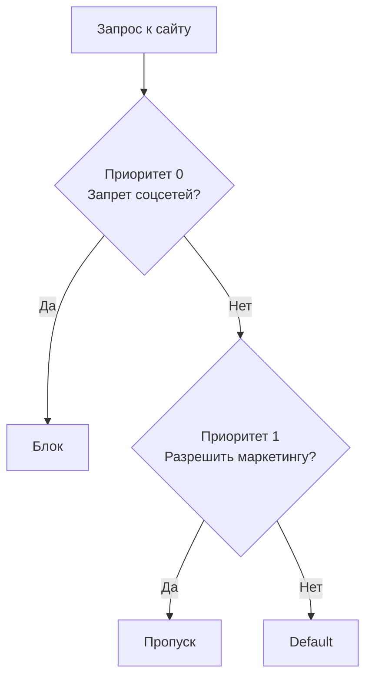

# KES_Веб_Контроль

> [!abstract] Кратко
> Веб-Контроль в KES ограничивает доступ пользователей к веб-ресурсам по категориям, адресам или маскам. Правила обрабатываются сверху вниз, приоритет — «кто выше, тот главнее». Позволяет заблокировать соцсети для всех, но разрешить конкретный ресурс для отдела. Риски: заражение с вредоносных сайтов, утечка данных, фишинг.

## 1. Зачем нужно
Понять, как ограничить доступ сотрудников к нежелательным или опасным сайтам без блокировки всего интернета. Это следующий слой после файловой защиты.

## 2. Простыми словами
Веб-Контроль — это «пропускной режим» для сайтов. Охранник на входе в интернет смотрит на список: «Соцсети — всем запрещены. Но для маркетинга — разрешены». Правила стоят по приоритету: кто выше, тот главнее.

## 3. Технические детали

**Где настраивается:** `Настройки → Защита → Веб-Контроль` (в KES) или через политику KSC.

**Параметры правила:**

| Параметр | Что делает |
|---|---|
| **Название** | Имя правила (например, `Запрет соцсетей`) |
| **Фильтровать содержание** | Категории (Соцсети, Файловые обменники, Веб-почта и т.д.) |
| **Применять к адресам** | Ко всем или к конкретным |
| **Применять к пользователям** | Ко всем или к группам |
| **Действие** | Разрешить / Запретить / Предупредить |
| **Расписание** | Всегда или по времени |

**Маски адресов:**
- `*` — заменяет любую последовательность символов.
- `*.example.com` — все поддомены.
- `*abc*` — любой URL, содержащий `abc`.

**Приоритеты:**
- Чем **меньше** число приоритета, тем **выше** правило (0 — самый высокий).
- Если приоритеты одинаковые — действует **запрет**.
- Правила обрабатываются сверху вниз.

**Пример блокировки категорий:**

| Приоритет | Название | Действие | Категория |
|---|---|---|---|
| 0 | Запрет соцсетей | Запретить | Социальные сети |
| 1 | Разрешить для маркетинга | Разрешить | Социальные сети (только для группы Маркетинг) |

Схема: логика приоритетов.

- **Читать схему:** если сработал запрет с приоритетом 0 — блок. Если нет, проверяется разрешение для конкретной группы.

## 4. Пример / команда
Создание правила блокировки:
- `Веб-Контроль` → `Добавить` → Название: `Запрет соцсетей`.
- Фильтровать содержание: `Социальные сети`.
- Действие: `Запретить`.

Создание исключения:
- `Добавить` → Название: `Разрешить для маркетинга`.
- Применять к пользователям: `Маркетинг`.
- Действие: `Разрешить`.
- Переместить правило выше запрещающего.

## 5. Для ИБ

| Риск | Защита |
|------|--------|
| Заражение с вредоносного сайта | Блокировка категорий «Вредоносные сайты», «Фишинг» |
| Утечка данных через мессенджеры | Блокировка «Веб-почта», «Соцсети» |
| Фишинговые сайты | Блокировка категории «Фишинг» |
| Слишком широкий запрет → падение продуктивности | Точечные исключения для рабочих групп |

## 6. Вопросы для самопроверки
1. На каком уровне работает Веб-Контроль?
2. Какой приоритет главнее: 0 или 1?
3. Что произойдет, если приоритеты одинаковые?
4. Как разрешить доступ к категории только для одной группы?
5. Что делает маска `*.example.com`?

## Связи
- [[KES_Контроль_Приложений]]
- [[KSC_Управление_Политиками]]
- [[UserGate_Web_Фильтрация]]