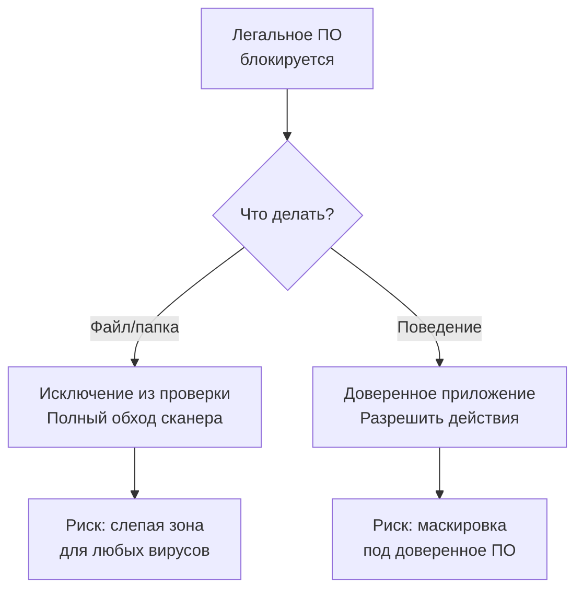

# KES_Исключения

> [!abstract] Кратко
> Исключения бывают двух типов: **Исключения из проверки** (файлы/папки, которые антивирус не сканирует) и **Доверенные приложения** (программы, которым разрешено подозрительное поведение). Исключения — это «слепые зоны»: если туда попадет вирус, его не найдут.

## 1. Зачем нужно
Понять, как легальному ПО не дать заблокироваться антивирусом. Но при этом не создать дыру в защите.

## 2. Простыми словами
Исключение — это записка охраннику: «Этого человека не проверять». Доверенное приложение — это «Этому человеку можно проносить нож, потому что он повар». В первом случае мы вообще не смотрим, во втором — смотрим, но разрешаем.

## 3. Технические детали

**Исключения из проверки:**
- Что: конкретные файлы, папки, расширения, процессы.
- Уровень: полное отключение сканирования для этих объектов.
- Риск: злоумышленник прячет вирус в исключенной папке.

**Доверенные приложения:**
- Что: действия, которые запускает сама программа (ее процессы).
- Уровень: антивирус продолжает анализировать, но доверяет определенным операциям.
- Риск: вредонос маскируется под доверенное приложение или использует его для запуска.

Схема: два типа исключений.

- **Читать схему:** исключение файла — грубо и опасно. Доверие приложению — тоньше, но тоже риск.

**Рекомендации по настройке:**
- Минимизировать количество.
- Указывать полный путь к файлу, а не всю папку.
- Использовать маски осторожно.
- Регулярно пересматривать.
- Предпочитать **Доверенные приложения** (безопаснее, чем исключения из проверки).
- Избегать исключений в `%TEMP%`, `C:\Windows\Temp`.

## 4. Пример / команда
Добавление исключения:
- Настройки → Защита → Исключения и типы объектов.
- **Исключения из проверки** → Добавить → Указать путь `C:\Users\Desktop\Исключение`.
- **Доверенные приложения** → Добавить → Указать путь к процессу или папке.

## 5. Для ИБ

| Риск | Защита |
|------|--------|
| Вирус в исключенной папке | Регулярный аудит исключений |
| Использование исключений злоумышленником | Ограничить права на изменение политики |
| Исключение для всей папки `C:\Temp` | Исключать только конкретный файл/процесс |
| Нет реестра исключений | Вести документацию: кто, что, зачем добавил |

## 6. Вопросы для самопроверки
1. Чем исключение из проверки отличается от доверенного приложения?
2. Какой тип исключения безопаснее и почему?
3. Какие папки не рекомендуется добавлять в исключения?
4. Что нужно сделать перед добавлением исключения?
5. Какой риск создает исключение для папки?

## Связи
- [[KES_Файловая_Защита]]
- [[KSC_Управление_Политиками]]
- [[Антивирусная_Защита_База]]