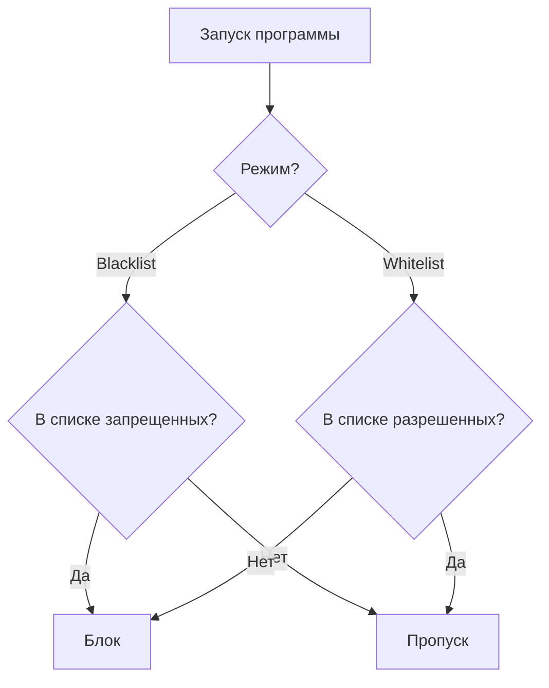

# KES_Контроль_Приложений

> [!abstract] Кратко
> Контроль приложений управляет запуском программ. Два режима: **Список запрещенных (blacklist)** — разрешено все, кроме указанных; **Список разрешенных (whitelist)** — запрещено все, кроме указанных. Правила можно строить по категориям, свойствам файла, KL-категориям. Действия: блокировать, применять правила, тестировать.

## 1. Зачем нужно
Понять, как запретить запуск игр, торрентов или несертифицированного ПО, не блокируя работу сотрудника. Это еще один слой защиты после файловой и веб-защиты.

## 2. Простыми словами
Контроль приложений — это «фейс-контроль» для программ. Охранник смотрит на список: «Telegram — запускай. Roblox — стой, тебе нельзя». Можно сделать наоборот: «Всё запрещено, кроме белого списка».

## 3. Технические детали

**Где настраивается:** `Настройки → Защита → Контроль приложений` (в KES) или через политику KSC.

**Режимы:**

| Режим | Логика | Когда использовать |
|---|---|---|
| **Список запрещенных (blacklist)** | Разрешено все, что не запрещено | Когда нужно запретить конкретные программы |
| **Список разрешенных (whitelist)** | Запрещено все, что не разрешено | Когда нужна максимальная безопасность (только проверенное ПО) |

**Способы добавления правил:**
- **Из списка исполняемых файлов** — выбрать из уже запущенных.
- **Из свойств файла** — указать путь, хеш, сертификат.
- **Метаданные файлов папки** — правило для всей папки.
- **Хеши файлов папки** — по хешу.
- **Сертификаты файлов из папки** — по цифровой подписи.
- **Из KL-категории** — по категории Kaspersky (например, «Офисные приложения»).

**Действия:**
- **Блокировать** — запретить запуск.
- **Применять правила** — использовать правила из списка.
- **Тестировать правила** — только логировать, не блокировать.

**Пример блокировки офисных приложений:**
- Категория: `Запрет (по пути)`.
- Пользователи: `Все`.
- Запретить: `Да`.

Схема: логика контроля приложений.

- **Читать схему:** в blacklist блокируется только то, что в списке. В whitelist — всё, кроме списка.

## 4. Пример / команда
Блокировка офисных приложений для всех:
- `Контроль приложений` → `Добавить` → Категория: `Запрет (по пути)`.
- Пользователи: `Все`.
- Запретить: `Да`.

Разрешение для одного студента:
- `Добавить` → Пользователь: `Студент 1`.
- Разрешить: `Да`.
- Переместить правило выше запрещающего.

## 5. Для ИБ

| Риск | Защита |
|------|--------|
| Запуск несертифицированного ПО | Whitelist (разрешено только проверенное) |
| Использование игр/торрентов | Blacklist (запрет конкретных категорий) |
| Вредоносное ПО под видом легального | Whitelist + контроль по хешу/сертификату |
| Слишком строгий whitelist → падение продуктивности | Тестирование правил перед блокировкой |

## 6. Вопросы для самопроверки
1. Чем blacklist отличается от whitelist?
2. Какой режим безопаснее и почему?
3. Что делает действие «Тестировать правила»?
4. Как разрешить запуск программы только одному пользователю?
5. По каким признакам можно добавить правило?

## Связи
- [[KES_Веб_Контроль]]
- [[KES_Контроль_Устройств]]
- [[KSC_Управление_Политиками]]