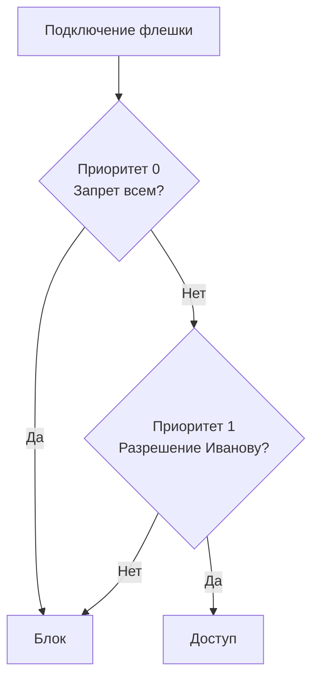

# KES_Контроль_Устройств

> [!abstract] Кратко
> Контроль устройств управляет подключением внешних устройств (флешки, диски, телефоны, принтеры). Правила задают доступ на чтение/запись для пользователей или групп. Приоритет 0 — запрет всем, приоритет 1 — разрешение конкретному. Можно настроить расписание доступа и запрос у администратора.

## 1. Зачем нужно
Понять, как предотвратить заражение через флешку и утечку данных через съемные носители. Без этого любой сотрудник может подключить зараженную флешку или скопировать базу клиентов.

## 2. Простыми словами
Контроль устройств — это «фейс-контроль» для флешек. Охранник проверяет: «Ты чья флешка? Иванова? Проходи. Петрова? Стой, тебе нельзя». Можно разрешить только чтение (взять файлы), но запретить запись (скопировать на флешку).

## 3. Технические детали

**Где настраивается:** `Настройки → Защита → Контроль устройств` (в KES) или через политику KSC.

**Типы устройств:**
- Съемные диски (флешки, внешние HDD).
- Локальные принтеры.
- Диски.
- CD/DVD-приводы.
- Модемы.
- Стримеры.
- Многофункциональные устройства.
- Устройства чтения смарт-карт.
- Wi-Fi.
- Внешние сетевые адаптеры.

**Правила доступа:**

| Параметр | Что делает |
|---|---|
| **Приоритет** | 0 — выше, 1 — ниже. Если равны — запрет главнее. |
| **Пользователи** | Кому применяется правило |
| **Чтение** | Разрешить открывать и копировать с устройства |
| **Запись** | Разрешить копировать на устройство |

**Разница чтения и записи:**

| Доступ | Что можно | Что нельзя |
|---|---|---|
| **Чтение** | Открывать файлы, копировать с флешки на ПК | Копировать с ПК на флешку |
| **Запись** | Копировать с ПК на флешку | — |
| **Чтение + Запись** | Полный доступ | — |

**Расписание доступа:** можно разрешить подключение только в рабочие часы, а в выходные — блокировать.

**Запрос доступа:** пользователь может отправить запрос администратору через KES. Администратор увидит ID устройства, модель, пользователя и сможет разрешить.

Схема: логика контроля устройств.

- **Читать схему:** сначала срабатывает запрет для всех (приоритет 0). Если его нет — проверяется разрешение для конкретного пользователя.

## 4. Пример / команда
Настройка правила:
- `Контроль устройств` → `Доступ к съемным дискам`.
- `Добавить` → Пользователь: `Все` → Приоритет: 0 → Чтение: нет, Запись: нет.
- `Добавить` → Пользователь: `DOMAIN\user` → Приоритет: 1 → Чтение: да, Запись: да.

Проверка: подключить флешку. У кого нет доступа — появится уведомление Kaspersky.

## 5. Для ИБ

| Риск | Защита |
|------|--------|
| Заражение через флешку | Запрет записи, только чтение |
| Утечка данных через флешку | Запрет записи для всех, кроме доверенных |
| Использование личных флешек | Разрешение только по ID устройства |
| Подключение в нерабочее время | Расписание доступа |

## 6. Вопросы для самопроверки
1. Чем доступ на чтение отличается от доступа на запись?
2. Какой приоритет главнее: 0 или 1?
3. Что произойдет, если приоритеты одинаковые?
4. Как разрешить флешку только одному сотруднику?
5. Зачем нужно расписание доступа?

## Связи
- [[KES_Веб_Контроль]]
- [[KSC_Управление_Политиками]]
- [[UserGate_Правила_Firewall]]