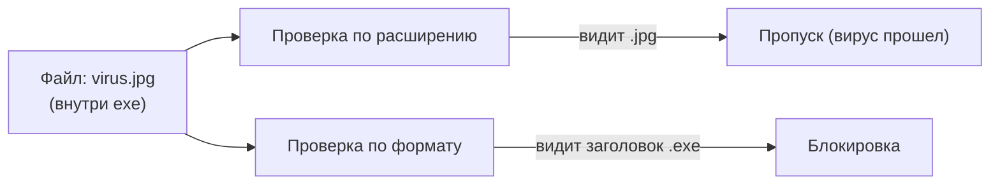

# KES_Файловая_Защита

> [!abstract] Кратко
> Защита от файловых угроз проверяет открываемые, сохраняемые и запускаемые файлы. Ключевые настройки: уровень безопасности (Высокий/Рекомендуемый/Низкий), типы файлов (по формату vs по расширению), методы проверки (сигнатуры, эвристика). Разница между форматом и расширением — критична.

## 1. Зачем нужно
Понять, как антивирус решает, что проверять. Без этого непонятно, почему вирус может проскочить или почему ПК тормозит при сканировании.

## 2. Простыми словами
Антивирус — это таможенник. Он может досматривать все сумки (Высокий уровень), только подозрительные (Рекомендуемый) или только по наклейке «взрывоопасно» (по расширению). Самый надежный способ — смотреть содержимое (по формату).

## 3. Технические детали

**Уровни безопасности:**
- **Высокий:** проверяет всё, все диски, архивы, установщики. Максимальная защита, но медленно.
- **Рекомендуемый:** проверяет файлы определенных форматов, не лезет в архивы. Баланс скорости и защиты.
- **Низкий:** проверяет только файлы с опасными расширениями. Быстро, но небезопасно.

**Типы файлов (важное отличие):**
- **По расширению:** смотрит только на `.exe`, `.dll`, `.doc`. Если вирус переименовать в `.jpg`, антивирус его пропустит.
- **По формату:** смотрит на заголовок файла (первые байты). Если внутри `.exe`, а написано `.jpg` — поймет и проверит.

**Методы проверки:**
- **Сигнатурный:** ищет известные «отпечатки» (вирусы из базы). Ловит 100% известных, но слеп к новым.
- **Эвристический:** ищет подозрительные команды (шифрование, автозагрузка). Ловит новые, но может ошибаться (ложные срабатывания).

Схема: разница формата и расширения.

- **Читать схему:** по расширению вирус маскируется, по формату — раскрывается.

## 4. Пример / команда
Настройка в KES:
- Настройки → Защита → Защита от файловых угроз → **Типы файлов**.
- Выбрать **«Файлы, проверяемые по формату»**.

Проверка файла на вирусы через контекстное меню Windows.

## 5. Для ИБ

| Риск | Защита |
|------|--------|
| Маскировка вируса под картинку | Проверка **по формату**, а не по расширению |
| Тормоза при полном сканировании | Рекомендуемый уровень, исключения для рабочих папок |
| Новая угроза без сигнатуры | Эвристический анализ (включен в KES) |
| Заражение через архив | Включить проверку архивов на Высоком уровне |

## 6. Вопросы для самопроверки
1. Чем проверка по формату отличается от проверки по расширению?
2. Какой уровень безопасности проверяет архивы?
3. В чем плюс и минус сигнатурного метода?
4. Что такое эвристический анализ?
5. Где в KES настраиваются типы файлов?

## Связи
- [[Антивирусная_Защита_База]]
- [[KES_Исключения]]
- [[Kaspersky_Архитектура]]