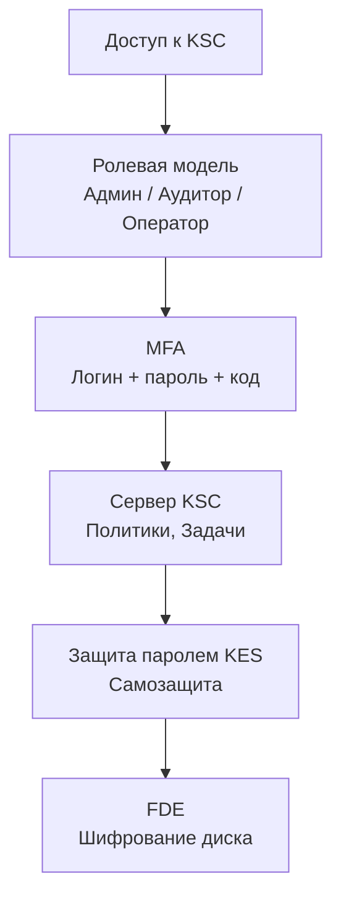

# KSC_Безопасность_Сервера

> [!abstract] Кратко
> Безопасность KSC строится на ролевой модели (Администратор, Аудитор, Оператор), MFA для доступа и защите данных (полнодисковое шифрование FDE, защита паролем KES, самозащита). FDE защищает от физического доступа, но не от вирусов.

## 1. Зачем нужно
Понять, как защитить сам сервер управления, чтобы злоумышленник не отключил антивирусы на всех ПК сразу. Без этого компромисс KSC = компромисс всей сети.

## 2. Простыми словами
KSC — это «пульт управления» всей защитой. Если он попадет в руки злоумышленника, тот сможет выключить антивирусы везде. Поэтому пульт защищают: роли (кто что может), пароли (MFA), шифрование (чтобы не украли ноутбук с настройками).

## 3. Технические детали

**Ролевая модель:**

| Роль | Что может |
|---|---|
| **Администратор безопасности** | Полный доступ, настройка политик, управление правами |
| **Аудитор** | Просмотр настроек и отчетов без права изменения |
| **Оператор** | Выполнение задач (удаление вирусов), но без изменения политик |
| **Главный администратор** | Управление сервером и учетными записями |

**MFA (Многофакторная аутентификация):**
- Логин + пароль + код из приложения/SMS/токена.
- Защищает от кражи пароля.

**Защита паролем KES:**
- Позволяет ограничить управление функциями KES.
- Запрашивать пароль для критических действий (отключение защиты, удаление).
- Рекомендуемое имя пользователя: `KLAdmin`.

**Самозащита KES:**
- Запрещает пользователю или программам:
  - Менять файлы KES.
  - Менять ключи реестра KES.
  - Останавливать службы KES.
  - Воздействовать на интерфейс KES.

**Полнодисковое шифрование (FDE):**
- Шифрует весь диск.
- Защищает от: утечки данных при краже/потере ноутбука.
- **Не защищает от:** вирусов, хакерских атак через сеть.
- Требует ввода пароля до загрузки ОС.

Схема: уровни защиты KSC.

- **Читать схему:** защита эшелонирована: от ролей до шифрования диска.

## 4. Пример / команда
Настройка MFA:
- `Сервер администрирования` → `Дополнительно` → `Учетные записи пользователей`.
- Выбрать пользователя → `Настроить MFA`.

Включение самозащиты:
- `KES` → `Настройки` → `Общие настройки` → `Самозащита`.
- Поставить галочку `Включить самозащиту`.

## 5. Для ИБ

| Риск | Защита |
|------|--------|
| Кража пароля администратора | MFA (TOTP, SMS, токен) |
| Пользователь отключает антивирус | Защита паролем KES, самозащита |
| Кража ноутбука с данными | FDE (полнодисковое шифрование) |
| Случайное изменение политики | Ролевая модель (Аудитор только смотрит) |

## 6. Вопросы для самопроверки
1. Чем роль Аудитора отличается от Оператора?
2. Зачем нужна MFA?
3. Что защищает FDE, а от чего не защищает?
4. Что запрещает самозащита KES?
5. Зачем нужна защита паролем KES?

## Связи
- [[KSC_Управление_Политиками]]
- [[KES_Файловая_Защита]]
- [[KES_Исключения]]