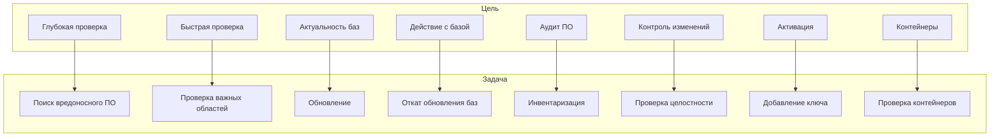

# KSC_Задачи_KES_Подробно

> [!abstract] Кратко
> Подробное описание задач Kaspersky Endpoint Security (KES), которые можно создать в Kaspersky Security Center (KSC). Для каждой задачи указано: что делает, обязательна ли, какие ключевые параметры настраиваются и когда применяется.

## 1. Зачем нужно
Понять, какую задачу выбрать для конкретной цели: регулярное сканирование, быстрая проверка после инцидента, обновление баз или активация. Без этого мастер задач — просто список непонятных пунктов.

## 2. Простыми словами
Задача — это конкретное поручение антивирусу: «проверь всё», «проверь главное», «обнови базы», «откати базы». У каждой задачи свой набор параметров и своё место в работе администратора.

## 3. Технические детали

### 3.1. Поиск вредоносного ПО (Malware Scan)
- **Что делает:** Однократная полная или выборочная проверка файлов на устройстве по требованию. Проверяет все объекты на локальных дисках, смонтированные и общие объекты (Samba, NFS) с рекомендуемыми параметрами безопасности.
- **Обязательна:** Да. Создаётся автоматически при первоначальной настройке. Рекомендуется запускать по расписанию минимум раз в неделю.
- **Ключевые параметры:**
    - **Область проверки:** файлы, архивы, загрузочные секторы, память процессов и ядра, объекты автозапуска.
    - **Ограничения:** размер и продолжительность проверки объекта.
    - **Действие при обнаружении:** лечение, удаление, блокировка и т.д.
    - **Исключения:** по именам/маскам или названиям угроз.
    - **Технологии:** эвристический анализатор, iChecker.
- **Когда использовать:** Плановая глубокая проверка (например, в нерабочее время, так как процессор будет занят) или после подозрительного события.

### 3.2. Проверка важных областей (Critical Areas Scan)
- **Что делает:** Быстрая проверка областей, где чаще всего скрывается вредоносное ПО: загрузочные секторы, объекты автозапуска, память ядра и запущенные процессы.
- **Обязательна:** Создаётся автоматически мастером настройки. Можно создавать пользовательские задачи.
- **Ключевые параметры:** Область проверки (по умолчанию: локальная ФС, память ядра, память процессов, автозапуск, загрузочные секторы) и действие при обнаружении (по умолчанию: «Лечить. Удалять, если лечение невозможно»).
- **Когда использовать:** Быстрая экспресс-диагностика после подозрительного события или для регулярной лёгкой проверки. Специалисты Kaspersky не рекомендуют менять параметры по умолчанию.

### 3.3. Обновление (Update)
- **Что делает:** Обновляет базы и модули приложения в соответствии с настройками.
- **Обязательна:** Да. Создаётся автоматически. Рекомендуется запускать минимум раз в день.
- **Ключевые параметры:**
    - **Источник обновлений:** Сервер администрирования KSC, серверы Kaspersky, пользовательский HTTP/FTP/SMB-сервер.
    - **Расписание:** Можно настроить (кроме задачи «Откат обновления»).
    - **Учётная запись:** Под какими правами выполняется задача.
- **Когда использовать:** Регулярно для поддержания актуальности баз. Оптимальное расписание — «При загрузке обновлений в хранилище» с автоматическим определением случайного интервала.

### 3.4. Откат обновления баз (Update Rollback)
- **Что делает:** Откатывает последнее обновление баз. Каждый раз при обновлении KES создаёт резервную копию текущих баз, что позволяет вернуться к предыдущей версии.
- **Обязательна:** Нет.
- **Ключевые параметры:** **Не имеет параметров.** Можно настроить только расписание и уведомления.
- **Когда использовать:** Если новая версия баз содержит ошибочные сигнатуры и блокирует безопасные приложения.

### 3.5. Инвентаризация (Inventory)
- **Что делает:** Собирает информацию обо всех исполняемых файлах приложений, хранящихся на компьютерах.
- **Обязательна:** Нет.
- **Важное условие:** Задачу выполняет компонент **«Контроль приложений»**. Если он не установлен, задача завершится с ошибкой.
- **Когда использовать:** Для получения списка ПО на устройствах, например, для аудита или планирования политик контроля приложений.

### 3.6. Проверка целостности системы (System Integrity Check)
- **Что делает:** Сравнивает текущее состояние объектов (файлы, реестр, подключение внешних устройств) с состоянием, зафиксированным в **снимке состояния системы**.
- **Обязательна:** Нет.
- **Ключевые параметры:** Требуется предварительно создать «снимок» (задачей «Обновление снимка состояния системы»). Можно настроить область мониторинга и режим проверки (быстрая/полная).
- **Когда использовать:** Если KES обнаружил вредоносный объект, но не обезвредил его, или для контроля изменений в критичных файлах и реестре.

### 3.7. Добавление ключа (Add Key)
- **Что делает:** Добавляет лицензионный ключ для активации приложения, в том числе **резервный** ключ.
- **Обязательна:** Нет (но без ключа приложение не работает).
- **Ключевые параметры:**
    - **Использовать ключ в качестве резервного:** Галочка.
    - **Выбрать ключ:** Из хранилища ключей KSC или добавить новый.
- **Важное ограничение:** Не поддерживается в режиме «Легкого агента» для защиты виртуальных сред.
- **Когда использовать:** Для активации или добавления резервного ключа.

### 3.8. Проверка контейнеров (Container Scan)
- **Что делает:** Проверяет контейнеры и образы на наличие вирусов и других вредоносных программ. Поддерживает интеграцию с Docker, CRI-O и др.
- **Обязательна:** Нет. Доступна для Linux.
- **Ключевые параметры:** Можно указать, какие контейнеры/образы проверять (по имени/маске), включать проверку всех слоёв образа, настраивать действие при обнаружении (прервать контейнер, не выполнять действий и т.д.).
- **Когда использовать:** При работе с контейнеризованными средами (Docker, Kubernetes) для проверки образов на уязвимости и вредоносное ПО.

### 3.9. Изменение состава компонентов приложения
- **Что делает:** Устанавливает или удаляет на клиентских компьютерах компоненты KES согласно списку в параметрах задачи. Компонент **«Защита от файловых угроз» удалить невозможно**.
- **Обязательна:** Нет.
- **Когда использовать:** Для оптимизации нагрузки на компьютер (например, отключить ненужные компоненты на серверах) или для приведения состава компонентов к единому стандарту.

Схема: выбор задачи по цели.

- **Читать схему:** Каждая цель администратора сопоставлена с конкретной задачей KES.

## 4. Пример / команда
Создание задачи «Проверка важных областей» (Web Console):

1. `Устройства` → `Задачи` → `Добавить`.
2. Программа: `Kaspersky Endpoint Security для Windows (или Linux)`.
3. Тип задачи: `Проверка важных областей`.
4. Название: `Быстрая проверка после инцидента`.
5. Область: выбрать устройства.
6. Параметры: оставить по умолчанию (рекомендовано Kaspersky).
7. Расписание: `Вручную` или `По расписанию`.
8. `Готово`.

## 5. Для ИБ

| Риск | Защита / Решение |
|------|------------------|
| Долгая полная проверка нагружает ПК | Использовать «Проверку важных областей» для быстрой диагностики или запускать полную проверку в нерабочее время. |
| Устаревшие базы пропускают новые угрозы | Настроить задачу «Обновление» на частое выполнение (например, при загрузке в хранилище). |
| Ошибочные сигнатуры блокируют легальное ПО | Использовать задачу «Откат обновления баз». |
| Нет данных о ПО на устройствах | Запустить «Инвентаризацию» (требуется «Контроль приложений»). |
| Подмена системных файлов | Использовать «Проверку целостности системы» со снимком состояния. |
| Неактивированное приложение | Использовать задачу «Добавление ключа» для активации или резервного ключа. |
| Вредоносное ПО в контейнерах | Использовать «Проверку контейнеров» (Linux). |

## 6. Вопросы для самопроверки
1. Какая задача обязательна для работы KES и создаётся автоматически?
2. В чём разница между «Поиском вредоносного ПО» и «Проверкой важных областей»?
3. Какая задача не имеет параметров?
4. Для какой задачи обязателен компонент «Контроль приложений»?
5. Что нужно создать перед использованием задачи «Проверка целостности системы»?
6. В каком режиме работы KES не поддерживается «Добавление ключа»?
7. Для какой ОС доступна задача «Проверка контейнеров»?

## Связи
- [[KSC_Мастер_Задач]]
- [[KSC_Управление_Политиками]]
- [[KES_Файловая_Защита]]
- [[MOC_Kaspersky]]