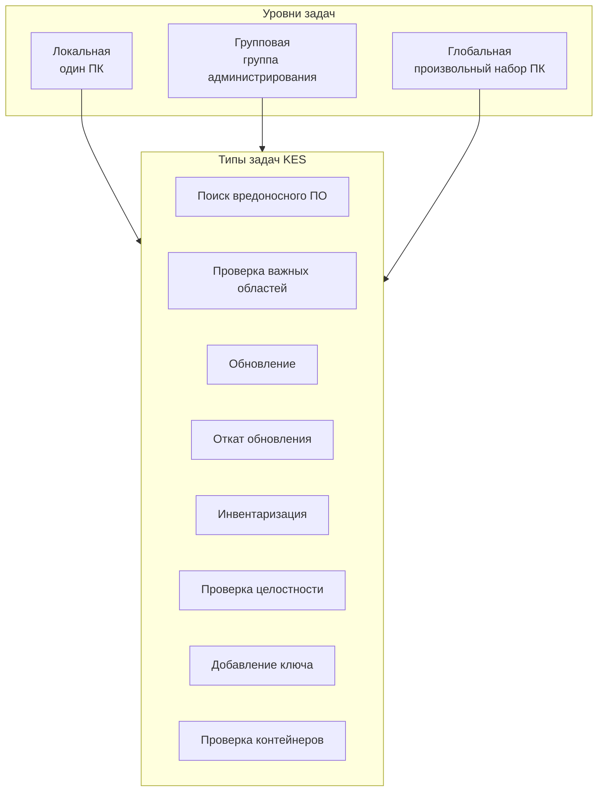

# KSC_Мастер_Задач

> [!abstract] Кратко
> Мастер задач в Kaspersky Security Center (KSC) создаёт задачи трёх уровней: локальные (один ПК), групповые (группа администрирования), глобальные (произвольный набор устройств). Типы задач для KES: Поиск вредоносного ПО, Проверка важных областей, Обновление, Откат обновления баз, Инвентаризация, Проверка целостности системы, Добавление ключа, Проверка контейнеров. Задача — разовое или периодическое действие; политика — постоянное правило.

## 1. Зачем нужно
Понять, какие задачи можно создать в KSC и как они отличаются от политик. Без этого нельзя настроить регулярное сканирование, обновление баз или реакцию на инцидент.

## 2. Простыми словами
Политика — это «устав»: как должна работать защита постоянно. Задача — это «поручение»: что нужно сделать прямо сейчас или по расписанию. Мастер задач — это пошаговый конструктор такого поручения.

## 3. Технические детали

### 3.1. Уровни задач (типы по области применения)

| Тип | Где выполняется | Особенность |
|---|---|---|
| **Локальная** | На одном конкретном устройстве | Может быть изменена и администратором, и пользователем. При конфликте приоритет у администратора |
| **Групповая** | На всех устройствах группы администрирования | Распространяется и на подгруппы, если не указано иное |
| **Глобальная** | На произвольном наборе устройств | Независимо от вхождения в группы |

### 3.2. Типы задач для Kaspersky Endpoint Security (KES)

| Тип задачи | Что делает |
|---|---|
| **Поиск вредоносного ПО** | Проверяет указанные области устройства на вирусы и другие вредоносные программы |
| **Проверка важных областей** | Проверяет загрузочные секторы, объекты автозапуска, память процессов и ядра |
| **Обновление** | Обновляет базы и модули программы в соответствии с настройками |
| **Откат обновления баз** | Откатывает последнее обновление баз |
| **Инвентаризация** | Собирает информацию обо всех исполняемых файлах на устройстве |
| **Проверка целостности системы** | Сравнивает текущее состояние объектов с ранее зафиксированным снимком |
| **Добавление ключа** | Добавляет ключ активации (в том числе резервный) |
| **Проверка контейнеров** | Проверяет контейнеры и образы на вирусы (для Linux) |

### 3.3. Задачи, выполняемые на Сервере администрирования

- Автоматическая рассылка отчётов.
- Загрузка обновлений в хранилище Сервера администрирования.
- Резервное копирование данных Сервера администрирования.
- Обслуживание базы данных.
- Синхронизация обновлений Windows Update.
- Создание инсталляционного пакета на основе образа эталонного устройства.

### 3.4. Шаги мастера создания задачи (Web Console)

1. **Запуск:** `Устройства → Задачи → Добавить`. Откроется мастер.
2. **Выбор программы и типа задачи:** в выпадающем списке «Программа» выбрать веб-плагин Kaspersky Security; в списке «Тип задачи» — нужный тип; ввести название задачи.
3. **Область применения:** выбрать одно из:
   - «Назначить задачу группе администрирования».
   - «Задать адреса устройств вручную или импортировать из списка».
   - «Назначить задачу выборке устройств».
4. **Настройка параметров:** зависят от типа задачи (области сканирования, расписание, действие при обнаружении и т.д.).
5. **Завершение:** нажать «Готово». Опционально — поставить галочку «Открыть окно свойств задачи после её создания» для настройки расписания.

Схема: три уровня задач.

- **Читать схему:** любой тип задачи можно создать на любом из трёх уровней. Уровень определяет, **где** выполняется задача, тип — **что** она делает.

## 4. Пример / команда
Создание локальной задачи «Поиск вредоносного ПО»:
- `Устройства` → `Задачи` → `Добавить`.
- Программа: `Kaspersky Endpoint Security для Windows`.
- Тип задачи: `Поиск вредоносного ПО`.
- Название: `Сканирование ПК`.
- Область: выбрать конкретное устройство.
- Параметры: области сканирования (все диски, съёмные диски, архивы).
- Расписание: вручную или по расписанию.
- `Готово`.

## 5. Для ИБ

| Риск | Защита |
|------|--------|
| Задача не выполняется, если программа не запущена | Проверить статус KES на устройстве |
| Задача изменена пользователем | Администратор имеет приоритет при конфликте |
| Задача с конфиденциальными данными в параметрах | Не указывать пароли в параметрах задач |
| Результаты задачи не сохраняются | Проверить журналы: локально и на Сервере администрирования |
| Задача не создаётся | Проверить, установлен ли плагин управления для программы |

## 6. Вопросы для самопроверки
1. Чем локальная задача отличается от групповой?
2. Какие три уровня задач существуют в KSC?
3. Назови пять типов задач для KES.
4. Что делает задача «Проверка важных областей»?
5. Чем задача отличается от политики?
6. Что произойдёт, если локальную задачу изменят и администратор, и пользователь?
7. Где сохраняются результаты выполнения задач?

## Связи
- [[KSC_Управление_Политиками]]
- [[KES_Файловая_Защита]]
- [[Kaspersky_Архитектура]]
- [[MOC_Kaspersky]]