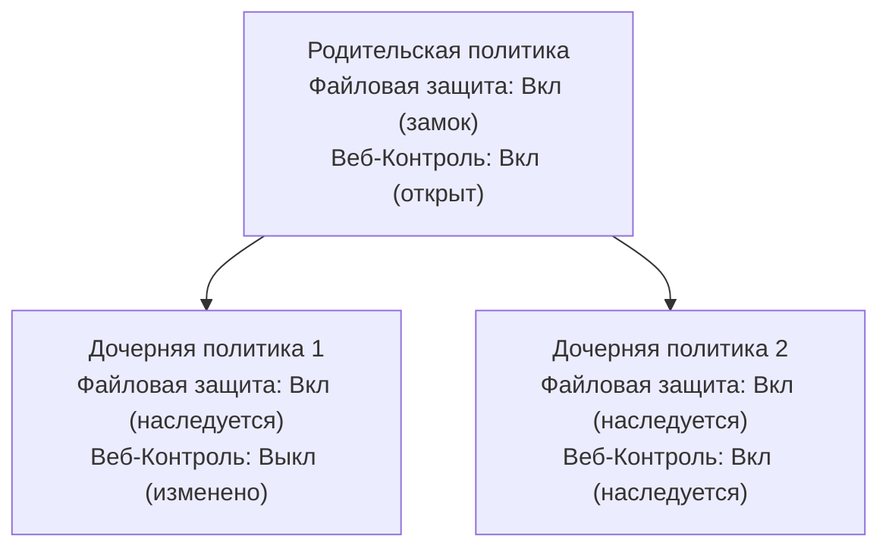

# KSC_Управление_Политиками

> [!abstract] Кратко
> Политика в KSC — централизованный источник настроек для группы устройств. Бывают родительские и дочерние, с наследованием параметров (замки). Позволяют задать разные настройки для разных групп (например, разработчикам отключить Веб-Контроль) без ручной настройки каждого ПК.

## 1. Зачем нужно
Понять, как управлять защитой сотен ПК, не настраивая каждый вручную. Политика — это «устав», который применяется к группе устройств.

## 2. Простыми словами
Политика — это приказ для отдела. «Всем бухгалтерам: Веб-Контроль включен. Всем разработчикам: Веб-Контроль выключен, но файловая защита — по полной». Приказ можно наследовать: главный приказ для всех, а для отдела — уточнение.

## 3. Технические детали

**Что такое политика:**
Централизованный источник настроек программы (KES, агент и т.д.). Применяется к группе устройств.

**Политика vs Задача:**

| Политика | Задача |
|---|---|
| Постоянное правило | Разовое или периодическое действие |
| Определяет настройки защиты | Выполняет действие (сканирование, обновление) |
| Действует непрерывно | Имеет расписание |
| «Как должна работать защита?» | «Какое действие выполнить сейчас?» |

**Наследование:**
- **Родительская политика** — общая для всех.
- **Дочерняя политика** — часть настроек наследуется, часть изменяется.

**Замки в политиках:**
- **Открытый замок** — параметр можно изменить в дочерней политике.
- **Закрытый замок** — параметр нельзя изменить (наследуется жестко).

**Правило:** в конечной политике все замки должны быть закрыты, если параметр не должен меняться.

**Профили политик:**
- Часть основной политики, где настройки отличаются для конкретной задачи.
- Остальные настройки совпадают с основной политикой.

Схема: наследование политик.

- **Читать схему:** в дочерней политике 1 Веб-Контроль отключен, потому что замок был открыт. Файловая защита наследуется жестко.

## 4. Пример / команда
Создание дочерней политики:
- `Сервер администрирования` → `Политики` → ПКМ на родительской политике → `Создать дочернюю политику`.
- В дочерней политике: `Контроль безопасности` → `Веб-Контроль` → снять галочку `Вкл`.

Проверка наследования: открыть свойства параметра, посмотреть на замок.

## 5. Для ИБ

| Риск | Защита |
|------|--------|
| Разные настройки для разных групп | Дочерние политики или профили |
| Случайное изменение критичного параметра | Закрытый замок на родительской политике |
| Пользователь меняет настройки локально | Защита паролем KES, закрытые замки |
| Забытая дочерняя политика | Регулярный аудит политик |

## 6. Вопросы для самопроверки
1. Чем политика отличается от задачи?
2. Что означает закрытый замок?
3. Зачем нужна дочерняя политика?
4. Что такое профиль политики?
5. Почему в конечной политике все замки должны быть закрыты?

## Связи
- [[KES_Веб_Контроль]]
- [[KES_Контроль_Устройств]]
- [[KSC_Безопасность_Сервера]]