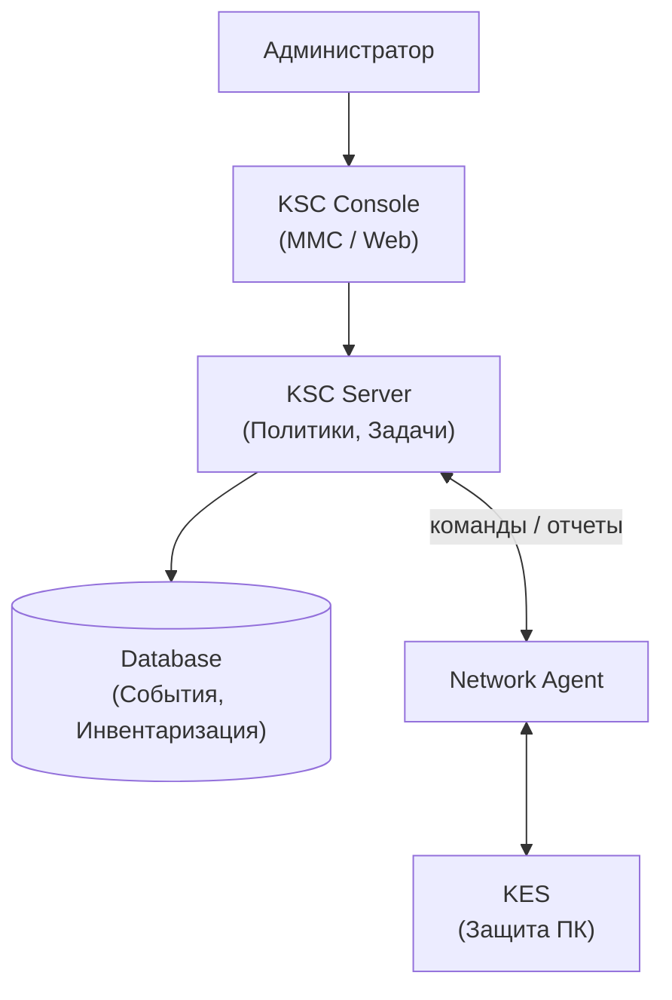

# Kaspersky_Архитектура

> [!abstract] Кратко
> Экосистема Kaspersky: Сервер администрирования (KSC) — «мозг», База данных — «архив», Консоль (MMC/Web) — «панель», Агент (Network Agent) — «связной», KES — «защитник» на ПК. Управление централизованное, настройки применяются через политики.

![[Pasted image 20261113095505.png]]

## 1. Зачем нужно
Понять, как устроена корпоративная защита. Без этого непонятно, где настраивать правила и почему изменения не применяются на ПК.

## 2. Простыми словами
Представь офис. **KSC Server** — это начальник. У него есть **База данных** (сейф с документами). **Администратор** смотрит на **Консоль** (монитор). На каждом компьютере сидит **Network Agent** (секретарь), который получает приказы от начальника и передает их **KES** (охраннику).

## 3. Технические детали

**Компоненты:**

| Компонент | Роль |
|---|---|
| **KSC Server** | Центральный узел, управляет политиками, распространяет задачи, собирает отчеты. |
| **Database (DB)** | Хранит инвентаризацию (ОС, IP, MAC), события, историю команд, статусы. |
| **KSC Console** | Интерфейс администратора. MMC (толстый клиент) или Web (браузер). |
| **Network Agent** | Служба на ПК. Связующее звено между Server и KES. Передает команды, загружает базы, шлет отчеты. |
| **KES (Endpoint)** | Клиентское приложение. Сканирует, блокирует, защищает конкретное устройство. |

Схема: архитектура управления.

- **Читать схему:** администратор настраивает политику в консоли, сервер сохраняет её в БД и передает через агента на KES. Отчеты идут обратно.

## 4. Пример / команда
Поиск ПК в KSC:
- В MMC-консоли: ПКМ на «Сервер администрирования» → **Поиск** → Ввести имя ПК.
- Откроются свойства ПК, где видны IP, группа, активные политики и события.

## 5. Для ИБ

| Риск | Защита |
|------|--------|
| Открытый Web-консоль KSC | Ограничение доступа по IP, MFA, ролевая модель |
| Перехват трафика Агент-Сервер | Шифрование (порт 13000), сертификаты |
| Компрометация KSC Server | Изоляция сервера, бэкапы, аудит действий админов |

## 6. Вопросы для самопроверки
1. Какую роль выполняет Network Agent?
2. Чем MMC-консоль отличается от Web-консоли?
3. Где хранятся события безопасности?
4. Почему KES не может работать автономно без политик?
5. Как администратор находит конкретный ПК в KSC?

## Связи
- [[Антивирусная_Защита_База]]
- [[KSC_Управление_Политиками]]
- [[UserGate_NGFW]]