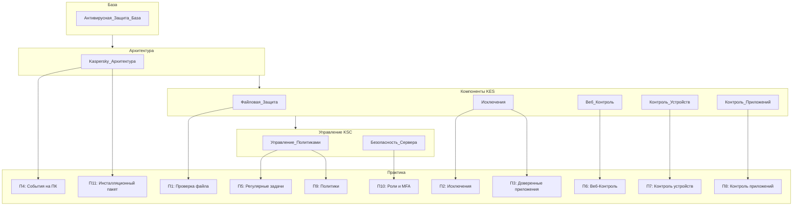

# MOC — Kaspersky (Антивирусная защита)

> [!abstract] Кратко
> Карта домена «Антивирусная защита»: 9 теоретических заметок по Kaspersky Endpoint Security (KES) и Kaspersky Security Center (KSC). Логика: от базы (ВПО, цикл защиты) → к архитектуре (Server, Agent, KES) → к компонентам защиты (файлы, веб, устройства, приложения) → к централизованному управлению (политики, роли, безопасность сервера). Практика — отдельным блоком.

## 0. Как читать

- **Теория** — что это и как работает.
- **Практика** — задания со стенда.
- **Схема зависимости** — что нужно знать перед чем.

## 1. Маршрут обучения (теория)

| Шаг | Блок               | Заметки                                                                                                          |
| --- | ------------------ | ---------------------------------------------------------------------------------------------------------------- |
| 1   | **База**           | `Антивирусная_Защита_База`                                                                                       |
| 2   | **Архитектура**    | `Kaspersky_Архитектура`                                                                                          |
| 3   | **Компоненты KES** | `KES_Файловая_Защита`, `KES_Исключения`, `KES_Веб_Контроль`, `KES_Контроль_Устройств`, `KES_Контроль_Приложений` |
| 4   | **Управление KSC** | `KSC_Управление_Политиками`, `KSC_Безопасность_Сервера`, `KSC_Задачи_KES_Подробно`                               |

## 2. Теория по блокам

### 2.1. База (1)

- [[Антивирусная_Защита_База]] — типы ВПО (червь, троян, шифровальщик, шпион, ботнет), цикл защиты (Подготовка → Обнаружение → Нейтрализация), кейсы WannaCry и NotPetya

### 2.2. Архитектура (1)

- [[Kaspersky_Архитектура]] — KSC Server, Database, Console (MMC/Web), Network Agent, KES. Связка «мозг — архив — панель — связной — защитник»

### 2.3. Компоненты KES (5)

- [[KES_Файловая_Защита]] — уровни безопасности (Высокий/Рекомендуемый/Низкий), проверка по формату vs по расширению, сигнатуры vs эвристика
- [[KES_Исключения]] — исключения из проверки (файлы/папки) vs доверенные приложения (поведение). Риски «слепых зон»
- [[KES_Веб_Контроль]] — фильтрация веб-ресурсов по категориям и маскам, приоритеты правил (0 — выше, 1 — ниже), исключения для групп
- [[KES_Контроль_Устройств]] — управление флешками, дисками, телефонами. Чтение vs запись, приоритеты, расписание, запрос доступа
- [[KES_Контроль_Приложений]] — blacklist (разрешено всё, кроме) vs whitelist (запрещено всё, кроме). Способы добавления: путь, хеш, сертификат, KL-категория

### 2.4. Управление KSC (3)

- [[KSC_Управление_Политиками]] — политика vs задача, родительские и дочерние политики, наследование, замки (открытый/закрытый), профили
- [[KSC_Безопасность_Сервера]] — ролевая модель (Администратор, Аудитор, Оператор), MFA, защита паролем KES, самозащита, FDE (полнодисковое шифрование)
- [[KSC_Задачи_KES_Подробно]] — Подробное описание задач Kaspersky Endpoint Security (KES), которые можно создать в Kaspersky Security Center (KSC). Для каждой задачи указано: что делает, обязательна ли, какие ключевые параметры настраиваются и когда применяется.

## 3. Практика (отдельный блок)

| # | Практика | Привязана к теории | Что делаем |
|---|---|---|---|
| 1 | Проверка файла | `Файловая_Защита` | ПКМ → Проверить на вирусы, Проверить репутацию в KSN |
| 2 | Исключения из проверки | `Исключения` | Добавить папку `C:\Users\Desktop\Исключение`, скопировать Eicar |
| 3 | Доверенные приложения | `Исключения` | Добавить путь к папке в доверенные, проверить, что Eicar не блокируется |
| 4 | События на ПК | `Архитектура` | Найти ПК в KSC → Свойства → События. Найти обнаруженный вирус, SHA256, проверить на VirusTotal |
| 5 | Регулярные задачи | `KSC_Управление_Политиками` | Сравнить «Поиск вредоносного ПО» (полная) и «Проверка важных областей» (быстрая) |
| 6 | Веб-Контроль | `KES_Веб_Контроль` | Заблокировать категорию «Социальные сети» для всех, разрешить для маркетинга |
| 7 | Контроль устройств | `KES_Контроль_Устройств` | Запретить флешки всем (приоритет 0), разрешить конкретному пользователю (приоритет 1). Добавить `NT AUTHORITY\SYSTEM` |
| 8 | Контроль приложений | `KES_Контроль_Приложений` | Заблокировать «Офисные приложения» для всех, разрешить одному студенту. Заблокировать PuTTY через свойства файла |
| 9 | Политики | `KSC_Управление_Политиками` | Создать дочернюю политику для разработчиков с отключенным Веб-Контролем |
| 10 | Роли и MFA | `KSC_Безопасность_Сервера` | Сравнить права Аудитора и Оператора KES. Настроить MFA для администратора |
| 11 | Инсталляционный пакет | `Архитектура` | Создать инсталляционный пакет KES, выбрать компоненты защиты |

**Маркер после:** после изменения политики в KSC — проверить, что «замок» закрыт. Иначе настройки не применятся на ПК.

## 4. Схема зависимости теории и практики

- **Читать схему:** теория идёт сверху вниз: база → архитектура → компоненты → управление. Практика привязана к конкретным блокам.

## 5. Логика изучения (почему такой порядок)

| Вопрос | Ответ |
|---|---|
| Почему база раньше архитектуры? | Без понимания ВПО непонятно, зачем все эти компоненты |
| Почему архитектура раньше компонентов? | Нужно знать, где настраивать (KSC) и где применять (KES) |
| Почему файловая защита первая? | Это базовый компонент, остальные — надстройки |
| Почему исключения после файловой? | Исключения — «дырка» в файловой защите, логично изучать после базы |
| Почему политики в конце? | Политики управляют всеми компонентами. Изучать их имеет смысл, когда знаешь, чем управлять |
| Почему безопасность сервера последняя? | Это защита самой системы управления. Венец, а не фундамент |

## 6. Ключевые ловушки (сводка)

| # | Ловушка | Где | Решение |
|---|---|---|---|
| 1 | Проверка по расширению пропускает вирус | `Файловая_Защита` | Использовать проверку **по формату** |
| 2 | Исключение для всей папки → слепая зона | `Исключения` | Исключать конкретный файл, не папку |
| 3 | Разрешающее правило ниже запрещающего | `Веб_Контроль`, `Контроль_Устройств` | Приоритет 0 — выше. Allow — выше Deny |
| 4 | Не добавлен `NT AUTHORITY\SYSTEM` | `Контроль_Устройств` | Добавить SYSTEM в разрешающее правило |
| 5 | Политика изменена, но замок открыт | `KSC_Управление_Политиками` | Закрыть замок, иначе не применится |
| 6 | FDE = антивирус | `Безопасность_Сервера` | FDE шифрует диск, вирусы не ловит |
| 7 | Задача = политика | `KSC_Управление_Политиками` | Политика — постоянно, задача — разово |
| 8 | Blacklist безопаснее whitelist | `Контроль_Приложений` | Whitelist безопаснее (запрещено всё, кроме) |

## 7. Вопросы для самопроверки

1. Сколько теоретических заметок по Kaspersky?
2. Почему архитектура изучается раньше компонентов?
3. Какая практика без закрытого замка в политике не сработает?
4. Где применяется `NT AUTHORITY\SYSTEM` и почему?
5. Чем политика отличается от задачи?
6. Что защищает FDE, а от чего не защищает?
7. Почему whitelist безопаснее blacklist?

## Связи
- [[Основы_ИТ_и_ИБ_Каркас]]
- [[MOC_UserGate_NGFW]]
- [[Итоги_цикла_сети]]
- [[Firewall]]