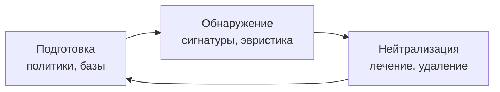

# Антивирусная_Защита_База

> [!abstract] Кратко
> Антивирусная защита — непрерывный процесс: Подготовка → Обнаружение → Нейтрализация. Защищает от ВПО: черви, трояны, шифровальщики, шпионы, реклама, ботнеты. Антивирус не панацея: нужны обновления ОС, цифровая гигиена и эвристика для новых угроз.

## 1. Зачем нужно
Понять, от чего именно защищает антивирус и почему сигнатурного метода недостаточно. Без этого настройка KES превращается в «нажимай галочки».

## 2. Простыми словами
Антивирус — это охранник с фонариком. Он знает в лицо старых преступников (сигнатуры) и умеет вычислять подозрительных по поведению (эвристика). Но если ты сам откроешь дверь вору (фишинг, старый софт, отключенный антивирус) — охранник может не успеть.

## 3. Технические детали

**Типы вредоносного ПО (ВПО):**
- **Червь (Worm):** самостоятельный, распространяется по сети.
- **Троян (Trojan):** маскируется под полезное ПО (игру, утилиту).
- **Шифровальщик (Ransomware):** шифрует данные и требует выкуп.
- **Шпион (Spyware):** крадет пароли, записывает экран/микрофон.
- **Реклама (Adware):** навязчивые баннеры, сбор данных.
- **Ботнет:** делает ПК частью управляемой сети для DDoS или майнинга.

**Цикл антивирусной защиты:**
1. **Подготовка:** установка, настройка, политики.
2. **Обнаружение:** сканирование, мониторинг, эвристика.
3. **Нейтрализация:** лечение, удаление, блокировка.

Схема: цикл защиты.

- **Читать схему:** процесс не заканчивается после удаления вируса. Он возвращается к подготовке (обновление баз, настройка).

**Реальные кейсы:**
- **WannaCry (2017):** использовал уязвимость SMB (EternalBlue). Устаревшие ОС и старые базы = остановка больниц.
- **Petya/NotPetya (2017):** атака через доверенное обновление (M.E.Doc). Сигнатуры бессильны, сработала эвристика. Ущерб >$10 млрд.

## 4. Пример / команда
Проверка файла на вирусы через контекстное меню KES:
- ПКМ на файле → **Проверить на вирусы**.
- ПКМ на файле → **Проверить репутацию в KSN**.

Результат: окно с отчетом (объекты проверены, угрозы найдены/удалены).

## 5. Для ИБ

| Риск | Защита |
|------|--------|
| Скачивание .exe из письма | Запрет на запуск из Temp/Downloads, Awareness |
| Атака через доверенное ПО (supply chain) | Эвристика и поведенческий анализ (KES) |
| Отключение антивируса пользователем | Самозащита KES, защита паролем |
| Устаревшие базы | Регулярное обновление (раз в сутки) |

## 6. Вопросы для самопроверки
1. Чем червь отличается от трояна?
2. Назови три этапа цикла антивирусной защиты.
3. Почему антивирус по сигнатурам бессилен против NotPetya?
4. Что такое ботнет?
5. Зачем нужна эвристика?

## Связи
- [[Kaspersky_Архитектура]]
- [[KES_Файловая_Защита]]
- [[Основы_ИТ_и_ИБ_Каркас]]