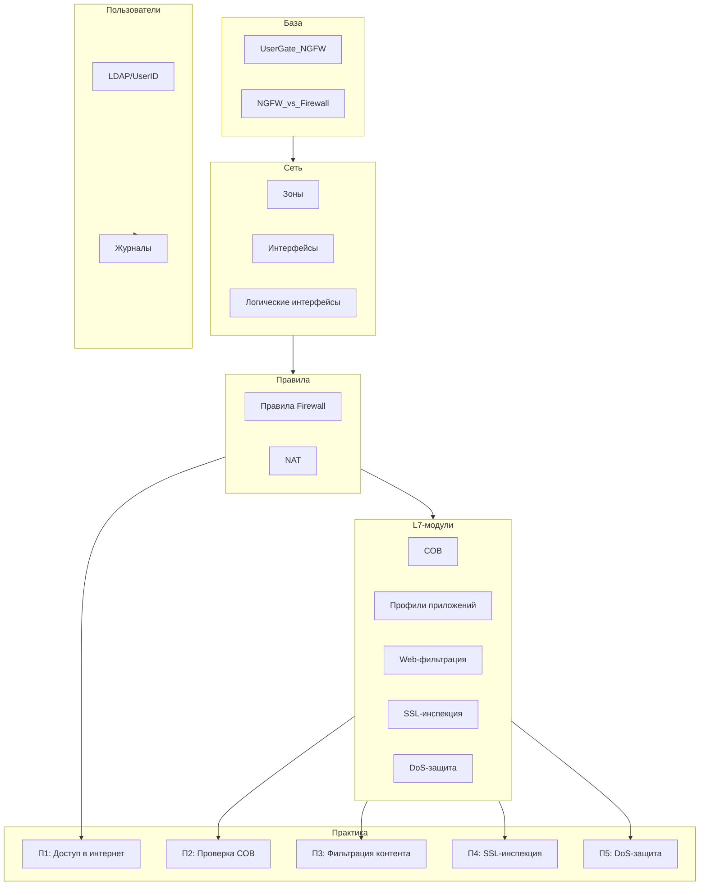

# MOC — UserGate NGFW

> [!abstract] Кратко
> Карта домена UserGate NGFW: 14 теоретических заметок + 5 практических. Логика: от общего устройства → к зонам и интерфейсам → к правилам и NAT → к L7-модулям (СОВ, фильтрация, SSL, DoS) → к идентификации и журналам. Практика — отдельным блоком, каждая практика привязана к теории.

## 0. Как читать

- **Теория** — что это и как работает.
- **Практика** — пошаговые задания со стенда.
- **Схема зависимости** — что нужно знать перед практикой.

## 1. Маршрут обучения (теория)

| Шаг | Блок | Заметки |
|---|---|---|
| 1 | **Общее устройство** | `UserGate_NGFW`, `NGFW_vs_Firewall` |
| 2 | **Зоны** | `UserGate_Зоны` |
| 3 | **Интерфейсы** | `UserGate_Интерфейсы`, `UserGate_Логические_Интерфейсы` |
| 4 | **Правила и NAT** | `UserGate_Правила_Firewall`, `UserGate_NAT` |
| 5 | **L7-модули** | `UserGate_СОВ`, `UserGate_Профили_Приложений`, `UserGate_Web_Фильтрация`, `UserGate_SSL_Инспекция`, `UserGate_DoS_Защита` |
| 6 | **Пользователи и журналы** | `UserGate_LDAP_Идентификация`, `UserGate_Журналы` |

## 2. Теория по блокам

### 2.1. Общее устройство (2)

- [[UserGate_NGFW]] — что такое NGFW, модули, зоны по умолчанию, первичная настройка, Packet Flow
- [[NGFW_vs_Firewall]] — чем NGFW отличается от классического firewall (L3/L4 vs L7)

### 2.2. Зоны (1)

- [[UserGate_Зоны]] — что такое зона, 8 зон по умолчанию, привязка интерфейсов, защита от DoS и спуфинга на уровне зоны

### 2.3. Интерфейсы (2)

- [[UserGate_Интерфейсы]] — физические (Layer 3, Mirror) и логические типы, свойства, привязка к зоне
- [[UserGate_Логические_Интерфейсы]] — VLAN, Tunnel, PPPoE, Loopback, VPN, Мост, Bond: зачем каждый

### 2.4. Правила и NAT (2)

- [[UserGate_Правила_Firewall]] — порядок обработки (сверху вниз), параметры правила, default block
- [[UserGate_NAT]] — SNAT, DNAT, Port Forwarding, почему NAT не разрешает трафик

### 2.5. L7-модули (5)

- [[UserGate_СОВ]] — IDS/IPS, профили СОВ, применение только к PASS-правилам
- [[UserGate_Профили_Приложений]] — Application Control, фильтры по категориям и именам, Drop vs Reset
- [[UserGate_Web_Фильтрация]] — фильтрация контента по категориям и URL, логика «И» между вкладками
- [[UserGate_SSL_Инспекция]] — расшифровка TLS, два туннеля, Inbound vs Outbound
- [[UserGate_DoS_Защита]] — профили DoS (пороги SYN/UDP/ICMP), правила DoS, два действия (Защитить/Запретить)

### 2.6. Пользователи и журналы (2)

- [[UserGate_LDAP_Идентификация]] — LDAP-коннектор + UserID, связка IP ↔ пользователь ↔ группа
- [[UserGate_Журналы]] — типы журналов, где смотреть при проблеме, Syslog-коннектор

## 3. Практика (отдельный блок)

| # | Практика | Привязана к теории | Что делаем |
|---|---|---|---|
| 1 | [[UserGate_Практика_Доступ_в_Интернет]] | `Правила_Firewall` + `NAT` | Правило firewall + SNAT, проверка ping |
| 2 | [[UserGate_Практика_Проверка_СОВ]] | `СОВ` | Сигнатура BlackSun, профиль IPS, Reset |
| 3 | [[UserGate_Практика_Фильтрация_Контента]] | `Web_Фильтрация` | Запрет категорий и URL, логика «И» |
| 4 | [[UserGate_Практика_SSL_Инспекция]] | `SSL_Инспекция` | Расшифровка TLS, сертификат KBZ JSC |
| 5 | [[UserGate_Практика_DoS_Защита]] | `DoS_Защита` | Профиль DoS + правило, curl, 200/000 |

**Маркер после:** после создания любого правила — проверить галочку «Включено». Правило создаётся выключенным.

## 4. Схема зависимости теории и практики

- **Читать схему:** теория идёт сверху вниз: база → сеть → правила → L7. Практика привязана к конкретным блокам.

## 5. Логика изучения (почему такой порядок)

| Вопрос | Ответ |
|---|---|
| Почему зоны раньше правил? | Правила строятся между зонами. Без зон — нечего связывать |
| Почему интерфейсы раньше правил? | Интерфейс привязывается к зоне. Без привязки — вне политик |
| Почему правила раньше L7? | L7-модули работают только после того, как firewall пропустил трафик |
| Почему NAT раньше практики? | Практика 1 без NAT даёт 100% потерь — это главная ловушка |
| Почему журналы в конце? | Журналы — инструмент диагностики. Читать их имеет смысл, когда знаешь, что настраивал |

## 6. Ключевые ловушки (сводка)

| # | Ловушка | Где | Решение |
|---|---|---|---|
| 1 | Правило создано, но не включено | Любое правило | Галочка «Включено» |
| 2 | Firewall PASS, но интернета нет | `Практика_Доступ` | Добавить SNAT |
| 3 | Разрешающий фильтр ниже запрещающего | `Профили_Приложений`, `Web_Фильтрация` | Allow — выше Deny |
| 4 | Одно правило для категорий и URL | `Web_Фильтрация` | Логика «И»: два правила |
| 5 | СОВ на DENY-правиле | `СОВ` | Только на PASS |
| 6 | SSL без доверия к CA | `SSL_Инспекция` | Добавить сертификат в доверенные |
| 7 | Default gateway не на port0 | Стенд | `route print`, шлюз = `110.65` |
| 8 | DoS-правило не совпало | `DoS_Защита` | Проверить зону источника, DNS, порядок |

## 7. Вопросы для самопроверки

1. Сколько теоретических заметок по UserGate?
2. Сколько практических?
3. Почему зоны изучаются раньше правил?
4. Какая практика без NAT даёт 100% потерь?
5. Где применяется профиль СОВ?
6. Что проверять после создания любого правила?
7. Почему журналы — в конце маршрута?

## Связи
- [[Итоги_цикла_сети]]
- [[MOC_Сети]]
- [[Firewall]]
- [[Протокол_NAT]]
- [[Протокол_TLS_и_PKI]]
- [[DMZ]]