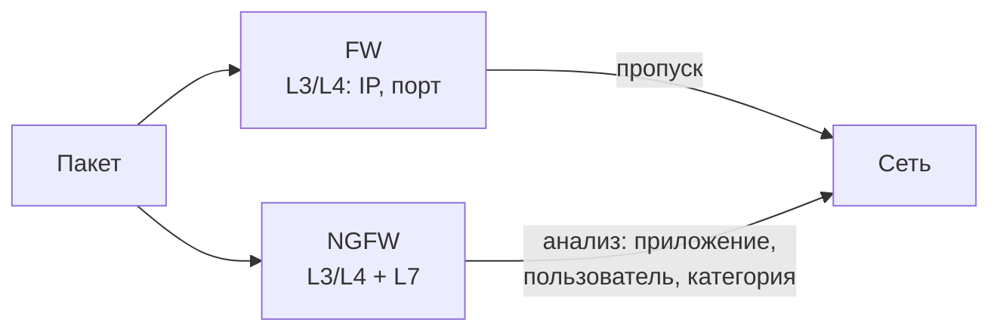

# NGFW_vs_Firewall

> [!abstract] Кратко
> Традиционный firewall фильтрует по L3/L4 (IP, порты). NGFW добавляет инспекцию L7, IDS/IPS, идентификацию пользователей, фильтрацию по категориям, инспекцию зашифрованного трафика. NGFW понимает, **что** за трафик, а не только **куда**.

## 1. Зачем нужно
Понять разницу между «старым» firewall и NGFW. Без этого NGFW выглядит как «файрвол с кнопками».

## 2. Простыми словами
Firewall — охранник, который смотрит на пропуск: «откуда, куда, какой порт». NGFW — охранник, который ещё и смотрит, **что** ты несёшь в сумке: торрент, мессенджер или вредоносный файл.

## 3. Технические детали

| FW | NGFW |
|---|---|
| Фильтрация L3/L4 | Инспекция приложений L7 |
| Простой NAT | IDS/IPS (СОВ) |
| Маршрутизация | Идентификация пользователей |
| Базовое журналирование | Фильтрация по категориям |
| — | Инспекция зашифрованного трафика (SSL/TLS) |

- **Пример FW:** разрешён TCP 443 на IP `x.x.x.x`.
- **Пример NGFW:** разрешён TCP 443 пользователям группы X, но **запрещены** торренты, мессенджеры и загрузка вредоносных файлов.

Схема: что видит FW и что видит NGFW.



- **Читать схему:** FW смотрит только на заголовок L3/L4. NGFW смотрит ещё и внутрь — на L7.

## 4. Пример / команда
Проверка функций в UserGate:

```text
Настройки → Политики безопасности → Фильтрация контента
Настройки → Политики безопасности → Профили СОВ
Настройки → Политики безопасности → Инспектирование SSL
```

## 5. Для ИБ

| Риск | Защита в NGFW |
|------|--------|
| Вредонос в HTTPS → FW пропускает | SSL-инспекция + СОВ |
| Торренты под видом 443 | Инспекция приложений L7 |
| Пользователь обходит правила по IP | Идентификация пользователей (LDAP) |
| Нежелательные категории сайтов | Фильтрация по категориям |

## 6. Вопросы для самопроверки
1. На каких уровнях работает FW?
2. Что добавляет NGFW?
3. Что такое инспекция приложений L7?
4. Зачем идентификация пользователей?
5. Чем пример FW отличается от примера NGFW?

## Связи
- [[UserGate_NGFW]]
- [[Firewall]]
- [[UserGate_Правила_Firewall]]
- [[UserGate_СОВ]]
- [[UserGate_SSL_Инспекция]]