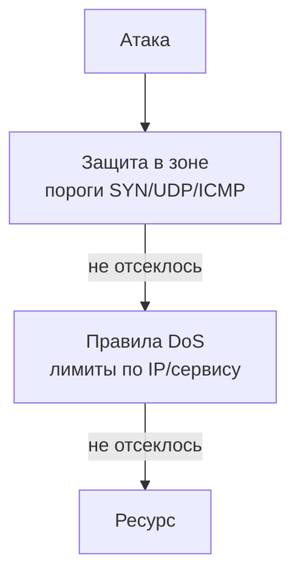

# UserGate_DoS_Защита

> [!abstract] Кратко
> DoS-атака перегружает ресурсы системы «мусорными» запросами. В UserGate защита настраивается через профили DoS (лимиты соединений и скорости) и правила DoS (кто, откуда, куда). Правила обрабатываются сверху вниз. Защита есть на уровне зоны и на уровне отдельных правил.

## 1. Зачем нужно
Понять, как NGFW защищает себя и внутренние ресурсы от флуда. Без этого атака «положит» сервис, и firewall не поможет.

## 2. Простыми словами
DoS — это толпа, которая ломится в одну дверь и не даёт пройти нормальным людям. Защита — это ограничитель: «не больше N человек в секунду, не больше M одновременно».

## 3. Технические детали

**Что настраивается в профиле DoS:**

| Параметр | Что ограничивает |
|---|---|
| **Максимум одновременных соединений** | Открытые TCP-сессии |
| **Скорость создания новых соединений** | Connections per second |
| **Лимиты по IP источника** | Защита от конкретного бота |
| **Лимиты по IP назначения** | Защита конкретного сервера |

**Правила DoS:**
- Обрабатываются **сверху вниз**, первое совпавшее.
- Условия: зоны, интерфейсы, IP источника (включая GeoIP), сервисы, приложения.

**Два уровня защиты:**
1. **В свойствах зоны** — пороги для TCP (SYN-flood), UDP, ICMP. Рекомендуемые: уведомление ~3000 pps, отбрасывание ~6000 pps.
2. **Отдельные правила DoS** — точечно для конкретных сервисов или IP.

Схема: уровни защиты от DoS.



- **Читать схему:** сначала срабатывает защита зоны (общая), потом правила DoS (точечные).

## 4. Пример / команда
Создание профиля DoS:

```text
Настройки → Политики безопасности → Профили DoS → Добавить
Название: Web_Protection
Максимум одновременных соединений: 1000
Connections per second: 100
```

Создание правила DoS:

```text
Настройки → Политики безопасности → Правила защиты DoS → Добавить
Зона источника: Untrusted
Зона назначения: DMZ
Профиль DoS: Web_Protection
```

## 5. Для ИБ

| Риск | Защита |
|------|--------|
| SYN-flood на внешний IP | Пороги в зоне Untrusted |
| Флуд на конкретный сервер | Правило DoS с лимитом по IP назначения |
| Бот из одной подсети | Лимит по IP источника |
| DoS без журналирования | Включить журнал событий DoS |
| Слишком жёсткие лимиты → блокировка легитимных | Настроить пороги по реальному трафику |

## 6. Вопросы для самопроверки
1. Что такое DoS-атака?
2. Что настраивается в профиле DoS?
3. Чем профиль DoS отличается от правила DoS?
4. В каком порядке обрабатываются правила DoS?
5. Где ещё, кроме правил, есть защита от DoS?

## Связи
- [[UserGate_NGFW]]
- [[UserGate_Зоны]]
- [[UserGate_Правила_Firewall]]
- [[Firewall]]
- [[UserGate_Журналы]]