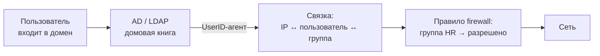

# UserGate_LDAP_Идентификация

> [!abstract] Кратко
> NGFW должен понимать не «железные IP», а конкретных людей и их должности. Для этого используется LDAP-коннектор (получение пользователей и групп из Active Directory/FreeIPA) и технология UserID (прозрачная привязка IP к пользователю по событиям аутентификации). Правила firewall и фильтрации контента строятся по **группам LDAP**, а не по IP-адресам.

## 1. Зачем нужно
Понять, как NGFW узнаёт, что за IP `192.168.x.x` сидит Петров из отдела кадров, а не «Unknown». Без этого правила «разрешить HR доступ к сайтам для поиска работы» невозможны.

## 2. Простыми словами
IP-адрес — это номер квартиры. NGFW хочет знать, кто именно в ней живёт, чтобы дать ключ от нужной двери. LDAP — это домовая книга, где записано: «кв. 10 — Петров, группа HR». UserID — это вахтёр, который смотрит, кто вошёл, и запоминает: «сейчас в кв. 10 Петров».

## 3. Технические детали

**Два компонента:**

| Компонент | Что делает |
|---|---|
| **LDAP-коннектор** | Подключается к Active Directory / FreeIPA, получает список пользователей и групп |
| **UserID (UserID-агент)** | Собирает события входа/выхода (логин/логаут) из AD, syslog или RADIUS и сопоставляет IP с пользователем |

**Как это работает вместе:**
1. LDAP-коннектор настроен на контроллер домена.
2. Пользователь входит в систему на своём ПК (доменный логин).
3. UserID-агент получает событие входа из журнала AD (Event ID 4624, 4768, 4769 и др.).
4. UserID-агент сопоставляет IP-адрес ПК с именем пользователя.
5. Если группы не пришли в событии — UserID-агент запрашивает их у LDAP.
6. NGFW обрабатывает связку: «за IP `192.168.1.10` — пользователь Иванов, группа HR. Этой группе разрешён доступ к ресурсу X».

**Параметры LDAP-коннектора:**

| Параметр | Что указывать |
|---|---|
| **Доменное имя LDAP или IP** | FQDN контроллера домена или домена (например, `test.local`) |
| **Bind DN (login)** | `DOMAIN\username` или `username@domain` — учётка для подключения к LDAP |
| **Пароль** | Пароль этой учётки |
| **Домены LDAP** | Список доменов (для дерева/леса AD) |
| **Пути поиска** | Откуда искать пользователей (например, `ou=Office,dc=example,dc=com`) |
| **SSL** | Использовать ли SSL для подключения |

**Источники событий для UserID:**
- **Microsoft Active Directory** (WMI-запросы к журналу безопасности).
- **Syslog** (отправка журналов на UserID-агент NGFW, порт TCP 514).
- **RADIUS accounting** (UDP 1813).

**Ключевое правило:**
Правила firewall и фильтрации контента строятся по **группам LDAP**, а не по IP. Это делает политику независимой от физического адреса.

Схема: связка LDAP + UserID.



- **Читать схему:** LDAP даёт список людей и групп. UserID привязывает IP к конкретному человеку. Правило работает с группой, а не с IP.

## 4. Пример / команда
Создание LDAP-коннектора:

```text
Настройки → Пользователи и устройства → Серверы аутентификации → Добавить LDAP-коннектор
Доменное имя LDAP или IP: test.local
Bind DN: DOMAIN\administrator
Пароль: ****
Домены LDAP: test.local
Пути поиска: ou=Office,dc=example,dc=com
SSL: включить
```

Проверка соединения:

```text
Нажать «Проверить соединение» — система покажет результат.
```

Использование в правиле:

```text
Настройки → Политики сети → Межсетевой экран → <правило>
Пользователи: добавить группу LDAP (например, HR)
```

## 5. Для ИБ

| Риск                                                 | Защита                                                 |
| ---------------------------------------------------- | ------------------------------------------------------ |
| LDAP без SSL → перехват учётных данных               | Включить SSL для LDAP-коннектора                       |
| Слабый пароль Bind DN → компрометация домена         | Отдельная сервисная учётка с минимальными правами      |
| UserID не собирает события → IP «Unknown»            | Проверить источники (AD/syslog/RADIUS), включить аудит |
| Правила по IP вместо групп → негибко и небезопасно   | Использовать группы LDAP в правилах                    |
| LDAP-кэш слишком долгий → уволенный сохраняет доступ | Настроить срок жизни кэша (1–48 часов)                 |

## 6. Вопросы для самопроверки
1. Что даёт LDAP-коннектор?
2. Что делает UserID-агент?
3. Как NGFW понимает, что за IP сидит конкретный пользователь?
4. Почему правила лучше строить по группам, а не по IP?
5. Какие источники событий может использовать UserID?
6. Зачем нужен SSL для LDAP?

## Связи
- [[UserGate_NGFW]]
- [[UserGate_Правила_Firewall]]
- [[UserGate_Web_Фильтрация]]
- [[UserGate_Зоны]]
- [[LDAP_и_Active_Directory]]