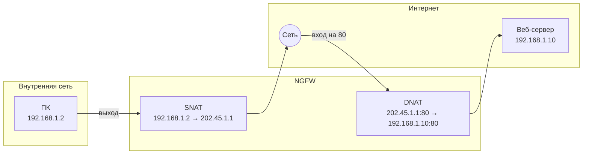

# UserGate_NAT

> [!abstract] Кратко
> NAT в UserGate — отдельный модуль (`Политики сети → NAT и маршрутизация`). SNAT меняет частный IP на публичный при выходе. DNAT перенаправляет входящие запросы на внутренние ресурсы. Правило NAT **не разрешает** трафик — это делает правило firewall.

## 1. Зачем нужно
Понять, почему после настройки NAT интернет не появляется. NAT и firewall — два разных механизма.

## 2. Простыми словами
NAT — это подмена обратного адреса на конверте. Firewall — охранник, который решает, пропускать конверт или нет. Подменил адрес, но охранник не пропустил — письмо не ушло.

## 3. Технические детали

**Типы NAT:**

| Тип | Что делает | Где используется |
|---|---|---|
| **SNAT** | Меняет частный IP отправителя на публичный | Выход из LAN (Trusted) в интернет (Untrusted) |
| **DNAT** | Перенаправляет входящий запрос с публичного IP на внутренний | Публикация ресурсов из DMZ |
| **Port Forwarding** | Вариация DNAT: публикует конкретную службу | Один внешний IP → несколько внутренних серверов |

**Ключевое правило:**
- **Правило NAT** — только меняет IP и порты в заголовке. **Не разрешает** трафик.
- **Правило firewall** — решает, пропускать пакет или нет.

**Для доступа в интернет нужны два условия:**
1. Правило SNAT (подмена адреса).
2. Разрешающее правило firewall (пропуск).

**Порядок обработки NAT:** сверху вниз, применяется первое совпавшее.

Схема: SNAT и DNAT.



- **Читать схему:** SNAT — для исходящих. DNAT — для входящих. Оба меняют только заголовок, не разрешают трафик.

## 4. Пример / команда
Создание правила SNAT:

```text
Настройки → Политики сети → NAT и маршрутизация → Добавить
Тип: NAT
SNAT IP (внешний адрес): <публичный IP>
Источник: Inside (объект с сетью 192.168.1.0/24)
Назначение: Outside
Журналирование: включить
```

## 5. Для ИБ

| Риск | Защита |
|------|--------|
| NAT без firewall → трафик не идёт | Всегда создавать пару: NAT + разрешающее правило firewall |
| DNAT открывает внутренний сервер | Публиковать только нужные порты, размещать в DMZ |
| NAT скрывает атаки | Журналирование NAT, IDS/IPS |
| Port Forwarding на весь сервер | Публиковать конкретную службу, не весь сервер |

## 6. Вопросы для самопроверки
1. Чем SNAT отличается от DNAT?
2. Разрешает ли правило NAT трафик?
3. Что нужно для выхода в интернет besides NAT?
4. Где создаётся правило NAT в UserGate?
5. Чем Port Forwarding отличается от DNAT?

## Связи
- [[Протокол_NAT]]
- [[UserGate_NGFW]]
- [[UserGate_Правила_Firewall]]
- [[Шлюз_по_умолчанию]]
- [[Firewall]]