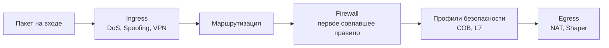

# UserGate_NGFW

> [!abstract] Кратко
> UserGate NGFW — российский межсетевой экран нового поколения. Объединяет firewall, NAT, маршрутизацию, IDPS, контент-фильтрацию, VPN, защиту от DoS. Управление через веб-консоль (порт 8001). Политики строятся на зонах, а не на интерфейсах.

## 1. Зачем нужно
Понять, как устроен NGFW и с чего начинается настройка. Без этого практика превращается в «нажимай кнопки по мануалу».

## 2. Простыми словами
UserGate — это не просто «файрвол». Это швейцарский нож для сети: он и маршрутизирует, и фильтрует, и ищет атаки, и прячет внутренние адреса. Управляется через браузер.

## 3. Технические детали

**Ключевые модули:**

| Модуль | Что делает |
|---|---|
| Межсетевой экран | Фильтрация по зонам, IP, пользователям, сервисам |
| NAT и маршрутизация | SNAT/DNAT, статическая и динамическая (OSPF, BGP) |
| СОВ (IDPS) | Обнаружение и предотвращение вторжений |
| Защита от DoS | Пороги и правила против флуда |
| Контент-фильтрация | Блокировка сайтов, приложений, категорий |
| VPN | Site-to-Site, Remote Access, SSL VPN |
| Кластеризация | Актив-Актив / Актив-Пассив |

**Зоны по умолчанию** (политики применяются к зонам, не к портам):

| Зона | Назначение |
|---|---|
| **Management** | Сеть управления (`port0`) |
| **Trusted** | LAN, доверенные сети |
| **Untrusted** | Интернет, недоверенные сети |
| **DMZ** | Демилитаризованная зона |
| **Cluster** | Интерфейсы кластера |
| **VPN for Site-to-Site** | Клиенты «офис-офис» |
| **VPN for remote access** | Удалённые пользователи |
| **Tunnel inspection zone** | Инспектирование туннелей |

**Первичная настройка (кратко):**
1. Подключиться к `port0` (DHCP или статический IP через CLI).
2. Веб-консоль: `https://<IP>:8001`.
3. Сменить пароль (по умолчанию `Admin` / `usergate` до инициализации).
4. Настроить интерфейсы и привязать к зонам.
5. Указать шлюз в интернет (зона Untrusted).
6. Настроить DNS и NTP.
7. Ввести лицензию (ПИН-код).
8. Включить готовые правила: `NAT from Trusted to Untrusted` и `Allow trusted to untrusted`.

**Логика обработки пакета (Packet Flow):**
1. **Ingress:** проверка на DoS, спуфинг, расшифровка VPN, DNAT, аутентификация.
2. **Policy processing:** маршрутизация → **firewall** (правила сверху вниз, срабатывает **первое совпавшее**) → профили безопасности (СОВ, L7).
3. **Egress:** shaping, SNAT, шифрование, выход.

**Ключевое правило:** если не создано ни одного правила firewall, **любой транзитный трафик запрещён**.

Схема: упрощённый поток пакета.



- **Читать схему:** пакет проходит три стадии. Firewall — центральный элемент, но не единственный.

## 4. Пример / команда
Проверка базовых вещей на практике:

```bash
# Узнать IP port0 (если DHCP)
# Смотреть в консоли NGFW после загрузки

# Веб-консоль
https://<IP>:8001

# Проверка правил NAT (если есть CLI/API доступ)
# В веб-консоли: Политики сети -> NAT и Маршрутизация
```

## 5. Для ИБ

| Риск | Защита в UserGate |
|------|--------|
| Открытый доступ в интернет | Правило `Allow trusted to untrusted` — включать осознанно |
| Открытый Management | `port0` в зоне Management, доступ только из админской сети |
| Слабый пароль Admin | Смена при первом входе, MFA (TOTP/SMS/email) |
| DoS-атака | Пороги в свойствах зоны + правила защиты |
| Нежелательный контент | Профили контент-фильтрации и контроля приложений (L7) |
| Отсутствие правил firewall | По умолчанию — запрет всего транзитного трафика |

## 6. Вопросы для самопроверки
1. Чем UserGate NGFW отличается от обычного firewall?
2. Какие зоны созданы по умолчанию?
3. На каком порту работает веб-консоль?
4. Что произойдёт, если не создать ни одного правила firewall?
5. В каком порядке применяются правила firewall?
6. Что такое Packet Flow и зачем его знать?

## Связи
- [[Firewall]]
- [[DMZ]]
- [[Протокол_NAT]]
- [[Сетевые_Порты]]
- [[Плоская_сеть]]