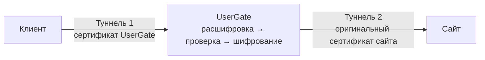

# UserGate_SSL_Инспекция

> [!abstract] Кратко
> SSL-инспекция — расшифровка TLS-трафика на NGFW, проверка модулями безопасности и повторное шифрование. UserGate становится посредником: два туннеля вместо одного. Бывает входящая (Inbound) и исходящая (Outbound). Требует сертификата, которому доверяют клиенты.

## 1. Зачем нужно
Понять, как NGFW видит, что внутри HTTPS. Без SSL-инспекции фильтрация контента и СОВ слепы к зашифрованному трафику.

## 2. Простыми словами
TLS — запечатанный конверт. NGFW не может прочитать, что внутри. SSL-инспекция — это вскрытие конверта, проверка содержимого и запечатывание обратно. Клиент думает, что говорит с сайтом, а на деле — с NGFW.

## 3. Технические детали

**Принцип работы:**
1. Клиент запрашивает HTTPS.
2. UserGate перехватывает `Client Hello`.
3. UserGate устанавливает соединение с реальным сайтом, проверяет его сертификат.
4. UserGate генерирует **свой** сертификат с данными оригинального сайта, подписывает своим CA.
5. Отдаёт этот сертификат клиенту.
6. Клиент шифрует трафик ключом UserGate.
7. UserGate расшифровывает, проверяет (DPI, IPS, антивирус, URL-фильтрация).
8. Если чисто — перешифровывает оригинальным ключом сайта и отправляет на сервер.

**Два типа инспекции:**

| Тип | Что защищает | Особенность |
|---|---|---|
| **Inbound SSL Inspection** | Собственные серверы компании (веб-сайт в DMZ) | UserGate хранит оригинальный закрытый ключ сервера |
| **Outbound SSL Inspection** | Контроль доступа сотрудников в интернет | Требует подмены сертификатов «на лету», самый сложный в настройке |

**Требование:** сертификат UserGate CA должен быть добавлен в доверенные на клиентских машинах. Иначе браузер покажет предупреждение.

Схема: два туннеля вместо одного.



- **Читать схему:** клиент видит UserGate как сервер, сайт видит UserGate как клиента. Два независимых TLS-туннеля.

## 4. Пример / команда
Создание правила:

```text
Настройки → Политики безопасности → SSL Инспекция → Добавить
```

Проверка сертификата в браузере:
- Открыть сайт → замок → сертификат → издатель должен быть UserGate CA.

## 5. Для ИБ

| Риск | Защита |
|------|--------|
| SSL-инспекция без доверия к CA → предупреждения | Добавить сертификат UserGate CA в доверенные |
| Инспекция всего трафика → нагрузка и приватность | Инспектировать только нужные категории/пользователей |
| Подмена сертификата → MITM-атака | Защита CA-ключа, контроль доступа к NGFW |
| Inbound без защиты ключа сервера | Хранить ключ в защищённом виде, ограничить доступ |

## 6. Вопросы для самопроверки
1. Что такое SSL-инспекция?
2. Чем Inbound отличается от Outbound?
3. Почему клиент должен доверять сертификату UserGate?
4. Что происходит с трафиком после проверки?
5. Почему SSL-инспекция — самый сложный режим?

## Связи
- [[UserGate_Web_Фильтрация]]
- [[UserGate_СОВ]]
- [[NGFW_vs_Firewall]]
- [[Протокол_TLS_и_PKI]]
- [[UserGate_Журналы]]