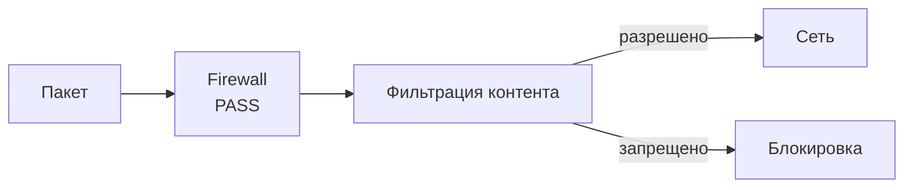

# UserGate_Web_Фильтрация

> [!abstract] Кратко
> Фильтрация контента в UserGate блокирует или разрешает доступ к сайтам по категориям, URL-спискам, морфологии. Правила обрабатываются сверху вниз, первое совпавшее. Работает на L7 и требует, чтобы трафик уже был разрешён правилом firewall.

## 1. Зачем нужно
Понять, как NGFW запрещает нежелательные сайты и категории, не блокируя весь интернет. Это следующий слой после firewall.

## 2. Простыми словами
Firewall решает, можно ли тебе вообще выйти в интернет. Фильтрация контента решает, **куда именно** можно зайти. Охранник пропустил на улицу, но в «плохие» магазины вход закрыт.

## 3. Технические детали

**Где:** `Настройки → Политики безопасности → Фильтрация контента`.

**Параметры правила:**

| Параметр | Что делает |
|---|---|
| **Действие** | `Разрешить` / `Запретить` / `Предупредить` |
| **Пользователи** | Любой / Known / Unknown / группы |
| **Категории URL** | Web browsing, Games, Social networking, Threats и др. |
| **Морфология** | Анализ содержимого по ключевым словам |
| **URL** | Конкретные адреса или списки |
| **Зона источника / назначения** | Откуда и куда |
| **Расписание** | Когда действует правило |

**Логика:**
- Правила обрабатываются **сверху вниз**, срабатывает **первое совпавшее**.
- Внизу — `Default allow` (разрешить всё, что не запрещено).
- Чтобы запретить категорию, её правило должно быть **выше** `Default allow`.

**Пример типового набора:**

| # | Название | Действие | Категория |
|---|---|---|---|
| 1 | Example white list | Разрешить | URL-список |
| 2 | Example black list | Запретить | URL-список |
| 3 | Example threats sites | Запретить | Threats |
| 4 | Example parental control | Запретить | Threats, Parental Control |
| 5 | Example non-productive sites | Предупредить | Productivity |
| 6 | Default allow | Разрешить | Любая |

Схема: место фильтрации в обработке трафика.



- **Читать схему:** фильтрация контента работает **после** firewall. Если firewall запретил — до фильтрации дело не дойдёт.

## 4. Пример / команда
Создание правила:

```text
Настройки → Политики безопасности → Фильтрация контента → Добавить
Действие: Запретить
Категории URL: Games, Social networking
Зона источника: Trusted
Пользователи: Любой
```

## 5. Для ИБ

| Риск | Защита |
|------|--------|
| Запрет ниже `Default allow` → не работает | Запрещающие правила — выше разрешающих |
| Фильтрация без SSL-инспекции → HTTPS не виден | Включить SSL-инспекцию для нужных категорий |
| Слишком широкий запрет → ложные блокировки | Точечные категории и URL-списки |
| Нет журналирования → инцидент не виден | Включить журнал веб-доступа |

## 6. Вопросы для самопроверки
1. На каком уровне работает фильтрация контента?
2. В каком порядке обрабатываются правила?
3. Где должно стоять запрещающее правило относительно `Default allow`?
4. Зачем нужна SSL-инспекция для фильтрации?
5. Что такое морфология?

## Связи
- [[UserGate_NGFW]]
- [[UserGate_Правила_Firewall]]
- [[UserGate_SSL_Инспекция]]
- [[NGFW_vs_Firewall]]
- [[UserGate_Журналы]]