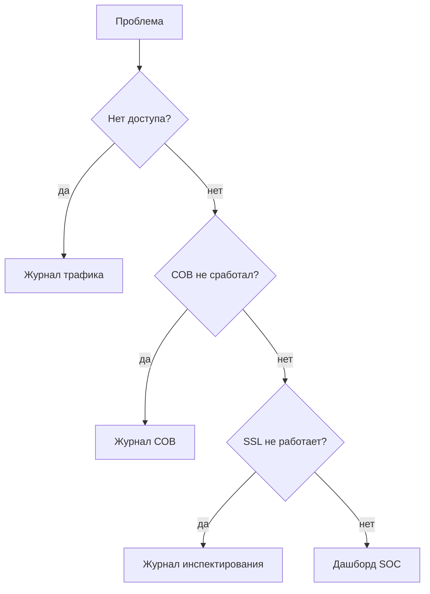

# UserGate_Журналы

> [!abstract] Кратко
> UserGate ведёт журналы: трафика, событий, веб-доступа, DNS, СОВ, инспектирования. Журналы — основа для обнаружения инцидентов, расследования и аудита. Смотреть: `Журналы и отчёты → Журналы`. Мониторинг: `Диагностика и мониторинг`.

## 1. Зачем нужно
Понять, где смотреть, что произошло. Без журналов NGFW — «чёрный ящик»: правила есть, а что реально прошло — неизвестно.

## 2. Простыми словами
Журналы — это камеры наблюдения. Ты не смотришь в них постоянно, но когда что-то случилось — идёшь и перематываешь.

## 3. Технические детали

**Типы журналов:**

| Журнал | Что показывает |
|---|---|
| **Журнал трафика** | Кто, куда, по какому правилу, приложение, порт, зоны |
| **Журнал событий** | Системные события NGFW |
| **Журнал веб-доступа** | Какие сайты открывали пользователи |
| **Журнал DNS** | DNS-запросы |
| **Журнал СОВ** | Срабатывания сигнатур IDS/IPS |
| **Журнал инспектирования** | События SSL/TLS-инспекции |
| **Журнал Windows AD** | События аутентификации |
| **Syslog коннектор** | Отправка логов во внешнюю систему |

**Где смотреть:**
- Журналы: `Журналы и отчёты → Журналы → <тип>`.
- Мониторинг: `Диагностика и мониторинг → Мониторинг → Трафик / Маршруты / OSPF / VPN`.
- Дашборд: `Дашборд → SOC` — топ пользователей, приложений, доменов.

**Ключевое для диагностики:**
- Если после правила firewall нет доступа — смотреть **журнал трафика**: сработало ли правило, какой профиль, какое действие.
- Если СОВ не сработал — смотреть **журнал СОВ**: включён ли профиль в правило.
- Если SSL-инспекция не работает — смотреть **журнал инспектирования**.

Схема: куда смотреть при проблеме.



- **Читать схему:** каждый тип проблемы ведёт к своему журналу. Начинать с журнала трафика.

## 4. Пример / команда
Просмотр журнала трафика:

```text
Журналы и отчёты → Журналы → Журнал трафика
Фильтр: Приложение = Yandex
```

Проверка маршрутов:

```text
Диагностика и мониторинг → Мониторинг → Маршруты
```

## 5. Для ИБ

| Риск | Защита |
|------|--------|
| Нет журналирования правила → инцидент не виден | Включить `Журналировать начало сессии` |
| Журналы только локально → потеря при сбое | Syslog-коннектор во внешнюю систему |
| Слишком много логов → перегрузка | Лимиты журналирования, фильтры |
| Нет мониторинга СОВ | Дашборд SOC + журнал СОВ |

## 6. Вопросы для самопроверки
1. Какие типы журналов есть в UserGate?
2. Где смотреть журнал трафика?
3. Куда идти, если СОВ не сработал?
4. Зачем нужен Syslog-коннектор?
5. Что показывает дашборд SOC?

## Связи
- [[UserGate_NGFW]]
- [[UserGate_Правила_Firewall]]
- [[UserGate_СОВ]]
- [[UserGate_SSL_Инспекция]]
- [[UserGate_Web_Фильтрация]]