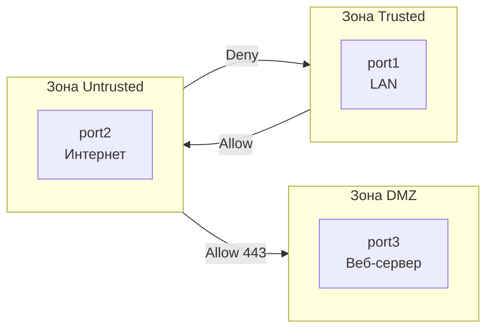

# UserGate_Зоны

> [!abstract] Кратко
> Зона в UserGate NGFW — это логическое объединение сетевых интерфейсов по функциональному назначению. Политики безопасности применяются **к зонам**, а не к отдельным портам. Это упрощает управление и делает правила независимыми от физики. По умолчанию созданы 8 зон (Management, Trusted, Untrusted, DMZ и др.).

## 1. Зачем нужно
Понять, почему в UserGate правила пишут «из Trusted в Untrusted», а не «с port1 на port2». Зоны — это язык, на котором NGFW разговаривает с администратором.

## 2. Простыми словами
Зона — это «район города». У тебя есть район «Доверенный» (офис), «Недоверенный» (улица) и «ДМЗ» (приёмная). Правила говорят: «из офиса на улицу можно, с улицы в офис — нельзя». Неважно, какая именно дорога (порт) ведёт в район — важно, в каком ты районе.

## 3. Технические детали

**Что такое зона:**
Зона — логическое объединение интерфейсов. Политики NGFW используют зоны, а не интерфейсы напрямую. Это даёт гибкость и упрощает управление кластером (зоны одинаковы на всех узлах).

| Параметр | Зачем |
|---|---|
| **Защита от DoS** | Пороги для TCP (SYN-flood), UDP, ICMP. Рекомендуемые: уведомление ~3000 pps, отбрасывание ~6000 pps. |
| **Контроль доступа (сервисы)** | Какие сервисы NGFW доступны из этой зоны (Ping, SNMP, Admin Console, DNS и др.). Для Untrusted — отключить всё лишнее. |
| **Защита от IP-спуфинга** | Указать допустимые диапазоны IP-источников для зоны. |

**Ключевое правило:**
Правила firewall строятся **от зоны к зоне**. Если интерфейс не привязан к зоне — он не участвует в политиках.

Схема: зоны и интерфейсы.



- **Читать схему:** интерфейсы сгруппированы в зоны. Правила работают между зонами, а не между портами.

## 4. Пример / команда
Создание зоны в веб-консоли:

```text
Настройки → Сеть → Зоны → Добавить
Имя: VLAN_10_Buh
DoS: включить защиту (опционально)
Сервисы: отключить всё лишнее
```

Привязка интерфейса к зоне:

```text
Сеть → Интерфейсы → выбрать VLAN-интерфейс → Зона: VLAN_10_Buh
```

### Зоны по умолчанию в UserGate NGFW

| Зона | Назначение | Интерфейс по умолчанию |
|---|---|---|
| **Management** | Сеть управления NGFW, из которой разрешён админ-доступ | `port0` |
| **Trusted** | Доверенные сети, например внутренняя LAN | `port1` |
| **Untrusted** | Недоверенные сети, например Интернет | `port2` |
| **DMZ** | Публичные сервисы (веб-сервер, почта) | — |
| **Cluster** | Служебные интерфейсы кластера | — |
| **VPN for remote access** | Удалённые пользователи (мобильные клиенты) | — |
| **VPN for Site-to-Site** | VPN между сетями (офис-офис) | — |
| **Tunnel inspection zone** | Инспектирование инкапсулированных пакетов | — |

### Что важно знать

1. **Не только эти зоны.** Список — стартовый набор. Настройки этих зон можно менять и создавать новые (максимум до 255) под задачи: отдельная зона для VLAN гостей, бухгалтерии и т.д.
2. **Порты по умолчанию.** Интерфейсы `port0`, `port1` и `port2` по умолчанию закреплены за Management, Trusted и Untrusted. Учитывать при первичном подключении.

## 5. Для ИБ

| Риск | Защита |
|------|--------|
| Открытые сервисы в Untrusted → атака на NGFW | Отключить все неиспользуемые сервисы в зоне |
| DoS-атака на внешний IP | Включить защиту от флуда в зоне Untrusted |
| IP-спуфинг из Untrusted | Настроить допустимые диапазоны источников |
| Правила «порт-в-порт» → сложно управлять | Использовать зоны: правила становятся логичными и переносимыми |
| Забытая зона для нового VLAN | Каждый VLAN-интерфейс должен быть привязан к зоне, иначе он вне политик |

## 6. Вопросы для самопроверки
1. Что такое зона в UserGate?
2. Почему политики применяются к зонам, а не к интерфейсам?
3. Какие зоны созданы по умолчанию?
4. Что настраивается в зоне besides привязки интерфейсов?
5. Что будет, если интерфейс не привязан к зоне?
6. Какие сервисы рекомендуется отключить в Untrusted?

## Связи
- [[UserGate_NGFW]]
- [[UserGate_Правила_Firewall]]
- [[Сегментация_VLAN_и_Маски]]
- [[Firewall]]
- [[DMZ]]