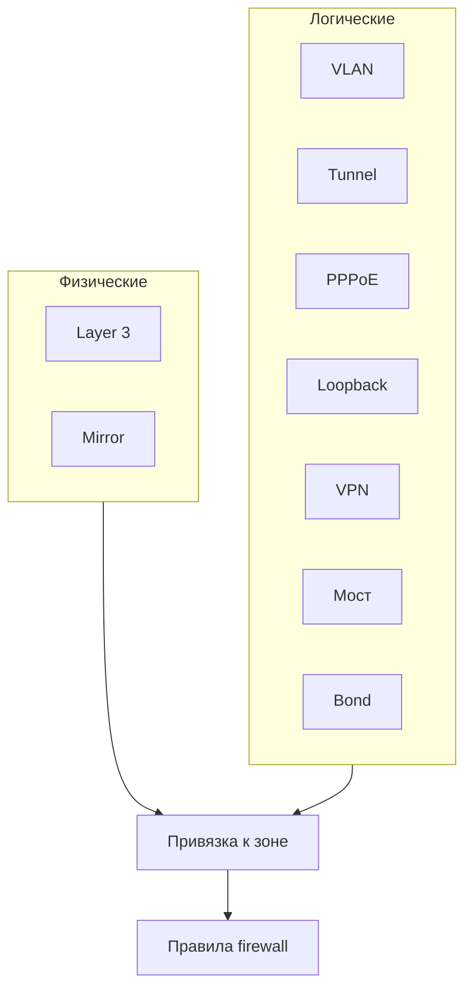

# UserGate_Интерфейсы

> [!abstract] Кратко
> Интерфейсы в UserGate делятся на физические (Mirror, Layer 3) и логические (VLAN, Tunnel, PPPoE, Loopback, VPN, Мост, Bond). Каждый интерфейс привязывается к зоне. Без привязки к зоне он не участвует в политиках.

## 1. Зачем нужно
Понять, как в NGFW появляются «порты» и «VLAN». Без этого не настроить ни зоны, ни правила.

## 2. Простыми словами
Интерфейс — это дверь в NGFW. Физическая дверь — порт. Логическая — VLAN, туннель, мост. Каждая дверь ведёт в какой-то район (зону).

## 3. Технические детали

**Типы интерфейсов:**

| Физические | Логические |
|---|---|
| **Layer 3** — IP-интерфейс | **VLAN** — сабинтерфейс с тегом |
| **Mirror** — зеркало трафика | **Tunnel** — туннель |
| — | **PPPoE** — подключение к провайдеру |
| — | **Loopback** — виртуальный интерфейс |
| — | **VPN** — VPN-интерфейс |
| — | **Мост (Bridge)** — L2-объединение |
| — | **Bond** — агрегация каналов |

**Свойства интерфейса:**

| Параметр | Что делает |
|---|---|
| **Включено** | Активен ли интерфейс |
| **Название** | Имя (например, `port0`) |
| **Теги** | Метки для группировки (`Internal`) |
| **Тип интерфейса** | Layer 3, Mirror, VLAN и т.д. |
| **Зона** | К какой зоне привязан |
| **Профиль netflow** | Экспорт трафика |
| **Профиль LLDP** | Обнаружение соседей |

**Ключевое правило:** интерфейс без зоны — вне политик. Правила firewall работают **между зонами**, а не между портами.

Схема: физические и логические интерфейсы.



- **Читать схему:** любой интерфейс (физический или логический) привязывается к зоне, и только потом участвует в правилах.

## 4. Пример / команда
Где смотреть:

```text
Настройки → Сеть → Интерфейсы
```

Пример VLAN-интерфейса:
- Название: `vlan10`
- Тип: `Layer 3` (или VLAN)
- Зона: `Trusted`
- IP: `192.168.10.1/24`

## 5. Для ИБ

| Риск | Защита |
|------|--------|
| Интерфейс без зоны → вне политик | Каждый интерфейс привязать к зоне |
| Открытый Mirror → утечка трафика | Ограничить доступ к Mirror-порту |
| Bond без резерва → отказ | LACP, резервные линки |
| PPPoE без шифрования | Использовать VPN поверх PPPoE |

## 6. Вопросы для самопроверки
1. Чем физический интерфейс отличается от логического?
2. Какие типы логических интерфейсов есть?
3. Зачем интерфейсу зона?
4. Что будет, если интерфейс не привязан к зоне?
5. Что такое Bond?

## Связи
- [[UserGate_NGFW]]
- [[UserGate_Зоны]]
- [[VLAN]]
- [[Сегментация_VLAN_и_Маски]]
- [[UserGate_Правила_Firewall]]