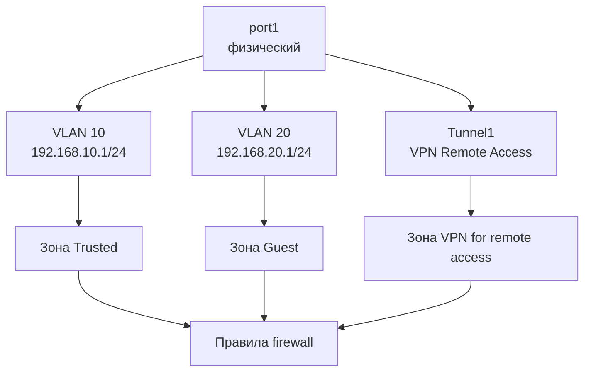

# UserGate_Логические_Интерфейсы

> [!abstract] Кратко
> Логические интерфейсы — виртуальные «двери» в NGFW внутри одного физического порта или поверх сети. Типы: VLAN, Tunnel, PPPoE, Loopback, VPN, Мост (Bridge), Bond. Каждый привязывается к зоне. Физических портов мало — логические дают много сетей на одном кабеле.

## 1. Зачем нужно
Понять, как из одного физического порта получить несколько сетей: LAN, гости, DMZ, VPN, управление. Без логических интерфейсов NGFW ограничен числом портов.

## 2. Простыми словами
Физический порт — одна дверь. Логические интерфейсы — несколько дверей внутри неё: квартира 10, квартира 20, коридор VPN. Один кабель — много «комнат».

## 3. Технические детали

**Типы логических интерфейсов:**

| Тип | Что это | Зачем нужен | Пример |
|---|---|---|---|
| **VLAN** | Сабинтерфейс с тегом 802.1Q на физическом порту | Разделить один кабель на несколько изолированных сетей | `port1.10` — VLAN 10 (бухгалтерия), `port1.20` — VLAN 20 (гости) |
| **Tunnel** | Туннель (GRE, IPsec и др.) | Связать две площадки через интернет | Офис 1 ↔ Офис 2 через GRE-туннель |
| **PPPoE** | Подключение к провайдеру по PPPoE | Выход в интернет там, где провайдер требует PPPoE | Логин/пароль провайдера |
| **Loopback** | Виртуальный интерфейс без физики | Стабильный IP для управления, BGP-пиринга, тестов | `lo0` с IP `10.255.255.1` — всегда up |
| **VPN** | Интерфейс для VPN-клиентов | Точка входа для удалённых пользователей или site-to-site | `tunnel1` для Remote Access, `tunnel2/3` для Site-to-Site |
| **Мост (Bridge)** | L2-объединение двух интерфейсов | Прозрачно пропускать трафик без маршрутизации | NGFW «поперёк» сети для фильтрации без смены IP |
| **Bond** | Агрегация нескольких физических портов | Резерв и суммарная пропускная способность | Два порта в LACP → один логический `bond0` |

**Ключевые правила:**
- Любой интерфейс (физический или логический) привязывается к **зоне**. Без зоны — вне политик.
- VLAN на коммутаторе должен быть **trunk** с разрешёнными VLAN.
- Loopback всегда up, если жив хотя бы один путь — используется для управления и BGP.
- Bridge не требует IP на интерфейсах, но правила firewall и СОВ работают.
- Bond: режимы active-backup (резерв) и LACP (агрегация).

Схема: физический порт → логические интерфейсы → зоны.



- **Читать схему:** один порт даёт несколько логических интерфейсов. Каждый — в своей зоне. Правила работают между зонами.

**Где смотреть в UserGate:**
`Настройки → Сеть → Интерфейсы`. Тип интерфейса выбирается при создании: `Layer 3`, `VLAN`, `Tunnel`, `PPPoE`, `Loopback`, `VPN`, `Мост`, `Bond`.

## 4. Пример / команда
Создание VLAN-интерфейса:

```text
Настройки → Сеть → Интерфейсы → Добавить → VLAN
Название: vlan10
Тип: Layer 3
Зона: Trusted
IP: 192.168.10.1/24
Тег VLAN: 10
Интерфейс: port1
```

Проверка:

```text
Настройки → Сеть → Интерфейсы
# у каждого VLAN-интерфейса должен быть IP, маска и зона
```

## 5. Для ИБ

| Риск | Защита |
|------|--------|
| Интерфейс без зоны → вне политик | Каждый интерфейс привязать к зоне |
| VLAN без trunk на коммутаторе → не работает | Настроить trunk и allowed VLAN на порту коммутатора |
| Loopback с слабым паролем → доступ к управлению | Ограничить доступ к management-зоне, MFA |
| Bridge в обход firewall → утечка | Контроль правил на Bridge-интерфейсе |
| Bond без резерва → отказ | LACP, active-backup, мониторинг линков |
| PPPoE без шифрования | VPN поверх PPPoE |

## 6. Вопросы для самопроверки
1. Чем логический интерфейс отличается от физического?
2. Какие типы логических интерфейсов есть?
3. Зачем интерфейсу зона?
4. Что будет, если интерфейс не привязан к зоне?
5. Зачем нужен Loopback?
6. Чем Bridge отличается от Bond?

## Связи
- [[UserGate_Интерфейсы]]
- [[UserGate_Зоны]]
- [[VLAN]]
- [[Сегментация_VLAN_и_Маски]]
- [[UserGate_Правила_Firewall]]
- [[UserGate_NGFW]]