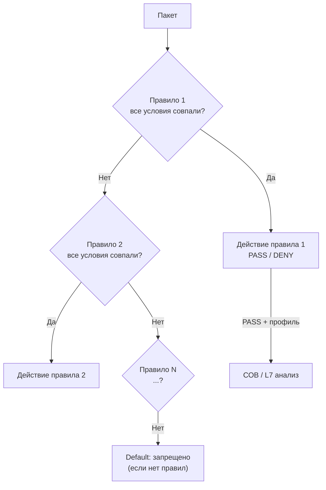

# UserGate_Правила_Firewall

> [!abstract] Кратко
> Правила МЭ в UserGate разрешают или запрещают транзитный трафик по зонам, IP, пользователям и сервисам. Применяются сверху вниз, срабатывает **первое совпавшее**. Если правил нет — весь транзитный трафик запрещён. В разрешающих правилах можно включить профили СОВ и L7.

## 1. Зачем нужно
Понять, как NGFW решает судьбу пакета. Без этого сегментация и VLAN остаются «трубами» без политики.

## 2. Простыми словами
Правила — это список охранников на проходной. Ты идёшь по списку сверху вниз: первый, кто скажет «проходи» или «стоп», решает твою судьбу. Если охранников нет — дверь заперта.

## 3. Технические детали

**Где создавать:** `Настройки → Политики сети → Межсетевой экран` → `Добавить`.

**Логика применения:**
- Правила применяются **сверху вниз**. Срабатывает **только первое** правило, где совпали **все** условия.
- Более специфичные правила — **выше**. Общие (например, `Block all`) — **ниже**.
- Если не создано ни одного правила → **любой транзитный трафик запрещён**.

**Ключевые параметры правила:**

| Параметр | Что делает |
|---|---|
| **Действие** | `Разрешить` (PASS) или `Запретить` (DENY) |
| **Источник** | Зона, IP-список, GeoIP, URL-список, MAC |
| **Назначение** | Зона, IP-список, GeoIP, URL-список |
| **Сервис** | Тип трафика (HTTP, HTTPS, TCP/порт и т.д.) |
| **Пользователи** | Any / Unknown / Known / конкретные |
| **Профиль СОВ** | IDPS-сигнатуры. Только для разрешающих правил |
| **Профиль приложений (L7)** | Контроль приложений. Только для разрешающих правил |
| **Журналирование** | `Начало сессии` (рекомендуется), `Каждый пакет`, `Нет` |
| **Отбросить и** | Для DENY: ICMP host unreachable, TCP reset (только для TCP-сервисов) |

**Что происходит после совпадения:**
- Если правило **разрешающее** и в нём указан профиль СОВ/L7 → трафик уходит на анализ сигнатурами. При срабатывании сигнатуры применяется действие профиля.
- Если правило **запрещающее** → трафик блокируется (опционально с ICMP/TCP reset).

Схема: порядок обработки правил.

- **Читать схему:** пакет идёт по списку сверху вниз. Первое совпадение останавливает проверку. Default — запрет.

## 4. Пример / команда
Типовой набор правил для сегментации (пример из практики):

| # | Название | Действие | Источник | Назначение | Сервис |
|---|---|---|---|---|---|
| 1 | `Web-server port forwarding` | Разрешить | Untrusted | DMZ | TCP_8080 |
| 2 | `Mgmt to DMZ` | Разрешить | Management | DMZ | Any |
| 3 | `Ping from dmz to internet` | Разрешить | DMZ | Untrusted | ICMP |
| 4 | `Block all` | Запретить | Any | Any | Any |

**Важно:** правило `Block all` — **последнее**. Всё, что выше, имеет приоритет.

## 5. Для ИБ

| Риск | Защита |
|------|--------|
| Правило `Allow any-any` вверху списка → всё открыто | Специфичные правила выше, `Block all` внизу |
| Забытый DENY между сегментами → сегментация не работает | Явные запреты между VLAN/зонами **выше** общих разрешений |
| Нет журналирования → инцидент не виден | Включить `Журналировать начало сессии` на ключевых правилах |
| DENY без ICMP/TCP reset → клиент «висит» | Настроить `Отбросить и` для явного отказа |
| СОВ/L7 не включены в разрешающее правило → трафик не анализируется | Добавить профили в разрешающие правила для критичных сервисов |

## 6. Вопросы для самопроверки
1. В каком порядке применяются правила МЭ?
2. Что произойдёт, если не создать ни одного правила?
3. Почему специфичные правила должны быть выше общих?
4. Можно ли включить профиль СОВ в запрещающее правило?
5. Что делает параметр `Отбросить и`?
6. Где включается журналирование правила?

## Связи
- [[UserGate_NGFW]]
- [[Firewall]]
- [[VLAN]]
- [[DMZ]]
- [[Сетевые_Порты]]