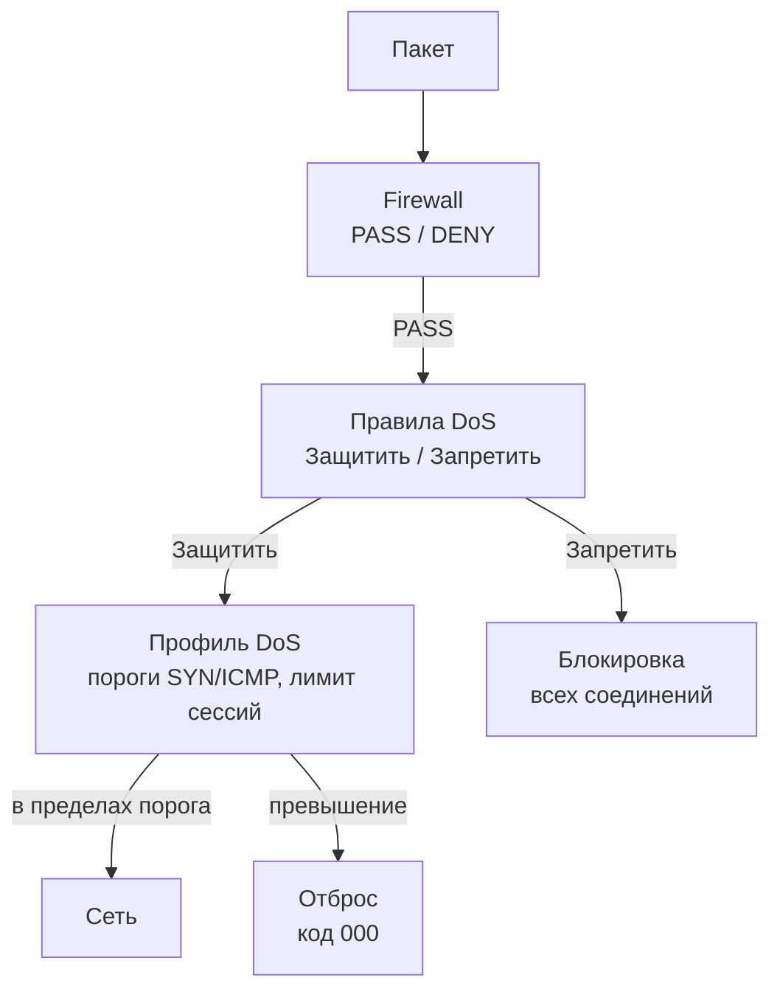

# UserGate_Практика_DoS_Защита

> [!abstract] Кратко
> Практическое задание: настроить защиту от DoS. Создаётся профиль DoS (пороги SYN/UDP/ICMP, ограничение сессий) и правило DoS (действие «Защитить» или «Запретить»). DoS-правила выполняются **после** firewall. Проверка: параллельные запросы `curl` показывают коды `200` (прошло) и `000` (отброшено). При действии «Запретить» сайт перестаёт открываться полностью.

## 1. Зачем нужно
Понять, как NGFW защищает ресурсы от перегрузки «мусорными» запросами. Firewall и фильтрация контента не спасают от флуда — нужен отдельный механизм с порогами и лимитами.

## 2. Простыми словами
DoS — это толпа, которая ломится в одну дверь и не даёт пройти нормальным людям. Защита — это ограничитель: «не больше N человек в секунду, не больше M одновременно». Если правило стоит на «Защитить» — лишние отсекаются, но свои проходят. Если на «Запретить» — дверь закрыта для всех.

## 3. Технические детали

### 3.1 Создание профиля DoS

`Настройки → Политики безопасности → Профили DoS → Добавить`

**Общие:**
- Название: `test_dos_profile`

**Защита DoS (пакетов/сек):**

| Протокол | Порог уведомления | Порог отбрасывания |
|---|---|---|
| **SYN** | 1 | 2 |
| **UDP** | выключен | — |
| **ICMP** | 1 | 2 |

*Значения 1 и 2 — экстремально низкие, только для теста. В реальности — сотни или тысячи.*

**Защита ресурсов:**
- Включено: да
- Ограничить число сессий: 1

### 3.2 Создание правила DoS

`Настройки → Политики безопасности → Правила защиты DoS → Добавить`

**Общие:**
- Название: `Test_DOS_rule`
- Действие: **Защитить** (применить профиль) или **Запретить** (блокировать без подсчёта)
- Профиль DoS: `test_dos_profile`
- Журналирование: `Журналировать начало сессии`

**Источник:**
- Зона: Management
- Адрес: `Local_net` (100.64.110.0/24)

**Назначение:**
- Зона: Untrusted
- Адрес: `ddos_url` (список доменов: `example.com`, `reg.ru`)

### 3.3 Два действия правила

| Действие | Что происходит | Результат для пользователя |
|---|---|---|
| **Защитить** | Применяется профиль DoS: лимиты и пороги. Лишние пакеты отбрасываются, но часть проходит. | Сайт открывается, но медленно. Часть запросов — `000`. |
| **Запретить** | Блокируется любое соединение без подсчёта. | Сайт не открывается вообще (таймаут). |

### 3.4 Порядок обработки

DoS-правила выполняются **после** межсетевого экрана, отдельным модулем. Если firewall запретил — до DoS дело не дойдёт. Если firewall разрешил — DoS применяет свои лимиты.

Схема: место DoS в обработке трафика.



- **Читать схему:** firewall пропускает, затем DoS-правило решает: применить профиль (лимиты) или заблокировать всё.

### 3.5 Проверка через curl

**Команда для параллельных запросов:**

```bash
curl.exe -s -o NUL -w "%{http_code}\n" -Z --parallel-max 5 --parallel-immediate "http://example.com/" "http://example.com/" "http://example.com/" "http://example.com/" "http://example.com/" | findstr /r "^[0-9][0-9][0-9]$"
```

**Разбор флагов:**

| Флаг | Что делает |
|---|---|
| `-s` | Silent — без прогресс-бара |
| `-o NUL` | Вывод тела ответа в никуда |
| `-w "%{http_code}\n"` | Напечатать HTTP-код ответа и перенос строки |
| `-Z` | Параллельная обработка всех URL |
| `--parallel-max 5` | Максимум 5 одновременных соединений |
| `--parallel-immediate` | Стартовать все передачи сразу |

**Что увидишь:**
- `200` — соединение прошло, сервер ответил.
- `000` — соединение не установилось (отброшено DoS-защитой).

**Пример результата при действии «Защитить»:**

```text
200
200
200
000
000
```

Первые 2–3 прошли, остальные отброшены (порог 2 пакета/сек + лимит 1 сессия).

**При действии «Запретить»:** все `000`, сайт не открывается.

## 4. Пример / команда

Проверка в браузере:
- `https://reg.ru` — при «Защитить»: открывается, но медленно (каждая картинка не чаще 2 раз в секунду).
- При «Запретить»: таймаут, сайт не открывается.

Проверка в журнале:

```text
Журналы и отчёты → Журналы → Журнал трафика
Фильтр: Правило = Test_DOS_rule
```

Видно предупреждения и блокировки.

## 5. Для ИБ

| Риск | Защита |
|------|--------|
| SYN-flood на внешний IP | Пороги в профиле DoS (SYN) |
| Флуд на конкретный сервер | Правило DoS с лимитом по IP/домену назначения |
| Бот из одной подсети | Лимит по IP источника в профиле |
| DoS без журналирования → инцидент не виден | Включить `Журналировать начало сессии` |
| Слишком жёсткие лимиты → блокировка легитимных | Настроить пороги по реальному трафику |
| Общее правило блокирует всё → нужны исключения | DoS-правила с действием «Защитить» для исключений, «Запретить» — для остального |

## 6. Вопросы для самопроверки
1. Чем профиль DoS отличается от правила DoS?
2. Что делает действие «Защитить»?
3. Что делает действие «Запретить»?
4. В каком порядке выполняются DoS-правила относительно firewall?
5. Что означает код `000` в выводе curl?
6. Зачем нужен параметр `--parallel-max 5`?
7. Почему при действии «Защитить» сайт всё равно открывается, но медленно?

## 7. Почему DoS важен, если есть firewall и фильтрация контента

Представь: десятки серверов, у каждого свои правила. Нужно заблокировать все IP из страны X, но один IP ошибочно попал в список — его надо разблокировать для портов 443 и 25.

**Проблема:** общее правило блокирует для всех. Ручные исключения для каждого сервера — не масштабируются.

**Решение:** DoS-правила с действием «Защитить» для исключений (пропустить, но с лимитами), «Запретить» — для остального. DoS выполняется после firewall, поэтому не открывает доступ в обход firewall — доступ по-прежнему регулируется межсетевым экраном.

### 8. Как я это починил
- Правило создаётся **выключенным**. Галочка «Включено» в `Общие` — по умолчанию пустая.
- Поставил галочку → правило заработало, curl начал давать `000`.
- **Маркер после:** после создания любого правила (firewall, DoS, фильтрация, SSL) — первым делом проверить «Включено».

## Связи
- [[UserGate_DoS_Защита]]
- [[UserGate_Правила_Firewall]]
- [[UserGate_Практика_Доступ_в_Интернет]]
- [[UserGate_Практика_Фильтрация_Контента]]
- [[UserGate_Журналы]]