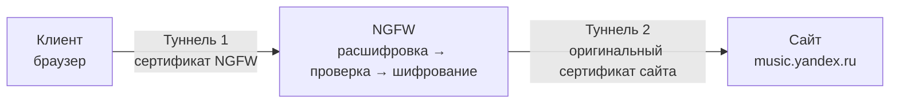

# UserGate_Практика_SSL_Инспекция

> [!abstract] Кратко
> Практическое задание: настроить SSL-инспекцию. NGFW расшифровывает HTTPS, видит полный URL и приложение (Yandex Music), применяет фильтрацию контента и блокирует. Браузер видит сертификат NGFW (`KBZ JSC` / `ngfwn-root-ca`), а не оригинальный. В журнале веб-доступа появляется полный адрес страницы и корректное имя приложения.

## 1. Зачем нужно
Без SSL-инспекции NGFW видит только `https://music.yandex.ru` как зашифрованный поток. Он не знает, что это Yandex Music, и не может применить правило блокировки по категории «Развлечения». Инспекция делает трафик «прозрачным» для проверок.

## 2. Простыми словами
TLS — это запечатанный конверт. NGFW не может прочитать, что внутри. SSL-инспекция — это вскрытие конверта, проверка содержимого и запечатывание обратно. Клиент думает, что говорит с сайтом, а на деле — с NGFW.

## 3. Технические детали

### 3.1 Создание правила

`Настройки → Политики безопасности → Инспектирование SSL → Добавить`

| Параметр | Значение |
|---|---|
| **Название** | `SSL_Inspect` |
| **Действие** | Инспектировать (Inspect) |
| **Профиль SSL** | `Default SSL profile` |
| **Профиль пересылки SSL** | `Default SSL forwarding profile` |
| **Записывать в журнал правил** | Да |
| **Зона источника** | Management |
| **Адрес источника** | `Local_net` (100.64.110.0/24) |
| **Зона назначения** | Untrusted |

### 3.2 Что происходит при инспекции

1. Клиент запрашивает `https://music.yandex.ru`.
2. NGFW перехватывает `Client Hello`.
3. NGFW устанавливает соединение с реальным сайтом, проверяет его сертификат.
4. NGFW генерирует **свой** сертификат с данными сайта, подписывает своим CA (`ngfwn-root-ca`, `KBZ JSC`).
5. Отдаёт этот сертификат клиенту.
6. Клиент шифрует трафик ключом NGFW.
7. NGFW расшифровывает, проверяет (DPI, IPS, антивирус, URL-фильтрация).
8. Если чисто — перешифровывает оригинальным ключом сайта и отправляет на сервер.

Схема: два туннеля вместо одного.



- **Читать схему:** клиент видит NGFW как сервер, сайт видит NGFW как клиента. Два независимых TLS-туннеля.

### 3.3 Что видно в браузере

- При открытии заблокированного сайта (`market.yandex.ru`) браузер перекидывает на страницу блокировки `block.ngfwn.kbz.s7`.
- В сертификате сайта виден издатель: `KBZ JSC`, `ngfwn-root-ca`, `Moscow`, `RU`.
- Это самоподписанный CA NGFW. Он добавлен в доверенные на клиентских машинах (в рамках стенда).

### 3.4 Что видно в журнале

`Журналы и отчёты → Журналы → Журнал веб-доступа`

- Появляется **второе** сообщение от правила `SSL_Inspect`.
- Виден **полный URL** (`https://music.yandex.ru/...`), а не только домен.
- Корректно определяется приложение: **Yandex Music**.
- Категория: «Развлечения» → срабатывает правило `User_web_denay` → блок (`PR_CONNECT_RESET_ERROR`).

## 4. Пример / команда

Проверка сертификата в браузере:
- Открыть сайт → замок → сертификат → издатель должен быть `KBZ JSC` / `ngfwn-root-ca`.

Проверка журнала:

```text
Журналы и отчёты → Журналы → Журнал веб-доступа
Фильтр: Правило = SSL_Inspect
```

## 5. Для ИБ

| Риск | Защита |
|------|--------|
| SSL-инспекция без доверия к CA → ошибки в браузере | Добавить сертификат NGFW CA в доверенные |
| Инспекция всего трафика → нагрузка и приватность | Инспектировать только нужные категории/пользователей |
| Подмена сертификата → MITM-атака | Защита CA-ключа, контроль доступа к NGFW |
| Инспекция банковских сайтов → юридические риски | Исключения для критичных категорий |
| Нет журналирования → непонятно, что расшифровано | Включить `Записывать в журнал правил` |

## 6. Вопросы для самопроверки
1. Зачем нужна SSL-инспекция?
2. Почему браузер видит сертификат `KBZ JSC`?
3. Что появляется в журнале веб-доступа после инспекции?
4. Какие два туннеля создаёт NGFW?
5. Почему без инспекции нельзя заблокировать Yandex Music по категории?
6. Где создаётся правило SSL-инспекции?

## 7. Самостоятельное задание (из практики 5)

Открыть доступ к `pinterest.com`. Подсказка: нужно создать исключение (правило «Разрешить») и в профиле приложений, и в фильтрации контента. Разрешающее правило должно быть выше запрещающих.

## Связи
- [[UserGate_SSL_Инспекция]]
- [[UserGate_Практика_Фильтрация_Контента]]
- [[UserGate_Правила_Firewall]]
- [[UserGate_Профили_Приложений]]
- [[UserGate_Журналы]]