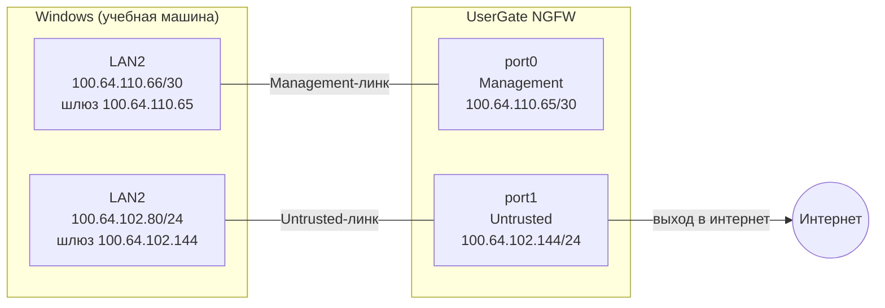
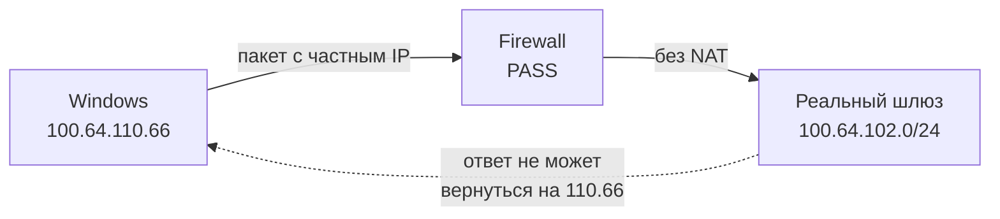

# UserGate_Практика_Доступ_в_Интернет

> [!abstract] Кратко
> Практическое задание: настроить доступ во внешнюю сеть. Создаётся разрешающее правило firewall (Management → Untrusted), но доступ не появится без SNAT. Firewall разрешает трафик, NAT подменяет адрес. Нужны оба.

## 1. Зачем нужно
Поймать главную ошибку новичка: «правило создал — интернет не работает». Причина — отсутствие NAT. Это не баг, а логика NGFW.

## 2. Простыми словами
Firewall — охранник, который говорит «проходи». NAT — секретарь, который переписывает обратный адрес на конверте. Охранник пропустил, но без секретаря ответ не вернётся.

## 3. Технические детали

### 3.1 Топология стенда (конкретные IP)

**Windows (учебная машина):**
- Интерфейс `LAN2`: `100.64.102.80/24`, шлюз `100.64.102.144` (NGFW, Untrusted)
- Интерфейс `LAN2`: `100.64.110.66/30`, шлюз `100.64.110.65` (NGFW, Management)

**NGFW UserGate:**
- `port0` (Management): `100.64.110.65/30`
- `port1` (Untrusted): `100.64.102.144/24`

**Ключевое:** Windows и NGFW соединены двумя линками. Management-линк (`100.64.110.64/30`) — для веб-консоли и управления. Untrusted-линк (`100.64.102.0/24`) — «выход в мир». Реальный шлюз в интернет сидит на `100.64.102.0/24`.

Схема стенда:



- **Читать схему:** Windows ходит в веб-консоль NGFW по Management-линку (`110.64/30`). В интернет — через Untrusted-линк (`102.0/24`), где NGFW (`102.144`) является шлюзом.

### 3.1.1 Схема стенда (упрощённо)

![[deepseek_mermaid_20261112_2db67c.png]]

Windows и NGFW соединены двумя линками. У Windows два сетевых интерфейса (`LAN2`), у NGFW — два порта (`port0`, `port1`).

**Дверь №1: Management (`port0`).**
- Windows: `100.64.110.66/30`, шлюз `100.64.110.65`.
- NGFW: `100.64.110.65/30`.
- Назначение: только управление NGFW (веб-консоль `https://100.64.110.65:8001`). В интернет через эту дверь не ходят.
- `/30` — крошечная сеть: 4 адреса, из них 2 свободных (NGFW и Windows), 1 адрес сети, 1 broadcast.

**Дверь №2: Untrusted (`port1`).**
- Windows: `100.64.102.80/24`, шлюз `100.64.102.144`.
- NGFW: `100.64.102.144/24`.
- Назначение: выход в интернет. Реальный шлюз провайдера находится в этой же сети `100.64.102.0/24`.
- `/24` — большая сеть: до 254 устройств.

**Как Windows выбирает дверь.** У Windows есть таблица маршрутизации:
- Если получатель в сети `100.64.110.64/30` (например, `100.64.110.65` для веб-консоли) — пакет идёт через Management.
- Если получатель вне известных сетей (например, `8.8.8.8`) — пакет идёт на шлюз по умолчанию `100.64.102.144` (Untrusted).

**Почему без NAT не работает.** Пакет уходит с адресом `100.64.110.66`, но реальный шлюз в интернет (`100.64.102.0/24`) не знает, куда возвращать ответ на `110.66` — эта сеть существует только внутри стенда. SNAT подменяет `100.64.110.66` на `100.64.102.144`, ответ возвращается на NGFW, а тот — на Windows.

### 3.2 Исходное состояние

- Единственное правило — `Default block` (действие «Запретить»).
- Запрещён **любой** трафик.

### 3.3 Шаг 1. Создать правило firewall

`Настройки → Политики сети → Межсетевой экран → Добавить`

| Параметр | Значение |
|---|---|
| Название | `Internet_allowed` |
| Действие | Разрешить |
| Журналирование | Журналировать начало сессии |
| Зона источника | Management |
| Адрес источника | `Local_net` (100.64.110.0/24) |
| Зона назначения | Untrusted |
| Сервис | Любой |

### 3.4 Шаг 2. Проверить доступ

```bash
ping 8.8.8.8
```

Результат: **100% потерь**. Интернета нет.

### 3.5 Шаг 3. Посмотреть журнал трафика

`Журналы и отчёты → Журналы → Журнал трафика`

Видно: правило `Internet_allowed` **срабатывает** (зелёная галочка). Трафик разрешён, но не возвращается.

### 3.6 Шаг 4. Причина — нет NAT

Пакет уходит с частным IP `100.64.110.66`. Реальный шлюз в интернет (`100.64.102.0/24`) не знает, куда возвращать ответ на `110.66` — этот адрес не маршрутизируется в интернете. Нужен SNAT: подменить `100.64.110.66` на `100.64.102.144` (NGFW Untrusted).

### 3.7 Шаг 5. Добавить SNAT

`Настройки → Политики сети → NAT и маршрутизация → Добавить`

| Параметр | Значение |
|---|---|
| Тип | NAT |
| SNAT IP (внешний адрес) | `100.64.102.144` (IP port1) |
| Источник | Inside (`Local_net` 100.64.110.0/24) |
| Назначение | Outside |

Схема: почему без NAT не работает.



- **Читать схему:** firewall пропустил, но обратный адрес — `110.66`. Реальный шлюз не знает, куда отвечать. SNAT подменяет `110.66` на `102.144`, и ответ возвращается на NGFW, а тот — на Windows.

## 4. Пример / команда

Проверка после NAT:

```bash
ping 8.8.8.8
# должно быть: 4 пакета отправлено, 4 получено
```

Проверка правила в журнале:

```text
Журналы и отчёты → Журналы → Журнал трафика
Фильтр: Правило = Internet_allowed
```

В журнале видно: сначала срабатывает `Internet_allowed`, потом `SNAT_Local_net`.

## 5. Для ИБ

| Риск | Защита |
|------|--------|
| Правило `Allow any-any` → всё открыто | Ограничить источник (`Local_net`), зону (Management) |
| Нет NAT → доступ не работает, но правило «разрешает» | Всегда пара: firewall PASS + SNAT |
| Нет журналирования → непонятно, сработало ли правило | Включить `Журналировать начало сессии` |
| `Default block` удалён → всё открыто | Не удалять `Default block`, он последний |
| IP-адреса забыты | Записать `port0` и `port1` в блокнот до начала |

## 6. Вопросы для самопроверки
1. Почему после создания правила firewall интернет не появился?
2. Что делает `Default block`?
3. Зачем нужен SNAT?
4. Где смотреть, сработало ли правило?
5. Что нужно для полноценного доступа в интернет?
6. Какой IP подставляется в SNAT на этом стенде?
7. Почему ответ не вернётся без SNAT?

## Связи
- [[UserGate_NGFW]]
- [[UserGate_Правила_Firewall]]
- [[UserGate_NAT]]
- [[UserGate_Журналы]]
- [[Протокол_NAT]]