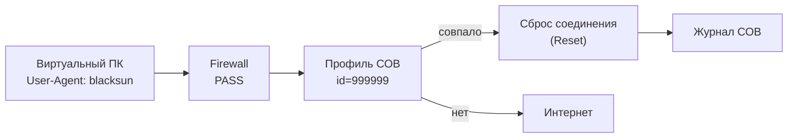

# UserGate_Практика_Проверка_СОВ

> [!abstract] Кратко
> Практическое задание: проверить работоспособность СОВ (IPS/IDS) с помощью тестовой сигнатуры `BlackSun Test` (id=999999). Создаётся профиль СОВ, добавляется фильтр по id, профиль применяется к правилу firewall. Клиент отправляет запрос с User-Agent "blacksun", NGFW срабатывает и сбрасывает соединение.

## 1. Зачем нужно
Убедиться, что NGFW реально инспектирует трафик и блокирует угрозы, а не просто стоит «для галочки». Тестовая сигнатура безопасна, но показывает, что механизм СОВ включён и работает.

## 2. Простыми словами
Это как проверить пожарную сигнализацию, поднеся к ней зажигалку (безопасную). Если она запищала — значит, датчик работает. Сигнатура `BlackSun` — это такая «безопасная зажигалка» для NGFW.

## 3. Технические детали

**Что такое сигнатура:**
Набор строк (паттернов) и семантических выражений, которые идентифицируют сетевую атаку. Сигнатуры добавляются в профили СОВ и применяются в правилах firewall.

**Тестовая сигнатура `BlackSun`:**
- ID: `999999`
- Назначение: безопасная проверка работоспособности СОВ.
- Срабатывание не означает реальную атаку.

**Шаги выполнения:**

1. **Проверить наличие сигнатуры:**
   `Настройки → Библиотеки → Сигнатуры СОВ`. Убедиться, что `BlackSun Test` (id=999999) есть в списке.

2. **Отправить тестовый запрос (без NGFW):**
   В PowerShell на виртуальном ПК:
   ```powershell
   Invoke-RestMethod -Uri "http://api.ipify.org" -UserAgent "blacksun"
   ```
   Результат: возвращается публичный IP-адрес (запрос проходит).

3. **Создать профиль СОВ:**
   `Настройки → Библиотеки → Профили СОВ → Добавить`
   - Название: `IPS_Profile`
   - Фильтры → Добавить → Расширенный: `id=999999`
   - Действие: **Сбросить (Reset)**

4. **Применить профиль к правилу firewall:**
   `Настройки → Политики сети → Межсетевой экран → Internet_allowed`
   - Профиль СОВ: `IPS_Profile`

5. **Повторить тестовый запрос:**
   В PowerShell:
   ```powershell
   Invoke-RestMethod -Uri "http://api.ipify.org" -UserAgent "blacksun"
   ```
   Результат: ошибка `WebException: The underlying connection was closed` или `curl: (56) Recv failure: Connection was reset`.

6. **Проверить журнал СОВ:**
   `Журналы и отчёты → Журналы → Журнал СОВ`. Найти событие `BlackSun Test` с действием «Сбросить».

Схема: путь тестового запроса.



- **Читать схему:** клиент отправляет запрос, firewall пропускает, профиль СОВ ловит сигнатуру и сбрасывает соединение.

## 4. Пример / команда

Две эквивалентные команды для теста:

```powershell
# PowerShell (встроенный метод)
Invoke-RestMethod -Uri "http://api.ipify.org" -UserAgent "blacksun"

# curl (если установлен)
curl.exe -A "blacksun" http://api.ipify.org
```

- `-UserAgent "blacksun"` — подменяет строку User-Agent в HTTP-запросе. Сигнатура СОВ ищет именно эту строку.
- `api.ipify.org` — сервис, который возвращает IP-адрес отправителя.

## 5. Для ИБ

| Риск | Защита |
|------|--------|
| СОВ не включён в правило → атака проходит | Профиль СОВ обязателен в разрешающих правилах |
| Сигнатуры не обновлены → новые атаки не детектируются | Регулярное обновление базы сигнатур |
| Действие «Отбросить» → таймаут, сложно диагностировать | Для явных тестов использовать «Сбросить» (RST) |
| СОВ без журналирования → инцидент не виден | Включить журнал СОВ, мониторинг |
| Шифрованный трафик не инспектируется без SSL | Включить SSL-инспекцию для нужных категорий |

## 6. Вопросы для самопроверки
1. Зачем нужна тестовая сигнатура `BlackSun`?
2. Что делает параметр `-UserAgent "blacksun"`?
3. Какой ID у сигнатуры `BlackSun`?
4. К какому правилу применяется профиль СОВ?
5. Чем «Сбросить» отличается от «Отбросить»?
6. Где смотреть срабатывание сигнатуры?

## Связи
- [[UserGate_СОВ]]
- [[UserGate_Правила_Firewall]]
- [[UserGate_Профили_Приложений]]
- [[UserGate_Практика_Доступ_в_Интернет]]
- [[NGFW_vs_Firewall]]