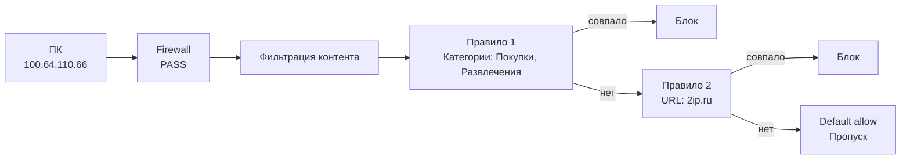

# UserGate_Практика_Фильтрация_Контента

> [!abstract] Кратко
> Практическое задание: запретить доступ к категориям сайтов («Покупки», «Развлечения») и к конкретному URL (2ip.ru). Создаются два отдельных правила фильтрации контента. Условия на разных вкладках правила объединяются логическим **И**, поэтому для комбинации «категория ИЛИ URL» нужны разные правила.

## 1. Зачем нужно
Понять, как NGFW блокирует нежелательные ресурсы по категориям и конкретным адресам. Это следующий шаг после базового firewall и NAT.

## 2. Простыми словами
Firewall решает, можно ли тебе вообще выйти в интернет. Фильтрация контента решает, **куда именно** можно зайти. Охранник пропустил на улицу, но в «магазины» и «развлекательные центры» вход закрыт.

## 3. Технические детали

### 3.1 Подготовка: включить журналирование

Открыть `Default allow` → `Общие` → поставить галочку **«Записывать в журнал правил»**. Это нужно, чтобы видеть, какие сайты проходят и блокируются.

### 3.2 Правило 1: Запрет по категориям

`Настройки → Политики безопасности → Фильтрация контента → Добавить`

| Параметр | Значение |
|---|---|
| **Название** | `User_web_denay` |
| **Действие** | Запретить |
| **Записывать в журнал** | Да |
| **Зона источника** | Management |
| **Адрес источника** | `Local_net` (100.64.110.0/24) |
| **Зона назначения** | Untrusted |
| **Категории URL** | Покупки, Развлечения |

**Проверка:** Открыть `https://market.yandex.ru/` — должен быть заблокирован (категория «Покупки»).

### 3.3 Правило 2: Запрет по конкретному URL

Зачем второе правило? Потому что условия на разных вкладках объединяются логическим **И**.

Если бы мы добавили URL `2ip.ru` в первое правило, логика была бы:
`Категория = (Покупки ИЛИ Развлечения) И URL = 2ip.ru`
То есть заблокировался бы только `2ip.ru`, если он относится к покупкам или развлечениям. Это не то, что нужно.

Чтобы заблокировать **все** покупки **И** отдельно `2ip.ru`, нужны два правила.

`Фильтрация контента → Добавить`

| Параметр | Значение |
|---|---|
| **Название** | `User_web_denay_url` |
| **Действие** | Запретить |
| **Зона источника** | Management |
| **Адрес источника** | `Local_net` |
| **Зона назначения** | Untrusted |
| **URL** | `URL_Denay` (список: `2ip.ru`) |

**Проверка:** Открыть `https://2ip.io/` — должен быть заблокирован.

### 3.4 Логика обработки

Правила обрабатываются **сверху вниз**, первое совпадение.
- Внизу — `Default allow` (разрешить всё, что не запрещено).
- Запрещающие правила — **выше** `Default allow`.

Схема: путь запроса через фильтрацию.

- **Читать схему:** запрос проходит через firewall, затем проверяется по правилам фильтрации. Если совпало с запретом — блок. Если нет — пропуск.

## 4. Пример / команда

Проверка в браузере после создания правил:
- `https://market.yandex.ru/` → заблокирован (категория «Покупки»).
- `https://2ip.io/` → заблокирован (URL-список).
- `https://google.com` → открывается (`Default allow`).

Журнал веб-доступа: `Журналы и отчёты → Журналы → Журнал веб-доступа`. Видно, какое правило сработало и какая категория у сайта.

## 5. Для ИБ

| Риск | Защита |
|------|--------|
| Запрет ниже `Default allow` → не работает | Запрещающие правила — выше |
| Одно правило для категорий и URL → логика «И» ломает замысел | Разделять правила: одно для категорий, одно для URL |
| Нет журналирования → непонятно, что заблокировано | Включить `Записывать в журнал правил` |
| Кеш браузера → правило не видно | `Ctrl+F5` или режим «Инкогнито» |
| Слишком широкий запрет → ложные блокировки | Точечные категории и URL-списки |

## 6. Вопросы для самопроверки
1. Почему для категорий и URL создаются два разных правила?
2. Как объединяются условия на разных вкладках правила?
3. Где должно стоять запрещающее правило относительно `Default allow`?
4. Зачем включать журналирование?
5. Как проверить, что правило сработало, если сайт всё равно открывается?

## 7. Самостоятельное задание

**Открыть доступ к `pinterest.com`.**

Подсказка: нужно создать **исключение** (правило «Разрешить») и в профиле приложений, и в фильтрации контента. Разрешающее правило должно быть **выше** запрещающих.

## Связи
- [[UserGate_Web_Фильтрация]]
- [[UserGate_Правила_Firewall]]
- [[UserGate_Профили_Приложений]]
- [[UserGate_Практика_Доступ_в_Интернет]]
- [[UserGate_Журналы]]