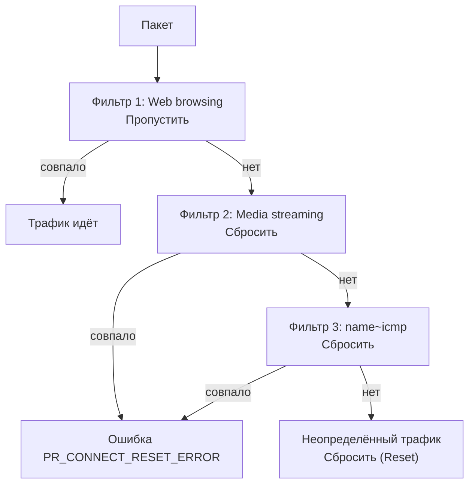

# UserGate_Профили_Приложений

> [!abstract] Кратко
> Профиль приложений в UserGate — это инструмент L7-фильтрации (Application Control). Вместо ручного перечисления тысяч игр и мессенджеров администратор задаёт фильтр (по категории, тегу или имени), система сама подбирает сигнатуры. Действия фильтров: «Пропустить», «Отбросить» (таймаут), «Сбросить» (RST, ошибка сразу). Порядок фильтров — сверху вниз, первое совпадение.

## 1. Зачем нужно
Понять, как NGFW распознаёт конкретные приложения (Telegram, Roblox, ICMP) и блокирует их, не блокируя весь интернет. Это следующий шаг после базового firewall и NAT.

## 2. Простыми словами
Firewall смотрит на порт и IP. Профиль приложений смотрит **внутрь** пакета и спрашивает: «Ты кто? Telegram? Блок. Браузер? Проходи». Ошибка `PR_CONNECT_RESET_ERROR` — это NGFW прислал пакет `RST` и сказал «соединение разорвано», а не просто молча выкинул пакет.

## 3. Технические детали

**Где:** `Настройки → Библиотеки → Профили приложений → Добавить`.

**Компоненты профиля:**

| Параметр | Что делает |
|---|---|
| **Название** | Имя профиля (например, `User_App_profile`) |
| **Фильтры** | Список правил фильтрации (категории, имена приложений) |
| **Настройки для неопределённого трафика** | Действие для того, что не попало ни в один фильтр (по умолчанию `Сбросить` или `Пропустить`) |

**Типы фильтров:**

| Фильтр | Пример | Что находит |
|---|---|---|
| **Категория** | `File storage and backup`, `Media streaming`, `Web browsing` | Группы приложений по назначению |
| **Имя** | `name~icmp` (тильда — содержит подстроку) | Конкретное приложение или протокол |
| **Расширенный** | `category = 'Web browsing' OR id=19` | Тонкая настройка по ID или полю |

**Действия фильтра:**

| Действие | Что происходит | Как выглядит для пользователя |
|---|---|---|
| **Пропустить** | Трафик идёт | Всё работает |
| **Отбросить (Drop)** | Пакеты молча удаляются | Ошибка по таймауту (браузер «висит») |
| **Сбросить (Reset)** | NGFW отправляет TCP RST | Ошибка сразу (`PR_CONNECT_RESET_ERROR`) |

**Порядок фильтров:**
- Обрабатываются **сверху вниз**.
- Срабатывает **первое** совпадение.
- Разрешающий фильтр (`Web browsing`) должен быть **выше** запрещающего (`Media streaming`), иначе он не сработает.

Схема: порядок обработки в профиле.

- **Читать схему:** пакет идёт по фильтрам сверху вниз. Первое совпадение решает судьбу. Всё, что не совпало, уходит в «неопределённый трафик».

## 4. Пример / команда
Создание профиля и фильтров (из практики):

**Шаг 1. Профиль:**
`Настройки → Библиотеки → Профили приложений → Добавить`
- Название: `User_App_profile`
- Неопределённый трафик: **Сбросить**

**Шаг 2. Фильтр 1 (разрешающий, должен быть выше):**
`Фильтры → Добавить`
- Категория: `Web browsing`
- Действие: **Пропустить**

**Шаг 3. Фильтр 2 (запрещающий):**
`Фильтры → Добавить`
- Категория: `File storage and backup`, `Media streaming`
- Действие: **Сбросить (Reset)**
- **Переместить этот фильтр НИЖЕ фильтра Web browsing.**

**Шаг 4. Фильтр 3 (ICMP):**
`Фильтры → Добавить → Расширенный`
- Условие: `name~icmp` (содержит "icmp")
- Действие: **Сбросить**

**Шаг 5. Применение к правилу firewall:**
`Настройки → Политики сети → Межсетевой экран → Internet_allowed`
- Профиль приложений: `User_App_profile`

**Результат:**
- `ping 8.8.8.8` → **100% потерь** (сработал фильтр ICMP).
- `https://rutube.ru` → **PR_CONNECT_RESET_ERROR** (сработал фильтр Media streaming, действие Reset).

## 5. Для ИБ

| Риск | Защита |
|------|--------|
| Разрешающий фильтр ниже запрещающего → запрет не работает | Порядок фильтров: Allow выше Deny |
| Действие `Отбросить` вместо `Сбросить` → пользователь ждёт таймаут | Для явных запретов использовать `Сбросить` (RST) |
| Шифрованный трафик не распознаётся без SSL-инспекции | Включить SSL-инспекцию для нужных категорий |
| Слишком широкий фильтр → ложные блокировки | Точечные категории, тесты |
| Профиль не привязан к правилу → не работает | Добавить профиль в разрешающее правило firewall |

## 6. Вопросы для самопроверки
1. Чем профиль приложений отличается от фильтрации контента?
2. Что делает действие «Отбросить» (Drop)?
3. Что делает действие «Сбросить» (Reset)?
4. Почему разрешающий фильтр должен быть выше запрещающего?
5. Как заблокировать ICMP через профиль приложений?
6. Какую ошибку в браузере даёт действие «Сбросить»?

## Связи
- [[UserGate_NGFW]]
- [[UserGate_Правила_Firewall]]
- [[UserGate_Web_Фильтрация]]
- [[UserGate_SSL_Инспекция]]
- [[UserGate_Практика_Доступ_в_Интернет]]