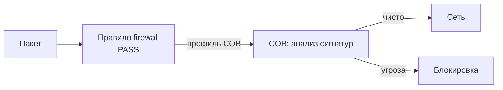

# UserGate_СОВ

> [!abstract] Кратко
> СОВ (Система обнаружения и предотвращения вторжений) в UserGate — это IDS/IPS. Обнаруживает и блокирует вредоносную активность по сигнатурам. Настраивается через профили СОВ, которые применяются **только к разрешающим** правилам firewall. Один профиль — одно правило.

## 1. Зачем нужно
Понять, как NGFW ловит атаки, которые firewall пропустил бы. СОВ — второй слой защиты после правил.

## 2. Простыми словами
Firewall — охранник на входе. СОВ — собака, которая обнюхивает каждого, кто прошёл. Если находит взрывчатку — блокирует.

## 3. Технические детали

**Что делает СОВ:**
- Распознаёт вредоносную активность.
- Использует обновляемую базу сигнатур.
- Обнаруживает, предотвращает, протоколирует угрозы.

**Алгоритм настройки:**
1. Настроить сигнатуры (опционально).
2. Создать профиль СОВ (обязательно).
3. Добавить профиль СОВ в разрешающее правило firewall (обязательно).

**Правила применения:**
- Профиль СОВ применяется **только к разрешающим** правилам (PASS).
- **Один** профиль на одно правило.
- События отображаются в `Журнал СОВ`.

**Профиль СОВ:**
- Набор сигнатур, выбранных фильтром.
- Каждую сигнатуру можно настроить индивидуально.
- Выбирать только релевантные сигнатуры для защищаемого ресурса.

Схема: место СОВ в обработке трафика.



- **Читать схему:** СОВ работает **после** того, как firewall разрешил трафик. Если правило DENY — СОВ не применяется.

## 4. Пример / команда
Создание профиля СОВ:

```text
Настройки → Библиотеки → Профили СОВ → Добавить
Название: Web Servers Protection
Фильтры: threat IN (medium, high, very high) AND protocol = http
Действие: Отбросить
```

Применение к правилу:

```text
Настройки → Политики сети → Межсетевой экран → <правило PASS>
Профиль СОВ: Web Servers Protection
```

## 5. Для ИБ

| Риск | Защита |
|------|--------|
| СОВ не включён в правило → трафик не анализируется | Добавить профиль СОВ в разрешающие правила |
| Слишком широкий профиль → ложные срабатывания | Выбирать релевантные сигнатуры |
| Нет журналирования СОВ | Включить `Журнал СОВ`, мониторинг |
| СОВ на DENY-правиле | Невозможно: только на PASS |

## 6. Вопросы для самопроверки
1. Что такое СОВ?
2. К каким правилам применяется профиль СОВ?
3. Сколько профилей на одно правило?
4. Где создаётся профиль СОВ?
5. Где смотреть события СОВ?

## Связи
- [[UserGate_NGFW]]
- [[UserGate_Правила_Firewall]]
- [[NGFW_vs_Firewall]]
- [[Firewall]]
- [[DMZ]]