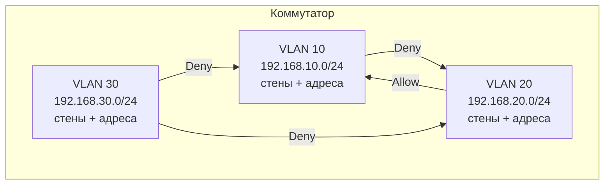

# Сегментация_VLAN_и_Маски

> [!abstract] Кратко
> VLAN и маска подсети решают одну задачу — сегментацию — но на разных уровнях. VLAN — стены между сегментами (L2), маска — адреса и границы подсетей (L3). Работают только вместе: VLAN без маски — комнаты без адресов, маска без VLAN — адреса без стен.

## 1. Зачем нужно
Понять, зачем два инструмента для одной цели. На практике их часто путают и настраивают только один — тогда сегментация не работает.

## 2. Простыми словами
Маска — это номера кабинетов и этажей. VLAN — это стены и замки между комнатами. Ты можешь расставить столы по группам (маска), но пока не поставил стены (VLAN), все слышат друг друга. Поставил стены — но без номеров и дверей (маска) никто не знает, как выйти.

## 3. Технические детали

| Инструмент | Уровень | Что делает | Аналогия |
|---|---|---|---|
| **Маска подсети** | L3 | Делит сеть на логические группы (подсети). Определяет, кто в одной группе, кто в другой. | Номера кабинетов и этажей |
| **VLAN** | L2 | Делит сеть на физически изолированные сегменты. Трафик не переходит между VLAN без маршрутизатора. | Стены и двери между комнатами |

**Почему нужны оба:**

| Сценарий | Что происходит |
|---|---|
| **Маска без VLAN** | Группы есть, но broadcast (ARP, DHCP) летит везде. Плоская сеть с логическими группами. Небезопасно. |
| **VLAN без маски** | Комнаты есть, но нет адресов и шлюзов. Устройства не выйдут наружу. Нужна маска для IP и шлюза. |
| **VLAN + маска** | Изоляция (VLAN) + адресация и управление (маска). Работает и безопасность, и маршрутизация. |

**Пример: офис, три отдела.**

- **VLAN 10** — бухгалтерия, подсеть `192.168.10.0/24`
- **VLAN 20** — IT, подсеть `192.168.20.0/24`
- **VLAN 30** — гости, подсеть `192.168.30.0/24`

| Сценарий | Без VLAN+маски | С VLAN+маской |
|---|---|---|
| Гость хочет зайти в бухгалтерию | Может, если в одной сети | Не может — разные VLAN, нет маршрута |
| Бухгалтерия шлёт broadcast | Летит всем | Только внутри VLAN 10 |
| IT управляет сервером | Любой может | Только IT, остальным запрещено правилами |

**Как это выглядит в UserGate NGFW:**
- VLAN создаётся как **L3-сабинтерфейс** с IP и маской.
- Привязывается к **зоне** (например, `VLAN_10_Buh`).
- Правила firewall строятся **между зонами**: `Deny` гостям в бухгалтерию, `Allow` бухгалтерии в интернет.
- Без правил firewall между зонами — трафик запрещён по умолчанию.

Схема: VLAN (стены) + маска (адреса).



- **Читать схему:** VLAN — это сегменты. Маска — адреса внутри. Правила между VLAN — это двери с замками.

## 4. Пример / команда
Проверка VLAN и масок на коммутаторе:

```bash
show vlan brief          # список VLAN
show ip interface brief  # IP и маска на SVI
```

В UserGate NGFW:

```bash
# Веб-консоль: Сеть -> Интерфейсы -> VLAN
# Проверить: у каждого VLAN есть IP и маска
# Политики сети -> Межсетевой экран: правила между зонами
```

## 5. Для ИБ

| Риск | Защита |
|------|--------|
| Плоская сеть → боковое перемещение | VLAN + маска + правила firewall между зонами |
| Гости видят внутреннюю сеть | Отдельная VLAN и подсеть, правило `Deny` |
| Broadcast-шторм | Малые VLAN и подсети |
| Сегментация без правил → всё открыто | Явные `Deny` между VLAN **выше** общих `Allow` |
| Маска шире нужного → лишние хосты | Точный префикс, ревизия подсетей |

## 6. Вопросы для самопроверки
1. На каком уровне работает VLAN?
2. На каком уровне работает маска подсети?
3. Что будет, если есть VLAN, но нет маски?
4. Что будет, если есть маска, но нет VLAN?
5. Зачем нужны правила firewall между VLAN?
6. Где в UserGate создаётся VLAN?

## Связи
- [[VLAN]]
- [[Маска_Подсети]]
- [[Сегментация_Сети]]
- [[UserGate_NGFW]]
- [[UserGate_Правила_Firewall]]
- [[Коммутатор_L3]]