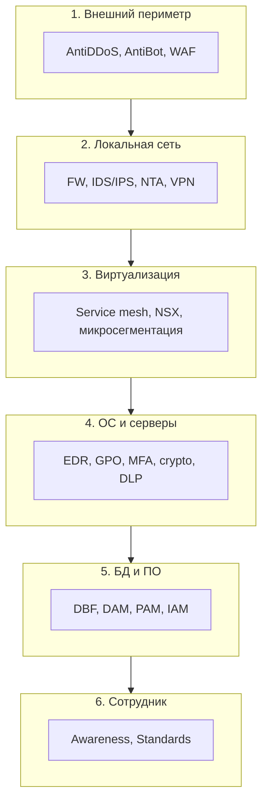

# Основы_ИТ_и_ИБ_Каркас

> [!abstract] Кратко
> Сводка 5 вводных лекций (корпоративный вводный курс). Базовые понятия (CIA, угроза, риск), структура подразделения ИБ, модель периметров безопасности, процесс Compliance (ФЗ-152, ФЗ-187) и Awareness (фишинг, обучение). Не техническая глубина, а карта местности.

## 1. Зачем нужно
Понять, как устроена ИБ в компании: кто отвечает, чем защищают, под какие законы заточены. Без карты дальше — набор разрозненных фактов.

## 2. Простыми словами
ИБ — это не один «безопасник с топором». Это структура: юристы пишут правила (Compliance), инженеры ставят заборы (Инфраструктура), SOC ловит воров (Мониторинг), архитекторы рисуют план, а сотрудников учат не открывать двери чужим (Awareness).

## 3. Технические детали

### 3.1. Три кита ИБ (CIA)
- **Конфиденциальность:** доступ только у тех, кому положено.
- **Целостность:** данные не изменены без следа.
- **Доступность:** данные выдаются по запросу, когда нужно.

### 3.2. Базовые понятия

| Термин | Что это |
|---|---|
| **Уязвимость** | Слабость системы (дыра в коде, слабый пароль) |
| **Угроза** | Потенциальное событие, которое использует уязвимость |
| **Риск** | Вероятность угрозы × тяжесть последствий |
| **Инцидент** | Угроза уже реализовалась |
| **СЗИ** | Средство защиты информации (антивирус, firewall, DLP) |

### 3.3. Структура подразделения ИБ

| Направление | Задачи |
|---|---|
| **Compliance** | Законы, стандарты, внутренние документы |
| **Инфраструктурная безопасность** | Сеть (NGFW, VPN, AntiDDoS), системы (Antivirus, IAM, DLP) |
| **Мониторинг и реагирование (SOC)** | 1 линия — операторы, 2 — аналитики, 3 — форензика |
| **Архитектура ИБ** | Проектирование защиты, AppSec, DevSecOps |
| **Киберразведка** | Сбор данных об угрозах, инструменты, ограничения |

### 3.4. Модель периметров (вложенные слои)
Защита строится эшелонировано: от внешнего мира до сотрудника.

- **Читать схему:** атака идёт снаружи внутрь. Каждый слой — свой набор инструментов. На сотруднике — обучение.

### 3.5. Compliance (Законодательство)

| Уровень | Что регулирует |
|---|---|
| **ФЗ-152** | Персональные данные (ПДн) |
| **ФЗ-187** | Критическая информационная инфраструктура (КИИ) |
| **ФЗ-149** | Информация и защита информации |
| **Регуляторы** | ФСТЭК (техника), ФСБ (крипто), Роскомнадзор (ПДн) |

- **ФЗ-152:** оператор ПДн обязан защищать данные субъектов, получать согласие, уведомлять РКН.
- **ФЗ-187:** компании с объектами КИИ обязаны категорировать их и выполнять требования по безопасности.

### 3.6. Awareness (Осведомлённость)
- 98% атак используют социальную инженерию, 90% начинаются с фишинга.
- Мероприятия: рассылки, статьи на портале, курсы, фишинговые учения (симуляция атак).
- Цель: сотрудник распознаёт фишинг и сообщает в СУЗ, а не вводит пароль.

## 4. Пример / команда
Проверка устойчивости пароля (из лекции): пароль из 7 символов с цифрами, буквами и спецсимволами ломается за 31 секунду. Из 12 символов — за 3000 лет. Длина важнее сложности.

## 5. Для ИБ

| Риск | Защита (по слоям) |
|------|--------|
| DDoS на сайт | Внешний периметр: AntiDDoS |
| Фишинг | Awareness + AntiSPAM + AntiPhishing |
| Слабая сеть | LAN: NGFW, сегментация |
| Утечка БД | БД: DBF, DAM, DLP |
| Слабый пароль | OS: MFA, политика паролей |
| Нарушение закона | Compliance: ФЗ-152, ФЗ-187 |

## 6. Вопросы для самопроверки
1. Что такое CIA?
2. Чем риск отличается от угрозы?
3. Назови 5 направлений в подразделении ИБ.
4. Сколько периметров безопасности?
5. Какой ФЗ регулирует ПДн?
6. Кто такой «оператор ПДн»?
7. Почему длина пароля важнее сложности?

## Связи
- [[UserGate_NGFW]]
- [[NGFW_vs_Firewall]]
- [[Firewall]]
- [[DMZ]]
- [[Сегментация_VLAN_и_Маски]]
- [[Итоги_цикла_сети]]