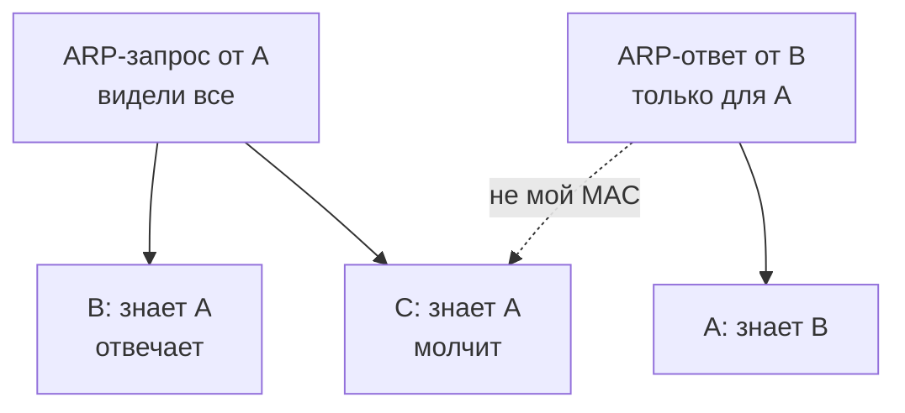

# ARP_в_локальной_сети

> [!abstract] Кратко
> ARP находит MAC по известному IP внутри локальной сети. Запрос — broadcast (`ff:ff:ff:ff:ff:ff`), ответ — unicast. Работает на L2, IP в пакете не участвует как адрес доставки. Результат — запись в ARP-таблице.

## 1. Зачем нужно
Понять первый шаг любого ping: до ICMP нужен MAC. Без ARP-обмена кадр некуда отправить.

## 2. Простыми словами
Ты знаешь номер квартиры (IP), но не знаешь, где она (MAC). Кричишь в подъезд: «Кто 192.168.0.2?» — отзывается один, ты записываешь. Дальше — уже лично.

## 3. Технические детали

Порядок для ping с хоста A (192.168.0.1) на B (192.168.0.2):

1. **ARP-запрос:** src MAC A, dst MAC `ff:ff:ff:ff:ff:ff`, тело «кто 192.168.0.2, спрашивает 192.168.0.1». IP-адреса доставки нет — ARP на L2.
2. **Хаб/коммутатор:** рассылает запрос (hub — всегда во все; switch — flood, пока MAC-таблица пуста).
3. **Все хосты** сохраняют запись об A (пассивное обучение), но **отвечает только B**.
4. **ARP-ответ:** src MAC B, dst MAC A, unicast, тело «192.168.0.2 — это 00:..:0b».
5. **A сохраняет** запись о B. Теперь есть MAC для кадра.
6. **ICMP-запрос/ответ** идут уже с известными MAC.

Схема: кто что знает после ARP-обмена.



- **Читать схему:** запрос видят все — поэтому C запоминает A. Ответ адресован только A — поэтому C о B не узнаёт. Кадр чужому отбрасывается на L2, ещё до IP.
- **При пустой MAC-таблице** коммутатор временно работает как хаб — flood, пока не обучится.
- **Потери при ping:** первые пакеты могут теряться — идёт ARP-обмен.

## 4. Пример / команда
Проверка ARP:

```bash
arp -a                     # Windows: ARP-таблица
ip neigh                   # Linux
arp -d 192.168.0.2         # Windows: удалить запись (сброс)
ping 192.168.0.2           # после ARP-обмена пойдёт ICMP
```

## 5. Для ИБ

| Риск | Защита |
|------|--------|
| ARP-спуфинг → перехват трафика | Dynamic ARP Inspection (DAI) |
| ARP-flood → переполнение таблицы | Ограничение ARP на порт |
| Пассивное обучение → подмена записи | DAI, статические записи для шлюза |
| ARP без контроля на access-порту | DHCP Snooping + DAI |
| Широковещательный шторм | Сегментация, малые broadcast-домены |

## 6. Вопросы для самопроверки
1. Что находит ARP?
2. Какой MAC у ARP-запроса?
3. Почему отвечает только один хост?
4. Почему C не узнаёт о B?
5. Почему первые ping могут теряться?
6. На каком уровне работает ARP?

## Связи
- [[Концентратор_Hub]]
- [[Коммутатор_L2]]
- [[VLAN]]
- [[Сегментация_Сети]]
- [[Сеть_Подсеть]]