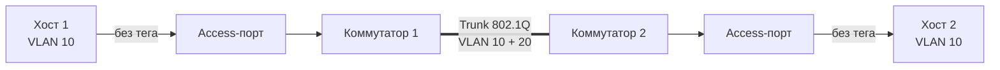

# Access_vs_Trunk_порты

> [!abstract] Кратко
> Access-порт передаёт трафик только одного VLAN, кадры без тега. Trunk-порт передаёт несколько VLAN через тегирование 802.1Q.

## 1. Зачем нужно
Понять, как один коммутатор одновременно обслуживает несколько VLAN и как они связаны между коммутаторами.

## 2. Простыми словами
Access — дверь в одну комнату, без бирки. Trunk — общий коридор между домами, на каждой вещи бирка с номером комнаты.

## 3. Технические детали

| Порт | Что передаёт | Тег |
|---|---|---|
| **Access** | Только один VLAN | Без тега |
| **Trunk** | Несколько VLAN | 802.1Q на каждом кадре |

- **Access:** хост не знает, что он в VLAN, — это забота коммутатора.
- **Trunk:** между коммутаторами; принимающая сторона читает тег и отдаёт кадр в нужную VLAN.
- **Native VLAN:** на trunk кадры без тега; по умолчанию VLAN 1 — риск VLAN hopping.

Схема:



- **Читать схему:** access-порты отдают кадры без тега. Trunk между коммутаторами несёт теги. На выходе тег снимается.

## 4. Пример / команда
Настройка портов:

```bash
interface GigabitEthernet0/1
 switchport mode access
 switchport access vlan 10
interface GigabitEthernet0/24
 switchport mode trunk
 switchport trunk allowed vlan 10,20
```

## 5. Для ИБ

| Риск | Защита |
|------|--------|
| Trunk на access-порт → утечка всех VLAN | Жёстко `mode access`, DTP off |
| Native VLAN 1 → VLAN hopping | Сменить native VLAN |
| Trunk без allowed list → лишние VLAN | Явный `allowed vlan` |
| Двойной тег 802.1Q | Отключить native на access, DTP off |

## 6. Вопросы для самопроверки
1. Сколько VLAN на access-порту?
2. Что несёт trunk?
3. Что такое native VLAN?
4. Чем опасен native VLAN 1?
5. Где ставить access, где trunk?

## Связи
- [[VLAN]]
- [[Трехуровневая_модель_сети]]
- [[Router_on_a_Stick]]
- [[Межвлановая_Маршрутизация]]