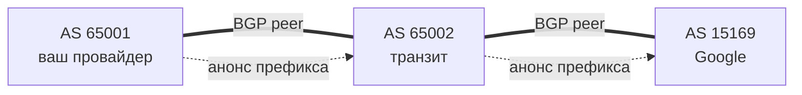

# BGP

> [!abstract] Кратко
> BGP связывает автономные системы: сессии доверия (peers), обмен маршрутами, выбор лучшего пути (короткий путь, надёжность, политики). Работает на доверии → угоны префиксов.

## 1. Зачем нужно
Понять, как миллионы AS договариваются о путях. Без BGP интернет — набор изолированных сетей.

## 2. Простыми словами
Провайдеры жмут друг другу руки: «Я знаю дорогу туда». Рукопожатие на доверии — соврал, и трафик ушёл не туда.

## 3. Технические детали

- **BGP-сессии (peers):** провайдеры устанавливают «сессии доверия» между AS, обмениваются маршрутами.
- **Выбор лучшего пути:**
  - короткий путь (минимум AS на пути);
  - надёжность провайдера (префикс «верифицирован»);
  - политики (например, «не пускать трафик через страну X»).
- **Трафик через AS:** даже из одной квартиры к одному ресурсу пути разные (смартфон через мобильного оператора, ПК через городского провайдера).

**Почему это опасно:**

- BGP работает **на доверии** — можно заявить «я владею сетью 8.8.8.0/24» (хотя 8.8.8.8 — DNS Google), и другие могут поверить.
- **Угоны префиксов:**
  - **2018** — трафик Amazon перенаправлен через сеть злоумышленников (кража криптовалюты);
  - **2021** — сбой BGP у Facebook «отключил» серверы на 6 часов.

Схема:



- **Читать схему:** каждая AS анонсирует свои префиксы соседям. Сосед верит анонсу — отсюда риск угона.

## 4. Пример / команда
Проверка BGP:

```bash
show ip bgp summary
show ip bgp
traceroute 8.8.8.8    # видно AS на пути
```

## 5. Для ИБ

| Риск | Защита |
|------|--------|
| Угон префикса | RPKI, ROA, prefix-filter |
| BGP без аутентификации | TCP MD5, BGPsec |
| Нет фильтрации анонсов | Prefix-list, route-map, max-prefix |
| Нет мониторинга AS-путей | BGP мониторинг (RIPE RIS, BGPStream) |

## 6. Вопросы для самопроверки
1. Что связывает BGP?
2. Что такое BGP peers?
3. Три критерия выбора пути?
4. Почему BGP опасен?
5. Пример угона префикса?

## Связи
- [[Автономная_система]]
- [[Иерархия_операторов_Tier]]
- [[Backbone]]
- [[Динамическая_Маршрутизация]]
- [[Протокол_BGP]]
