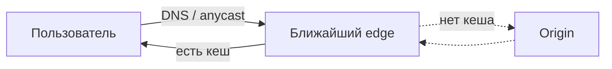

# CDN_как_Overlay

> [!abstract] Кратко
> CDN — сеть доставки контента: оверлей поверх интернета для перенаправления пользователя к ближайшему кешу. Примеры: Akamai, Cloudflare. Снижает задержки, разгружает origin.

## 1. Зачем нужно
Понять, как крупные сайты отдают контент быстро по всему миру, не строя свою глобальную сеть.

## 2. Простыми словами
Вместо одного склада — сотни складов по городам. Едешь в ближайший, а не через страну.

## 3. Технические детали

- **CDN** — сеть доставки контента, оверлей поверх интернета.
- **Как работает:** пользователь запрашивает контент → DNS/anycast направляет к ближайшему кешу → кеш отдаёт, если есть, иначе тянет с origin.
- **Примеры:** Akamai, Cloudflare.
- **Что даёт:** меньше задержек, отказоустойчивость, разгрузка origin, защита от DDoS.

Схема:



- **Читать схему:** пользователь попадает на ближайший edge. Если контент в кеше — сразу, иначе — с origin.

## 4. Пример / команда
Проверка CDN:

```bash
dig example.com
curl -I https://example.com
```

## 5. Для ИБ

| Риск | Защита |
|------|--------|
| Кеш с чужим контентом | Подпись контента, purge |
| Origin без защиты от прямого доступа | ACL только для CDN |
| DDoS на edge | Защита CDN-провайдера |
| Утечка через кеш | Разделение по клиентам, токены |

## 6. Вопросы для самопроверки
1. Что такое CDN?
2. Как выбирается edge?
3. Что делает origin?
4. Зачем CDN защищает от DDoS?
5. Примеры CDN?

## Связи
- [[Overlay_сети]]
- [[Multicast_Anycast]]
- [[BGP]]
- [[Backbone]]
