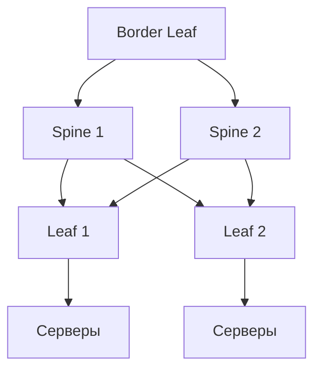

# Clos_топология

> [!abstract] Кратко
> Leaf → Spine → Border Leaf. Каждый leaf соединён со всеми spine своего уровня. Масштабируемость (добавление spine), отказоустойчивость (нет единой точки отказа), равномерная нагрузка (ECMP). Стандарт современных ЦОД.

## 1. Зачем нужно
Понять, как строится сеть ЦОД, когда трехуровневой модели мало.

## 2. Простыми словами
«Лего»: каждый лист соединён с каждым столбом. Упал один столб — трафик пошёл через остальные.

## 3. Технические детали

- **Структура:** Leaf (листья) → Spine (столбы) → Border Leaf (граница).
- **Принцип:** каждый leaf соединён со всеми spine своего уровня.
- **Путь:** сервер → leaf → spine → другой leaf → целевой сервер.
- **ECMP:** трафик распределяется через все доступные пути.

| ✅ Преимущества |
|---|
| Масштабируемость — добавление spine увеличивает пропускную способность |
| Отказоустойчивость — нет единой точки отказа |
| Равномерная нагрузка — ECMP через все пути |

**Многоуровневый Clos (5 уровней):**

| Вариант | Плюсы | Минусы | Где |
|---|---|---|---|
| **POD → своя пара Super-Spine** | Простота, изоляция отказов, меньше кабелей | Ограниченная масштабируемость, неравномерная нагрузка | Небольшие ЦОД |
| **POD → все Super-Spine** | Высокая отказоустойчивость, ECMP, масштабируемость | Сложность (BGP/OSPF), дорого, риск перегрузки управления | Гипермасштабные ЦОД |

Схема:



- **Читать схему:** каждый leaf соединён с обоими spine. Упал Spine 1 — трафик идёт через Spine 2.

## 4. Пример / команда
Проверка ECMP:

```bash
show ip route
show ip bgp summary
```

## 5. Для ИБ

| Риск | Защита |
|------|--------|
| BGP/OSPF без аутентификации | MD5/SHA, prefix-list |
| Нет изоляции POD → боковое перемещение | ACL между POD, VRF |
| Перегрузка таблиц маршрутизации | Иерархия, summarization |
| Один border leaf → точка отказа | Резервирование border |

## 6. Вопросы для самопроверки
1. Три уровня Clos?
2. Как соединены leaf и spine?
3. Что даёт ECMP?
4. Чем отличается 5-уровневый Clos?
5. Где применяют Clos?

## Связи
- [[Fat_Trees]]
- [[Сравнение_Clos_Fat_Trees]]
- [[ЦОД]]
- [[Динамическая_Маршрутизация]]
