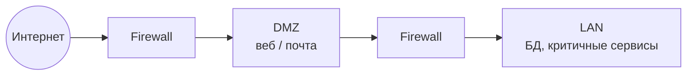

# DMZ

> [!abstract] Кратко
> Изолированный сегмент для публичных сервисов (веб, почта), отделённый от LAN межсетевым экраном. Буфер между интернетом и внутренней сетью.

## 1. Зачем нужно
Понять, куда ставить серверы, доступные из интернета, чтобы взлом не открывал внутреннюю сеть.

## 2. Простыми словами
Прихожая: с улицы заходишь туда, но в комнаты — только через дверь с проверкой.

## 3. Технические детали

- **Публичные сервисы** — в DMZ (веб-сервер, почта).
- **Критичные данные** — во внутренней сети (LAN), недоступной извне.
- **Между интернетом и DMZ, между DMZ и LAN** — firewall.
- **Пример:** веб-сервер `company.com` в DMZ, база клиентов — во внутренней сети.

Схема:



- **Читать схему:** два firewall — один на границе с интернетом, второй между DMZ и LAN. Взлом DMZ не даёт доступа к LAN.

## 4. Пример / команда
Проверка зон firewall:

```bash
show zone-pair security
show ip nat translations
```

## 5. Для ИБ

| Риск | Защита |
|------|--------|
| DMZ без второго firewall → прямой доступ к LAN | Два firewall, разные политики |
| DMZ в общей VLAN с LAN | Отдельная подсеть/VLAN |
| Публичный сервис с доступом к БД напрямую | Только через API/прокси |
| Нет логирования DMZ | IDS/IPS, логи |

## 6. Вопросы для самопроверки
1. Что такое DMZ?
2. Что размещают в DMZ?
3. Что остаётся в LAN?
4. Сколько firewall между зонами?
5. Зачем изоляция?

## Связи
- [[Firewall]]
- [[Front_End_Back_End]]
- [[Плоская_сеть]]
- [[ЦОД]]
