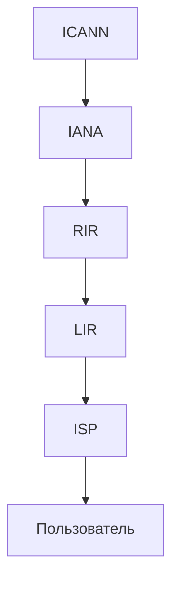

# ICANN_IANA_RIR

> [!abstract] Кратко
> ICANN — вершина (домены, IP). IANA — адресное пространство. RIR — региональные регистраторы, выдают номера AS и блоки IP. LIR — локальные, получают блоки от RIR и присваивают клиентам. ISP — подключают компании и клиентов.

## 1. Зачем нужно
Понять, кто и как выдаёт адреса и номера AS — кому платить и к кому идти.

## 2. Простыми словами
ICANN — мэрия мира. IANA — земельный кадастр. RIR — областные управления. LIR — районные. ISP — управляющие компании.

## 3. Технические детали

| Уровень | Организация | Роль |
|---|---|---|
| Вершина | **ICANN** | Управление доменными именами и IP-адресами |
| Администрация | **IANA** | Адресное пространство интернета |
| Региональные | **RIR** | Выдача номеров AS |
| Локальные | **LIR** | Получают блоки от RIPE NCC, присваивают IP клиентам |
| Провайдеры | **ISP** | Подключение компаний и клиентов |
| Потребители | Мы | Платим за доступ к информации |

Схема:



- **Читать схему:** сверху вниз — от глобального управления к конечному пользователю. Каждый уровень получает ресурсы от вышестоящего.

## 4. Пример / команда
Проверка регистратора:

```bash
whois 8.8.8.8
whois example.com
```

## 5. Для ИБ

| Риск | Защита |
|------|--------|
| Угон домена через регистратора | 2FA у регистратора, lock домена |
| Поддельные AS-номера | RPKI, ROA |
| Нет контроля WHOIS | Приватность WHOIS, мониторинг изменений |
| Слабый пароль у LIR | Сильная аутентификация, аудит |

## 6. Вопросы для самопроверки
1. Что делает ICANN?
2. Что делает IANA?
3. Кто выдаёт номера AS?
4. Кто получает блоки от RIR?
5. Кто присваивает IP клиентам?

## Связи
- [[Регулирование_интернета]]
- [[Автономная_система]]
- [[Иерархия_операторов_Tier]]
- [[BGP]]
