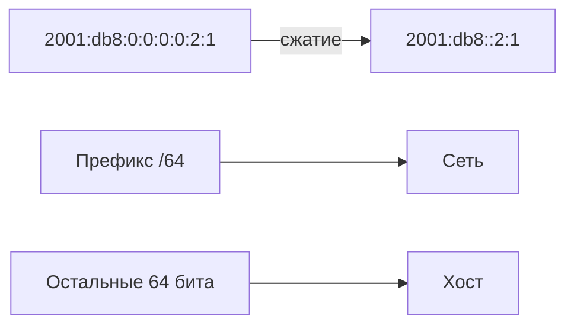

# IPv6

> [!abstract] Кратко
> IPv6 — 128-битные адреса, восемь 16-битных блоков через двоеточие. Сжатие `::` для нулевых блоков. Типы префиксов: Global Unicast, ULA, Link-Local, Multicast, Anycast. Генерация — SLAAC или DHCPv6.

## 1. Зачем нужно
Понять, зачем придумали IPv6 и как читать адрес. Без этого IPv6 выглядит случайным набором символов.

## 2. Простыми словами
IPv4 — 4 числа, закончились. IPv6 — 8 блоков, хватит на каждую песчинку. Запись длинная, поэтому нули сжимают.

## 3. Технические детали

- **Формат:** 128 бит, восемь 16-битных блоков через двоеточие. Пример: `2001:db8:0:0:0:0:2:1`.
- **Сжатие:** смежные нулевые блоки → `::`. Пример: `2001:db8::2:1`.
- **Префикс:** часть адреса, определяющая сеть. Запись: `IPv6-адрес/длина_префикса`. Пример: `2001:db8::/32` — первые 32 бита = сеть.

| Тип префикса | Диапазон | Назначение |
|---|---|---|
| **Global Unicast** | `2000::/3` | Публичные адреса |
| **ULA** | `fc00::/7` (фактически `fd00::/8`) | Аналог Private IP |
| **Link-Local** | `fe80::/10` | Связь в сегменте, без маршрутизации |
| **Multicast** | `ff00::/8` | Групповая рассылка |
| **Anycast** | Из глобальных/локальных | Несколько устройств, один адрес |
| **Зарезервированный** | `::ffff:0:0/96` | Совместимость с IPv4 |

- **Генерация адреса:** префикс от маршрутизатора (RA) + MAC (EUI-64) или случайные числа (Privacy IPv6).

Схема:



- **Читать схему:** слева — полная запись, справа — сжатая. Префикс отделяет сеть от хоста, как маска в IPv4.

## 4. Пример / команда
Проверка IPv6:

```bash
ip -6 addr show
ping6 2001:4860:4860::8888
```

## 5. Для ИБ

| Риск | Защита |
|------|--------|
| IPv6 включён, но не фильтруется | Явные правила firewall для IPv6 |
| SLAAC без контроля → случайные адреса | DHCPv6, RA Guard |
| Link-Local без защиты | RA Guard, ND Inspection |
| Забытый IPv6-туннель → обход правил | Аудит туннелей, отключение лишнего |

## 6. Вопросы для самопроверки
1. Сколько бит в IPv6?
2. Как сжимают нули?
3. Что такое префикс?
4. Три типа префиксов?
5. Как генерируется адрес?

## Связи
- [[Отличия_IPv4_IPv6]]
- [[SLAAC_DHCPv6]]
- [[Multicast_Anycast]]
- [[Проблемы_перехода_IPv6]]
- [[Маска_Подсети]]
