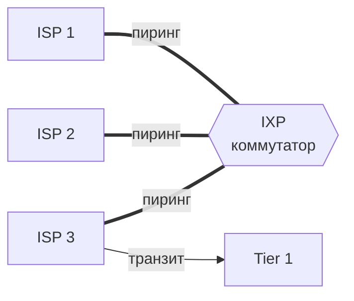

# IXP_Пиринг_Транзит

> [!abstract] Кратко
> IXP — физическая площадка обмена трафиком между провайдерами. Пиринг — бесплатный взаимный обмен (публичный через IXP, приватный напрямую). Транзит — платный доступ к интернету через другую сеть.

## 1. Зачем нужно
Развести три близких понятия: где встречаются, как договариваются, кто кому платит.

## 2. Простыми словами
IXP — перекрёсток. Пиринг — «давай возить друг другу бесплатно». Транзит — «плачу, чтобы ты возил меня по своим дорогам».

## 3. Технические детали

| Понятие | Что это | Платно? |
|---|---|---|
| **IXP** | Площадка обмена трафиком | Нет (обычно членский взнос) |
| **Пиринг** | Взаимный обмен трафиком между сетями | Нет |
| **Транзит** | Доступ к интернету через другую сеть | Да |

- **IXP:** коммутаторы L2/L3, роутеры участников. Примеры: DE-CIX (Германия, крупнейший), MSK-IX (Россия).
- **Публичный пиринг** — через IXP. **Приватный пиринг** — прямой линк между двумя сетями.
- **Пиринг** обычно бесплатный при равных объёмах трафика.
- **Транзит** — стоимость зависит от пропускной способности (Гбит/с).
- **Зачем IXP:** уменьшает задержки, оптимизирует маршруты, снижает расходы на магистраль.

Схема:



- **Читать схему:** на IXP все равные обмениваются бесплатно. Если сети нет на IXP — она покупает транзит у Tier 1.

## 4. Пример / команда
Проверка участников IXP:

```bash
whois -h whois.peeringdb.com <AS_номер>
show ip bgp summary
```

## 5. Для ИБ

| Риск | Защита |
|------|--------|
| IXP без prefix-filter → утечка маршрутов | Prefix-list на IXP, RPKI |
| Пиринг без договора → юридические риски | Контракты, документация |
| Транзит без шифрования | IPsec, TLS |
| Нет мониторинга BGP-сессий | BGP-мониторинг, алерты |

## 6. Вопросы для самопроверки
1. Что такое IXP?
2. Чем пиринг отличается от транзита?
3. Публичный и приватный пиринг — разница?
4. Кто платит за транзит?
5. Зачем IXP снижает задержки?

## Связи
- [[Иерархия_операторов_Tier]]
- [[BGP]]
- [[Backbone]]
- [[Автономная_система]]
