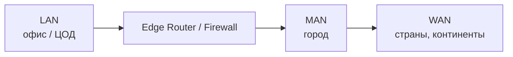

# LAN_MAN_WAN

> [!abstract] Кратко
> LAN — локальная сеть (квартира, офис, ЦОД). MAN — город/район. WAN — города, страны, континенты. Пограничный маршрутизатор подключает LAN к WAN.

## 1. Зачем нужно
Понять три масштаба сетей — от комнаты до континента. Без этого «интернет» кажется одной большой LAN, а это не так.

## 2. Простыми словами
LAN — квартира. MAN — город. WAN — страна и мир. Между ними — дверь на улицу (пограничный маршрутизатор).

## 3. Технические детали

| Тип | Расшифровка | Охват |
|---|---|---|
| **LAN** | Local Area Network | Квартира, офис, предприятие, ЦОД |
| **MAN** | Metropolitan Area Network | Город, крупный район |
| **WAN** | Wide Area Network | Города, страны, континенты |

- **LAN:** может быть и домашняя сеть с роутером, и крупный ЦОД с пограничным маршрутизатором (Edge Router). Обычно — сети предприятий/офисов.
- **MAN:** промежуточное положение между WAN и LAN. Примеры: сеть городского провайдера, транспортная система с камерами, умный город.
- **WAN:** соединяет устройства и множество LAN на больших расстояниях.
- **Пограничный маршрутизатор (Edge Router)** или межсетевой экран подключает LAN к WAN.

Схема:



- **Читать схему:** LAN выходит в MAN через пограничный маршрутизатор, MAN — часть WAN. Каждый уровень — свой масштаб.

## 4. Пример / команда
Проверка своего уровня:

```bash
ipconfig          # LAN-адрес
tracert 8.8.8.8   # путь через WAN
```

## 5. Для ИБ

| Риск | Защита |
|------|--------|
| LAN без границы → прямой выход в WAN | Edge firewall, NAT |
| MAN без контроля → боковое перемещение между филиалами | VPN, ACL между площадками |
| WAN без шифрования | IPsec, TLS |
| Нет схемы уровней → сложная диагностика | Документация LAN/MAN/WAN |

## 6. Вопросы для самопроверки
1. Что такое LAN?
2. Что такое MAN?
3. Что такое WAN?
4. Чем подключается LAN к WAN?
5. Где MAN занимает место?

## Связи
- [[Автономная_система]]
- [[BGP]]
- [[Иерархия_операторов_Tier]]
- [[Backbone]]
