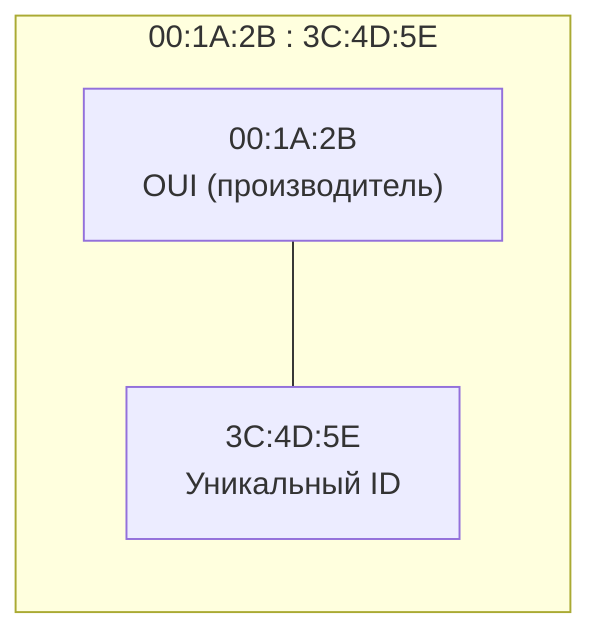

# MAC_Адресация

> [!abstract] Кратко
> MAC-адрес — уникальный 48-битный идентификатор, встроенный в сетевую карту (NIC) для идентификации устройства в локальной сети. Работает на канальном уровне (L2). Состоит из 6 пар шестнадцатеричных цифр. Широковещательный MAC — FF:FF:FF:FF:FF:FF.

## 1. Зачем нужно
Понять, как устройства находят друг друга внутри одной локальной сети до того, как появится IP-адресация. Без MAC не работает коммутатор и ARP.

## 2. Простыми словами
MAC-адрес — это паспорт сетевой карты. Он прошит производителем и не меняется при переезде. IP-адрес — это адрес прописки, который может меняться. Коммутатор читает паспорт и решает, в какую дверь (порт) отдать письмо.

## 3. Технические детали

- **Формат:** 48 бит, 6 байт, записывается через двоеточие или тире (например, `00:1A:2B:3C:4D:5E`).
- **Структура:** Первые 24 бита — OUI (идентификатор производителя), последние 24 бита — уникальный номер устройства.
- **Типы адресов:**
  - **Unicast** — один получатель (индивидуальный).
  - **Multicast** — группа получателей (первый бит первого октета — 1).
  - **Broadcast** — все устройства в сегменте (`FF:FF:FF:FF:FF:FF`).
- **Где используется:** Ethernet, Wi-Fi (802.11), ARP (для поиска MAC по IP).
- **Отличие от IP:** MAC — физический (L2), IP — логический (L3).

Схема: структура MAC-адреса.



- **Читать схему:** первая половина — производитель, вторая — конкретное устройство.

## 4. Пример / команда
Просмотр MAC-адреса на Windows и Linux:

```bash
ipconfig /all        # Windows: строка "Физический адрес"
ip link show         # Linux: строка "link/ether"
```

## 5. Для ИБ

| Риск | Защита |
|------|--------|
| Подмена MAC (MAC-spoofing) → обход ACL | Port Security на коммутаторе, привязка MAC к порту |
| MAC-flooding → переполнение таблицы → flood | Лимит MAC на порт (Port Security) |
| ARP-спуфинг с подменой MAC | Dynamic ARP Inspection (DAI) |
| Отслеживание устройств по MAC | Рандомизация MAC (Privacy MAC) в ОС |

## 6. Вопросы для самопроверки
1. Сколько бит в MAC-адресе?
2. Какой MAC-адрес является широковещательным?
3. На каком уровне OSI работает MAC-адресация?
4. Чем MAC отличается от IP?
5. Какую информацию можно узнать по первым 24 битам?

## Связи
- [[ARP_в_локальной_сети]]
- [[Коммутатор_L2]]
- [[Протокол_IPv4]]
- [[Сравнение_сетевых_устройств]]
- [[Модель_OSI]]
