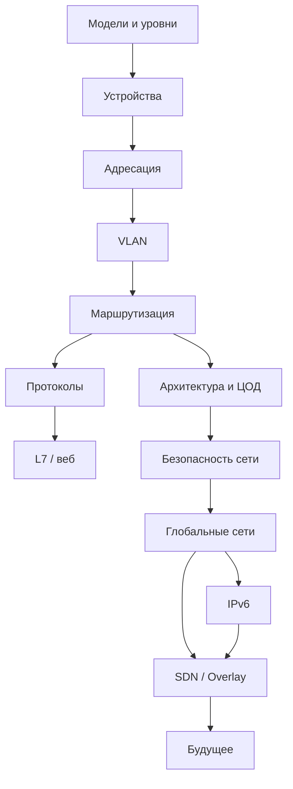

# MOC — Сети

> [!abstract] Кратко
> Актуальная карта домена «сети»: 112 файлов (106 старых + 5 новых из лекции + 1 обновлённый MOC), 12 доменов. Собрана по manifest и дополнена новыми заметками. Поколения: `[база]` — новое (template=ok), `[old]` — старое (не по шаблону), `[hub]` — хаб.

## 0. Как читать

- `[база]` — заметка по шаблону ядра.
- `[old]` — создана до шаблона, содержание не сверено.
- `[hub]` — хаб или сводка.
- **Порядок обучения** — раздел 1. Домены — раздел 2. Связи — раздел 3.

## 1. Маршрут обучения

| Шаг | Домен | Зачем сначала |
|---|---|---|
| 1 | Модели и уровни | Каркас: OSI, TCP/IP, L1–L7 |
| 2 | Устройства | Что стоит на каждом уровне |
| 3 | Адресация | IP, маска, подсеть, MAC, шлюз |
| 4 | VLAN и коммутация | Как делить L2 |
| 5 | Маршрутизация | Как связать сегменты |
| 6 | Архитектура и ЦОД | Как собрать сеть целиком |
| 7 | Протоколы | Детали L3–L4 |
| 8 | L7 / веб | HTTP, TLS, API, RDP |
| 9 | Безопасность сети | DMZ, firewall, NAT |
| 10 | Глобальные сети | Интернет, BGP, операторы |
| 11 | IPv6 | Следующее поколение |
| 12 | SDN / Overlay | Современные подходы |

## 2. Домены

### 2.1 Модели и уровни (9)

- [[Модель_OSI]] `[old]`
- [[Модель_TCP_IP]] `[old]`
- [[Уровень_L1_Физический]] `[old]`
- [[Уровень_L2_Канальный]] `[old]`
- [[Уровень_L3_Сетевой]] `[old]`
- [[Уровень_L4_Транспортный]] `[old]`
- [[Уровень_L5_Сеансовый]] `[old]`
- [[Уровень_L6_Представительный]] `[old]`
- [[Уровень_L7_Прикладной]] `[old]`

Смежное: [[Среды_передачи_L1]] `[old]`, [[Туннелирование]] `[old]`, [[Основы_сетевой_математики]] `[old]`.

### 2.2 Устройства (14)

- [[Коммутация_Маршрутизация]] `[база]`
- [[Коммутатор_L2]] `[база]`
- [[Коммутатор_L3]] `[база]`
- [[Коммутатор_L3_Plus]] `[база]`
- [[Маршрутизатор]] `[база]`
- [[Сравнение_сетевых_устройств]] `[база]`
- [[Концентратор_Hub]] `[база]`
- [[Switchport_no_switchport]] `[база]`
- [[Access_vs_Trunk_порты]] `[база]`
- [[Router_on_a_Stick]] `[база]`
- [[ARP_в_локальной_сети]] `[база]`
- [[Протокол_ARP]] `[old]` — дубль с ARP_в_локальной_сети, решить
- [[Протокол_IPv4]] `[old]`
- [[Протокол_ICMP]] `[old]`

### 2.3 Адресация (8)

- [[Сеть_Подсеть]] `[база]`
- [[Маска_Подсети]] `[база]`
- [[Сегментация_Сети]] `[база]`
- [[Конфликт_Масок]] `[база]`
- [[Основы_сетевой_математики]] `[old]`
- [[Протокол_IPv4]] `[old]` — пересекается, уточнить по содержанию
- **[[MAC_Адресация]]** `[база]` — **новая**
- **[[Шлюз_по_умолчанию]]** `[база]` — **новая**

### 2.4 VLAN и коммутация (5)

- [[VLAN]] `[база]`
- [[Access_vs_Trunk_порты]] `[база]`
- [[Super_VLAN]] `[база]`
- [[Межвлановая_Маршрутизация]] `[база]`
- [[Switchport_no_switchport]] `[база]`

### 2.5 Маршрутизация (10)

- [[Маршрутизация]] `[база]`
- [[Статическая_Маршрутизация]] `[база]`
- [[Динамическая_Маршрутизация]] `[база]`
- [[Приоритет_маршрутов]] `[база]`
- [[Маршрутизация_через_Маршрутизатор]] `[база]`
- [[Маршрутизация_между_двумя_маршрутизаторами]] `[база]`
- [[Router_on_a_Stick]] `[база]`
- [[Межвлановая_Маршрутизация]] `[база]`
- [[Proxy_ARP]] `[база]`
- [[Протокол_OSPF]] `[old]` — уточнить по содержанию

### 2.6 Протоколы (23)

- [[Протокол_TCP]] `[old]`
- [[Протокол_TCP_углубленно]] `[old]`
- [[Протокол_UDP]] `[old]`
- [[Протокол_SCTP]] `[old]`
- [[Сравнение_UDP_TCP_SCTP]] `[old]`
- [[Протокол_ICMP]] `[old]`
- [[Протокол_IGMP]] `[old]`
- [[Протокол_IPv4]] `[old]`
- [[Протокол_ARP]] `[old]`
- [[Протокол_DNS]] `[old]`
- [[Протокол_DHCP]] `[old]`
- [[Протокол_BGP]] `[old]`
- [[Протокол_OSPF]] `[old]`
- [[Протокол_MPLS]] `[old]`
- [[Протокол_GRE]] `[old]`
- [[Протокол_IPsec]] `[old]`
- [[Протокол_TLS_и_PKI]] `[old]`
- [[Интерфейс_сокетов]] `[old]`
- [[Защищенный_DNS]] `[old]`
- [[Протокол_HTTP]] `[old]`
- [[Протокол_HTTPS]] `[old]`
- [[Протокол_HTTP_API]] `[old]`
- **[[Протокол_NAT]]** `[база]` — **новая**

Смежное: [[Туннелирование]] `[old]`, [[Протокол_SCTP]] `[old]`.

### 2.7 L7 / веб (11)

- [[Протокол_HTTP]] `[old]`
- [[HTTP_0.9]] `[old]`
- [[HTTP_1.0]] `[old]`
- [[HTTP_1.1]] `[old]`
- [[HTTP_2]] `[old]`
- [[HTTP_3]] `[old]`
- [[Методы_HTTP]] `[old]`
- [[HTTP_кэширование]] `[old]`
- [[URI_и_URL]] `[old]`
- **[[Сетевые_Порты]]** `[база]` — **новая**
- **[[Протокол_RDP]]** `[база]` — **новая**

API: [[Протокол_HTTP_API]] `[old]`, [[HTTP_API_Postman]] `[old]`, [[Инструмент_Postman]] `[old]` — дубль с HTTP_API_Postman, решить.

### 2.8 Архитектура и ЦОД (7)

- [[Трехуровневая_модель_сети]] `[база]`
- [[Маршрутизация_на_Distribution]] `[база]`
- [[Маршрутизация_на_Access]] `[база]`
- [[Выбор_архитектуры_маршрутизации]] `[база]`
- [[ЦОД]] `[база]`
- [[Clos_топология]] `[база]`
- [[Fat_Trees]] `[база]`
- [[Сравнение_Clos_Fat_Trees]] `[база]`

### 2.9 Безопасность сети (5)

- [[Плоская_сеть]] `[база]`
- [[DMZ]] `[база]`
- [[Firewall]] `[база]`
- [[Front_End_Back_End]] `[база]`
- [[Протокол_NAT]] `[база]` — **новая** (пересекается с протоколами, но важна для безопасности)

Смежное: [[Протокол_IPsec]] `[old]`, [[VPN_как_Overlay]] `[база]`.

### 2.10 Глобальные сети (9)

- [[LAN_MAN_WAN]] `[база]`
- [[Автономная_система]] `[база]`
- [[BGP]] `[база]`
- [[Иерархия_операторов_Tier]] `[база]`
- [[IXP_Пиринг_Транзит]] `[база]`
- [[Backbone]] `[база]`
- [[ICANN_IANA_RIR]] `[база]`
- [[Регулирование_интернета]] `[база]`
- [[Итоги_цикла_сети]] `[hub]`

### 2.11 IPv6 (5)

- [[IPv6]] `[база]`
- [[Отличия_IPv4_IPv6]] `[база]`
- [[SLAAC_DHCPv6]] `[база]`
- [[Multicast_Anycast]] `[база]`
- [[Проблемы_перехода_IPv6]] `[база]`

### 2.12 SDN / Overlay (7)

- [[SDN]] `[база]`
- [[SD_WAN]] `[база]`
- [[Overlay_сети]] `[база]`
- [[Overlay_vs_SDN]] `[база]`
- [[Overlay_в_ЦОД]] `[база]`
- [[CDN_как_Overlay]] `[база]`
- [[VPN_как_Overlay]] `[база]`

### 2.13 Итоги и будущее (2)

- [[Итоги_цикла_сети]] `[hub]`
- [[Будущее_сетей]] `[база]`

### 2.14 Хабы (2)

- [[TCP_IP_хаб]] `[hub]` — словарь и ресурсы, уточнить по содержанию
- [[Итоги_цикла_сети]] `[hub]`

## 3. Карта домена

- **Читать схему:** слева-вверх — фундамент (модели, устройства), справа — надстройки (глобальные, IPv6, SDN). Стрелка — «опирается на».

