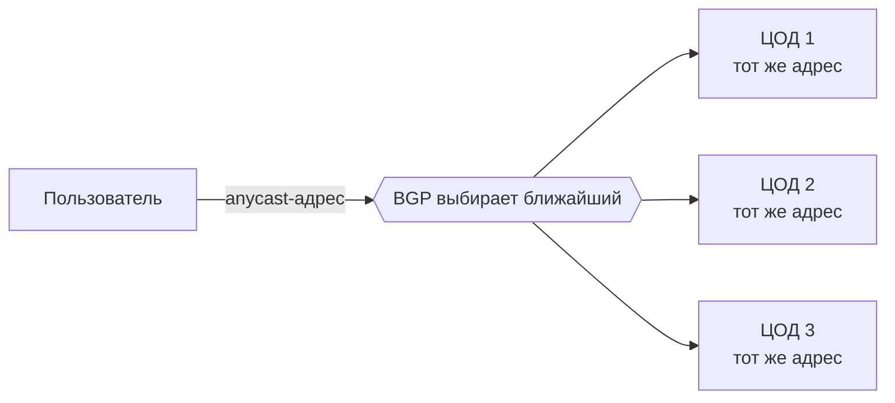

# Multicast_Anycast

> [!abstract] Кратко
> Multicast — доставка группе (замена broadcast в IPv6). Anycast — один адрес на несколько устройств, пакет идёт ближайшему. Anycast работает через BGP-анонс.

## 1. Зачем нужно
Понять два способа доставки в IPv6, которых нет или почти нет в IPv4.

## 2. Простыми словами
Multicast — рассылка по списку подписчиков. Anycast — несколько серверов с одним номером, звонок идёт в ближайший.

## 3. Технические детали

**Multicast:**

- Групповая рассылка: пакет доставляется всем устройствам в группе.
- В IPv6 broadcast заменён targeted multicast.
- Примеры адресов: `ff02::1` — все узлы в сегменте, `ff02::2` — все маршрутизаторы, `ff05::1:3` — все DHCPv6-серверы.
- **Преимущества:** меньше нагрузки, энергоэффективность, кэш путей для групп.

**Anycast:**

- Группа устройств с одним адресом. Пакет доставляется ближайшему узлу.
- Пример: DNS Google `2001:4860:4860::8888` развёрнут в десятках ЦОД.
- **Как работает:** несколько серверов на один адрес → маршрутизаторы объявляют его через BGP → трафик идёт к ближайшему.
- **Преимущества:** меньше задержек, отказоустойчивость, балансировка.

Схема:



- **Читать схему:** три ЦОД с одним адресом. BGP направляет пользователя к ближайшему.

## 4. Пример / команда
Проверка anycast:

```bash
ping6 2001:4860:4860::8888
traceroute6 2001:4860:4860::8888
```

## 5. Для ИБ

| Риск | Защита |
|------|--------|
| Multicast без контроля → утечка группы | MLD Snooping, ACL |
| Anycast-угон через BGP | RPKI, prefix-filter |
| Anycast без мониторинга → «ближайший» недоступен | Мониторинг из нескольких точек |
| Multicast-шторм | IGMP/MLD Snooping, rate limit |

## 6. Вопросы для самопроверки
1. Что такое multicast?
2. Что такое anycast?
3. Чем anycast отличается от multicast?
4. Как anycast выбирает ближайший?
5. Пример anycast-адреса?

## Связи
- [[IPv6]]
- [[BGP]]
- [[Отличия_IPv4_IPv6]]
- [[SLAAC_DHCPv6]]
