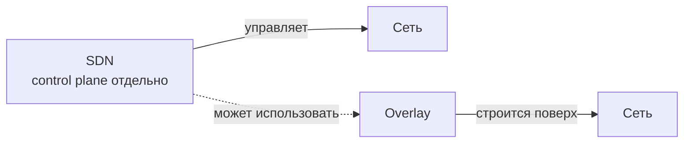

# Overlay_vs_SDN

> [!abstract] Кратко
> SDN отделяет control plane от data plane и полностью контролирует сеть. Overlay работает поверх обычной сети и полностью от неё зависит. Overlay ≠ SDN, но концепции связаны с виртуализацией.

## 1. Зачем нужно
Развести два близких термина, которые часто путают. Без этого выбор технологии — наугад.

## 2. Простыми словами
SDN — «мозг управляет всей сетью». Overlay — «сеть поверх сети». Первый меняет, как сеть думает. Второй добавляет слой сверху.

## 3. Технические детали

| | SDN | Overlay |
|---|---|---|
| **Что делает** | Разделяет control plane и data plane | Строит виртуальную сеть поверх физической |
| **Контроль** | Полный контроль над сетью | Зависит от underlay |
| **Замена «железа»** | Часто нужна (OpenFlow) | Не нужна |
| **Отказ underlay** | Не зависит напрямую | Overlay не работает |
| **Где применяют** | ЦОД, крупные сети | ЦОД, VPN, CDN, контейнеры |

- **Общее:** обе концепции связаны с виртуализацией сети.
- **Разное:** SDN меняет способ управления, Overlay — способ организации.

Схема:



- **Читать схему:** SDN управляет сетью, Overlay строится поверх. Могут сочетаться, но это разные вещи.

## 4. Пример / команда
Проверка (косвенно):

```bash
ovs-vsctl show          # SDN/OpenFlow
ip link show vxlan0     # Overlay
```

## 5. Для ИБ

| Риск | Защита |
|------|--------|
| Путаница → неверная архитектура | Явная схема: где SDN, где Overlay |
| SDN-контроллер без защиты | Изоляция, 2FA, TLS |
| Overlay в обход правил underlay | DPI, контроль туннелей |
| Нет документации | Схема слоёв, роли |

## 6. Вопросы для самопроверки
1. Что разделяет SDN?
2. Что строит Overlay?
3. Чем Overlay зависит от underlay?
4. Могут ли сочетаться?
5. Главное отличие?

## Связи
- [[SDN]]
- [[Overlay_сети]]
- [[SD_WAN]]
- [[Overlay_в_ЦОД]]
