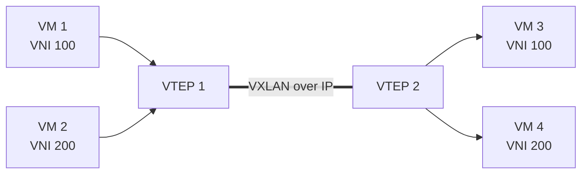

# Overlay_в_ЦОД

> [!abstract] Кратко
> В ЦОД overlay решает проблему масштабирования VLAN (4094 сети): VXLAN, NVGRE, GENEVE. Позволяют десятки тысяч изолированных L2-сетей поверх L3-физики. Ключ для облаков и контейнеров.

## 1. Зачем нужно
Понять, почему в ЦОД не хватает VLAN и как overlay это решает.

## 2. Простыми словами
VLAN — 4094 комнаты, дальше номера кончились. VXLAN — этажи: комнат становится десятки тысяч.

## 3. Технические детали

- **Проблема VLAN:** 12 бит VLAN ID → 4094 сети. Мало для облака.
- **VXLAN:** 24 бита VNI → ~16 млн сетей. L2 поверх L3.
- **NVGRE, GENEVE:** альтернативы VXLAN с разными инкапсуляциями.

| Протокол | Инкапсуляция | Особенность |
|---|---|---|
| **VXLAN** | UDP | Наиболее распространён |
| **NVGRE** | GRE | Меньше поддержки |
| **GENEVE** | UDP | Гибкие метаданные |

- **Где:** облака, ЦОД, Kubernetes CNI.
- **Что даёт:** десятки тысяч изолированных логических сетей поверх физической IP-сети ЦОД.

Схема:



- **Читать схему:** VTEP инкапсулирует кадр с VNI в IP-пакет. На другом конце — распаковка и доставка в нужную VM.

## 4. Пример / команда
Проверка VXLAN:

```bash
ip -d link show vxlan0
bridge fdb show dev vxlan0
```

## 5. Для ИБ

| Риск | Защита |
|------|--------|
| VNI без изоляции → утечка между клиентами | VRF, ACL между VNI |
| VTEP без аутентификации | IPsec, MACsec |
| Overlay в обход firewall | DPI, контроль VTEP |
| Нет мониторинга туннелей | NetFlow, sFlow на VTEP |

## 6. Вопросы для самопроверки
1. Сколько сетей в VLAN?
2. Сколько в VXLAN?
3. Три протокола overlay в ЦОД?
4. Что такое VTEP?
5. Зачем overlay в ЦОД?

## Связи
- [[Overlay_сети]]
- [[VLAN]]
- [[ЦОД]]
- [[Clos_топология]]
