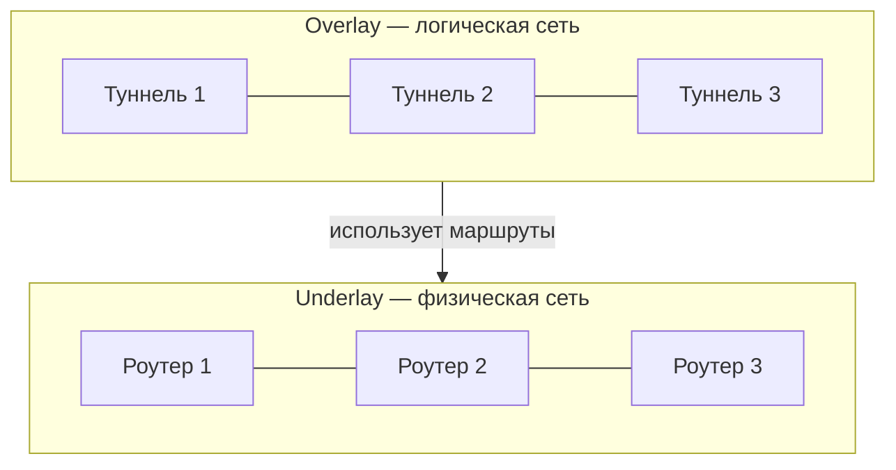

# Overlay_сети

> [!abstract] Кратко
> Overlay — виртуальная сеть поверх физической (underlay). Узлы соединены логическими туннелями, использующими маршруты underlay. Отделяет логическую топологию от физической. Полностью зависит от underlay.

## 1. Зачем нужно
Понять, как строят изолированные сети поверх существующей инфраструктуры без замены «железа».

## 2. Простыми словами
Underlay — дороги. Overlay — маршрутки, которые едут по этим дорогам, но со своим расписанием и остановками. Дороги сломались — маршрутки встали.

## 3. Технические детали

- **Overlay** — виртуальная сеть «поверх» физической (**underlay**).
- **Узлы** соединены логическими туннелями, использующими маршруты underlay.
- **Ключевая идея:** отделить логическую топологию и сервисы от физической.

**Основные цели:**

1. Внедрение новых возможностей без замены «железа».
2. Изолированные среды — логическая сегментация клиентов/приложений без физического разделения.
3. Дополнительный функционал, не заложенный в underlay (QoS, распределённое хранение, специфическая маршрутизация).

**Главный недостаток:**

- **Накладные расходы:** инкапсуляция увеличивает пакеты → возможна фрагментация → нужна вычислительная мощность.
- **Неоптимальная маршрутизация** относительно физической топологии underlay.

Схема:



- **Читать схему:** туннели overlay едут по маршрутам underlay. Порвался underlay — overlay не работает.

## 4. Пример / команда
Проверка туннеля (пример VXLAN):

```bash
ip link show vxlan0
bridge fdb show dev vxlan0
```

## 5. Для ИБ

| Риск | Защита |
|------|--------|
| Overlay в обход firewall | Контроль туннелей, firewall на границе underlay |
| Инкапсуляция скрывает трафик | DPI, мониторинг туннелей |
| Overlay без шифрования | IPsec, MACsec |
| Нет изоляции клиентов → утечка | VRF, отдельные VNI |

## 6. Вопросы для самопроверки
1. Что такое overlay?
2. Что такое underlay?
3. Три цели overlay?
4. Главный недостаток?
5. Overlay работает без underlay?

## Связи
- [[Overlay_vs_SDN]]
- [[Overlay_в_ЦОД]]
- [[CDN_как_Overlay]]
- [[VPN_как_Overlay]]
